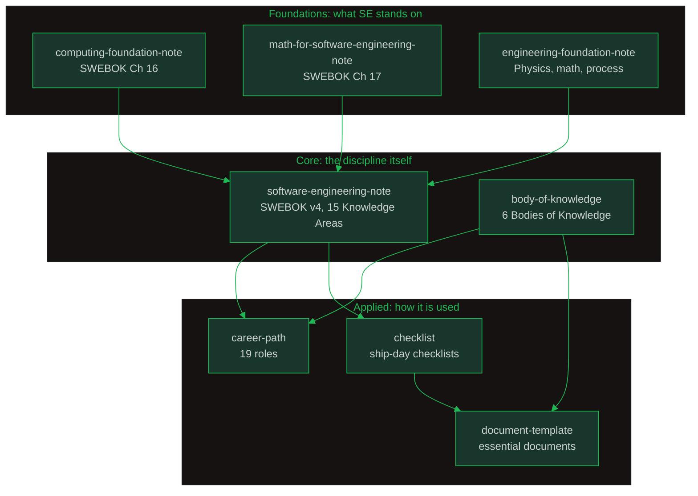

# Oralita Software Engineering Knowledge

My software engineering knowledge Obsidian vault: a lifelong project to relearn software engineering in the AI era, built on **SWEBOK v4** as the spine.

SWEBOK defines the 15 Knowledge Areas of the discipline. This vault studies each one, fills the foundations SWEBOK assumes (computing, math, engineering), extends outward into the other major Bodies of Knowledge, and turns all of it into practical career maps and shipping checklists.

**~1,830 notes across 8 sub-vaults.** Every sub-vault has one Overview note that is the entry point.

---

## Vault Map

| Sub-vault | What lives there | Notes |
|---|---|---:|
| [software-engineering-note/](https://github.com/oat431/swe-knowledge/blob/main/software-engineering-note/Software%20Engineering%20Note%20Content.md) | SWEBOK v4's 15 Software Engineering Knowledge Areas, one folder per KA | 403 |
| [body-of-knowledge/](https://github.com/oat431/swe-knowledge/blob/main/body-of-knowledge/Body%20of%20Knowledge%20-%20Overview.md) | Six Bodies of Knowledge: SWEBOK, PMBOK, SEBoK, BABOK, CyBOK, DMBOK | 109 |
| [computing-foundation-note/](https://github.com/oat431/swe-knowledge/blob/main/computing-foundation-note/Computing%20Foundation%20Overview.md) | SWEBOK Ch 16 Computing Foundations: architecture, algorithms, OS, DB, networks, HCI, AI | 138 |
| [math-for-software-engineering-note/](https://github.com/oat431/swe-knowledge/blob/main/math-for-software-engineering-note/Math%20For%20SE%20Note%20Overview.md) | SWEBOK Ch 17 Mathematical Foundations: logic, proofs, graphs, FSMs, probability | 14 |
| [engineering-foundation-note/](https://github.com/oat431/swe-knowledge/blob/main/engineering-foundation-note/Engineering%20Foundation%20Overview.md) | Physics & math fundamentals (Moaveni) + SWE process foundations (Pfleeger & Atlee) | 30 |
| [career-path/](https://github.com/oat431/swe-knowledge/blob/main/career-path/00_Career_Path_Overview.md) | 19 career paths from Software Engineer to Forward Deployed Engineer | 1,042 |
| [checklist/](https://github.com/oat431/swe-knowledge/blob/main/checklist/Overview.md) | 12 reference checklists + the ship-day checklists you actually tick | 83 |
| [document-template/](https://github.com/oat431/swe-knowledge/blob/main/document-template/00_Essential%20Document/Essential%20Documents%20-%20Overview.md) | Essential-document checklists per BOK + 3 project-size profiles | 11 |

## How the Sub-vaults Relate

- **Foundations** fill what SWEBOK assumes you already know.
- **software-engineering-note** is the main study vault, one folder per SWEBOK Knowledge Area.
- **body-of-knowledge** is the reference shelf: the same knowledge viewed as industry standards.
- **career-path**, **checklist**, and **document-template** turn knowledge into action.

---

## The Sub-vaults in Detail

### software-engineering-note (SWEBOK v4, 15 Knowledge Areas)

Master index: [Software Engineering Note Content](https://github.com/oat431/swe-knowledge/blob/main/software-engineering-note/Software%20Engineering%20Note%20Content.md) (with per-KA coverage status from the 2026-07-21 gap analysis, all KAs 85 to 95 percent covered).

| Group | Knowledge Areas |
|---|---|
| Core Engineering | 01 Requirements, 02 Architecture, 03 Design, 04 Construction, 05 Testing, 06 Operations, 07 Maintenance |
| Management & Process | 08 Configuration Management, 09 Engineering Management, 10 Engineering Process |
| Quality & Cross-Cutting | 11 Models & Methods, 12 Software Quality, 13 Software Security |
| Professional Practice | 14 Professional Practice, 15 Software Engineering Economics |

### body-of-knowledge (six Bodies of Knowledge)

Entry: [Body of Knowledge: Overview](https://github.com/oat431/swe-knowledge/blob/main/body-of-knowledge/Body%20of%20Knowledge%20-%20Overview.md)

| BOK | Source | Edition | Focus |
|---|---|---|---|
| SWEBOK | IEEE Computer Society | v4 (2024) | Software Engineering: 18 Knowledge Areas |
| PMBOK | Project Management Institute | v8 (2025) | Project Management: 7 Performance Domains |
| SEBoK | BKCASE | v2 (2025) | Systems Engineering: 8 Parts |
| BABOK | IIBA | v3 (2015) | Business Analysis: 6 Knowledge Areas |
| CyBOK | NCSC (UK) | v1.1 (2021) | Cyber Security: 21 Knowledge Areas |
| DMBOK | DAMA International | v2 (2017) | Data Management: 11 Knowledge Areas |

They are complementary: PMBOK manages the work, SWEBOK builds the software, SEBoK engineers the whole system, BABOK defines the business need, CyBOK secures it all, DMBOK governs the data.

### computing-foundation-note (SWEBOK Ch 16)

Entry: [Computing Foundations: Overview](https://github.com/oat431/swe-knowledge/blob/main/computing-foundation-note/Computing%20Foundation%20Overview.md)

100% SWEBOK Chapter 16 coverage (9 knowledge areas), plus practitioner depth added 2026-09-30: system concepts, computer organization (modern ISAs, speculative execution), data structures & algorithms (basic + advanced), programming languages and compiler design, operating systems (containers, virtualization, Linux internals, distributed systems), databases (warehousing & mining), computer networks (routing, TLS/PKI, sockets, VPN, wireless), HCI with Clean Code and Design Patterns, and AI/ML including the AI and SE intersection.

### math-for-software-engineering-note (SWEBOK Ch 17)

Entry: [Mathematical Foundations: Overview](https://github.com/oat431/swe-knowledge/blob/main/math-for-software-engineering-note/Math%20For%20SE%20Note%20Overview.md)

Twelve topics in progression: basic logic, proof techniques, sets/relations/functions, counting, discrete probability, graphs & trees, finite state machines, grammars, number theory, algebraic structures, calculus, numerical precision, plus new advancements.

### engineering-foundation-note

Entry: [Engineering Foundation: Overview](https://github.com/oat431/swe-knowledge/blob/main/engineering-foundation-note/Engineering%20Foundation%20Overview.md)

Two parts: physics and math fundamentals (*Engineering Fundamentals* by Moaveni), and SWE process foundations (*Software Engineering: Theory and Practice* by Pfleeger & Atlee). Together they cover the physics and the process of engineering.

### career-path

Entry: [Software Engineering Career Paths](https://github.com/oat431/swe-knowledge/blob/main/career-path/00_Career_Path_Overview.md)

Nineteen roles in five families: technical individual contributor (Senior, Staff, Principal/Distinguished), technical leadership (Tech Lead, Software Architect), operations & security (SRE/Platform, Security), data & quality (Data/ML, Quality & Test), and management, product & consulting (EM, TPM, PM, Program Manager, Solutions Architect, Dev Advocate, Independent Consultant, Applied AI Engineer, Forward Deployed Engineer). Each role folder has a `00_overview` plus capability-area modules with topic notes, readable at overview level or studied end to end.

### checklist

Entry: [Improved Checklists: Overview](https://github.com/oat431/swe-knowledge/blob/main/checklist/Overview.md)

Twelve reference checklists (api, microservice, web, release, security, database, qa, ai, mobile, infra, batch, book) that double as deep-dive manuals, and above them the improved ship-day checklists (Release, Security, Database, PostgreSQL, MongoDB, Valkey, QA, AI, API Launch, Microservice Launch, Frontend Launch): tick every box before shipping, follow the arrow link back into the vault when a box is unticked.

### document-template

Entry: [Essential Documents: Overview](https://github.com/oat431/swe-knowledge/blob/main/document-template/00_Essential%20Document/Essential%20Documents%20-%20Overview.md)

Essential-document checklists per BOK (SWEBOK, PMBOK, SEBOK, BABOK, CyBOK, DMBOK, UX/UI) plus three project profiles that scale them: Small Startup, Medium Enterprise, Large Safety-Critical.

---

## How to Use This Vault

- **Studying the discipline:** start at [Software Engineering Note Content](https://github.com/oat431/swe-knowledge/blob/main/software-engineering-note/Software%20Engineering%20Note%20Content.md), pick a Knowledge Area, follow its Overview note.
- **New software engineer reading path:** SWEBOK essentials then PMBOK essentials (see [Body of Knowledge: Overview](https://github.com/oat431/swe-knowledge/blob/main/body-of-knowledge/Body%20of%20Knowledge%20-%20Overview.md) for paths).
- **Planning a career move:** [career-path/00_Career_Path_Overview](https://github.com/oat431/swe-knowledge/blob/main/career-path/00_Career_Path_Overview.md) then a role's `00_overview` then its capability modules.
- **Shipping this week:** open a checklist in [checklist/](https://github.com/oat431/swe-knowledge/blob/main/checklist/Overview.md), tick every box, and jump into the vault for anything unticked.
- **Starting a project:** pick the matching profile in [document-template/](https://github.com/oat431/swe-knowledge/blob/main/document-template/00_Essential%20Document/Essential%20Documents%20-%20Overview.md).

## Conventions

- Every sub-vault starts at one Overview note; knowledge areas and roles are numbered folders with their own `00_overview` or Overview note.
- YAML frontmatter on notes (title, tags, created), wikilinks for cross-references, coverage tables where a gap analysis was run.
- Mermaid diagrams use one locked dark theme (green brand palette) so they render consistently inside Obsidian.
- En-dashes mark ranges (Ch 12–13); em-dashes are not used in prose.

## Sources

SWEBOK v4 (IEEE Computer Society, 2024) · PMBOK Guide v8 (PMI, 2025) · SEBoK v2 (BKCASE, 2025) · BABOK Guide v3 (IIBA, 2015) · CyBOK v1.1 (NCSC, 2021) · DMBOK v2 (DAMA International, 2017) · *Engineering Fundamentals: An Introduction to Engineering* by Saeed Moaveni, 4th ed. · *Software Engineering: Theory and Practice* by Pfleeger & Atlee, 4th ed.

## License

Released into the public domain under [The Unlicense](https://github.com/oat431/swe-knowledge/blob/main/LICENSE).
