# Software Engineer

> **Positioning:** The starting role in this career map. A software engineer applies engineering principles to understand, build, test, operate, and improve software systems, and grows from guided tasks to independent feature ownership.

## What This Path Is

A software engineer turns problems and requirements into working software. The role includes more than writing code: it involves understanding users, choosing designs, verifying behavior, collaborating with other disciplines, and supporting the system after release.

This path covers the whole foundation stage: **junior (guided execution) through mid-level (independent feature ownership)**. It defines the mid-level baseline that every other path in this vault compares against, teaches the daily craft and collaboration habits the job runs on, adds AI-assisted engineering as a first-class skill, and ends with a deliberate bridge to the senior level. The role is a foundation for both technical and non-technical paths: develop enough breadth to understand the software lifecycle, then choose where to increase scope or specialization.

## Role Boundary

| Role | Owns | Defers to |
|---|---|---|
| Software Engineer | Features and small components: implementation, tests, docs, safe release | System-wide design and roadmap: leads |
| Senior Software Engineer | A system area end to end, problem framing, team-level quality | Multi-team strategy: Staff, Tech Lead, EM |
| Tech Lead | The team's technical direction and delivery system | People management: EM |
| Specialist (SRE, Security, Data/ML, QA) | A discipline's depth applied across systems | Generalist feature delivery: Software Engineer |

## Level Expectations: Junior vs Mid

| Dimension | Junior (guided execution) | Mid-level (independent feature ownership) |
|---|---|---|
| Scope | Well-specified tasks and bugs | Features from rough request to production |
| Autonomy | Regular guidance; check-ins on approach | Light oversight; escalates only hard calls |
| Ambiguity | Needs help turning requests into plans | Clarifies requirements and cuts scope with evidence |
| Impact | Own output correct and timely | Own output plus visible help to teammates |
| Communication | Reports status and blockers | Explains trade-offs; anticipates questions |

This table is the vault's canonical mid-level definition; see [[career-path/01_Software_Engineer/01_Leveling_and_Growth/02_Junior_vs_Mid_Level_Expectations|Junior vs Mid Level Expectations]] for the full framework.

## Capability Areas

| Capability | What you build here | Module |
|---|---|---|
| Leveling and growth | Level literacy, autonomy, feedback, evidence habits | [[career-path/01_Software_Engineer/01_Leveling_and_Growth/00_overview\|Leveling and Growth]] |
| Daily engineering craft | Code reading, debugging, PRs, review, testing, estimation, docs | [[career-path/01_Software_Engineer/02_Daily_Engineering_Craft/00_overview\|Daily Engineering Craft]] |
| AI-assisted engineering | Delegation, verification, security, real productivity | [[career-path/01_Software_Engineer/03_AI_Assisted_Engineering/00_overview\|AI Assisted Engineering]] |
| Production basics | Telemetry, runbooks, on-call shadowing, incidents, releases | [[career-path/01_Software_Engineer/04_Production_Basics/00_overview\|Production Basics]] |
| Collaboration and teamwork | PM, design, QA partnerships; 1:1s; feedback; handoffs | [[career-path/01_Software_Engineer/05_Collaboration_and_Teamwork/00_overview\|Collaboration and Teamwork]] |
| Choosing a path | Direction tests across the map; staying T-shaped | [[career-path/01_Software_Engineer/06_Choosing_a_Path/00_overview\|Choosing a Path]] |
| Readiness for senior | Ownership growth, framing, design judgment, evidence | [[career-path/01_Software_Engineer/07_Readiness_for_Senior/00_overview\|Readiness for Senior]] |

## Typical Progression

```mermaid
%%{init: {'theme':'base','themeVariables':{'primaryColor':'#19362D','primaryTextColor':'#CDD3D1','primaryBorderColor':'#1FB854','lineColor':'#1FB854','background':'#1B1717','mainBkg':'#19362D','clusterBkg':'#161212','edgeLabelBackground':'#161212','titleColor':'#1FB854','fontSize':'14px'}}}%%
flowchart LR
    LEARN["Learn the codebase"] --> DELIVER["Deliver reliable changes"]
    DELIVER --> OWN["Own a component"]
    OWN --> BROADEN["Understand the full lifecycle"]
    BROADEN --> CHOOSE["Choose a direction"]
    CHOOSE --> NEXT["Senior, or a specialist path"]
```

## Signals for Moving Forward

- You deliver features with decreasing supervision.
- You explain the trade-offs behind your implementation.
- You identify and communicate risks early.
- You help teammates understand the system you work in.
- You participate in requirements, design, testing, and operations discussions.
- You use AI assistance safely and can defend every line you ship.
- You are curious about either broader scope or a deeper specialization.

## Self-Assessment (with linked evidence)

Rate yourself honestly, then link the artifact that supports each rating:

- [ ] I can take a feature from rough request to production with only light oversight; evidence: link to a shipped feature
- [ ] I debug with hypotheses and can show the narrowing steps; evidence: link to a bug write-up or postmortem comment
- [ ] My pull requests are reviewable in one pass; evidence: link to a representative PR
- [ ] I write tests that match the risk of my changes; evidence: link to a test plan or PR with layered tests
- [ ] I have safely used AI assistance and verified the output; evidence: link to an AI-assisted change you fully reviewed
- [ ] I have read dashboards or logs to answer a production question; evidence: link to a runbook step or incident note
- [ ] I have given feedback that changed someone's approach; evidence: link to a review thread
- [ ] I can state my level's expectations and name two current growth gaps (see [[career-path/01_Software_Engineer/01_Leveling_and_Growth/06_Feedback_and_Self_Assessment|Feedback and Self Assessment]])

## Evidence Table: Artifact to What It Demonstrates

| Artifact | What it demonstrates |
|---|---|
| Shipped feature with PR trail | End-to-end delivery capability |
| Bug write-up with root cause | Systematic debugging and production curiosity |
| Design note or ADR | Judgment and trade-off articulation |
| Test plan for a risky change | Risk-aware quality thinking |
| Runbook improvement | Operational maturity |
| Review comments that taught something | Collaboration and multiplication |
| Brag document with dated entries | Self-management and evidence discipline |

## First 90 Days (new team or first job)

1. **Days 1–30: learn and ship small.** Set up the environment, read the module map of your service, ship one small change end to end, and write down everything that confused you. Keep a running questions list and review it weekly with your buddy or manager.
2. **Days 31–60: widen safely.** Take a medium feature, join a code review rotation, shadow an on-call shift, and ask for one specific piece of feedback per fortnight. Start your brag document now (see [[career-path/01_Software_Engineer/01_Leveling_and_Growth/07_The_Brag_Document|The Brag Document]]).
3. **Days 61–90: own something small.** Volunteer for a small component or operational area, propose one process improvement with a rationale, and agree on your growth targets for the next quarter with your manager.

## Getting Hired

- **Typical interview formats (junior/mid):** coding exercises (algorithms or practical), a take-home or pair programming session, system-design-lite ("design a URL shortener" at this level), and behavioral questions on teamwork and learning. Expectations scale with level: mid-level candidates are expected to reason about trade-offs, not just produce working code.
- **Portfolio:** 2–3 projects you can explain end to end: the decisions, the trade-offs, what broke, what you would do differently. Quality of reasoning beats project count. Public contributions are a plus, not a requirement.
- **Certifications:** none are required or particularly valued for generalist software engineering roles. Cloud or security certifications matter only if you target those specialist paths (see the relevant path's guidance).
- **Preparation map:** [[career-path/01_Software_Engineer/02_Daily_Engineering_Craft/00_overview|Daily Engineering Craft]] for practical rounds, [[career-path/01_Software_Engineer/06_Choosing_a_Path/00_overview|Choosing a Path]] for targeting, and the target path's own notes for specialization questions.

## Career Paths Beyond

- [[career-path/02_Senior_Software_Engineer/00_overview|Senior Software Engineer]]: broader ownership and independent judgment (the default next step)
- [[career-path/07_SRE_and_Platform_Engineer/00_overview|SRE and Platform Engineer]]: reliability and delivery systems
- [[career-path/08_Security_Engineer/00_overview|Security Engineer]]: security risk and secure development
- [[career-path/09_Data_and_ML_Engineer/00_overview|Data and ML Engineer]]: data-intensive or intelligent systems
- [[career-path/10_Quality_and_Test_Engineering/00_overview|Quality and Test Engineering]]: quality strategy and verification
- [[career-path/11_Engineering_Manager/00_overview|Engineering Manager]]: people, delivery, and team health
- [[career-path/12_Technical_Program_Manager/00_overview|Technical Program Manager]]: cross-team technical coordination
- [[career-path/13_Project_and_Program_Manager/00_overview|Project or Program Manager]]: formal delivery management
- [[career-path/14_Product_Manager/00_overview|Product Manager]]: product outcomes and customer value
- [[career-path/18_Applied_AI_Engineer/00_overview|Applied AI Engineer]]: products built on foundation models

Most specialist routes are entered from Senior rather than directly; check each path's `entry_from` before planning a jump.

## Foundation Reading Route

1. [[SWEBOK v4 - Overview]]
2. [[Computing Foundation Overview]]
3. [[Engineering Foundation Overview]]
4. [[software-engineering-note/01_Software_Requirements/Software Requirements Overview]]
5. [[software-engineering-note/02_Software_Architecture/Software Architecture Overview]]
6. [[software-engineering-note/05_Software_Testing/Software Testing Overview]]
7. [[software-engineering-note/06_Software_Engineering_Operations/Software Engineering Operations Overview]]
8. [[software-engineering-note/14_Software_Engineering_Professional_Practice/Professionalism of Software Engineering Overview]]

## Sources

- *The Missing README* (Chris Riccomini, Dmitriy Ryaboy): the practical manual this path mirrors
- *The Pragmatic Programmer* (David Thomas, Andrew Hunt): daily craft philosophy
- *Software Engineering at Google* (Titus Winters, Tom Manshreck, Hyrum Wright): engineering practices at scale
- *A Philosophy of Software Design* (John Ousterhout): design judgment foundations
- [U.S. Bureau of Labor Statistics: Software Developers, Quality Assurance Analysts, and Testers](https://www.bls.gov/ooh/computer-and-information-technology/software-developers.htm)
- [[SWEBOK v4 - Overview]]

## Related

- [[00_Career_Path_Overview|Career Path Overview]]
- [[career-path/02_Senior_Software_Engineer/00_overview|Senior Software Engineer]]: the next level
- [[career-path/05_Tech_Lead/05_Team_Development_and_Mentoring_Leadership/02_Growing_Engineers_at_Levels|Growing Engineers at Levels]]: the vault's level map
