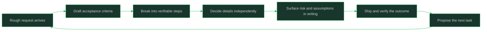

# Junior vs Mid Level Expectations

> **Core skill:** Defining exactly what mid-level means across five dimensions

## What Changes from Junior to Mid

This note is the vault's canonical definition of the junior-to-mid jump. A junior engineer delivers well-specified tasks with regular guidance; a mid-level engineer carries a feature from a rough request to production with light supervision, surfaces problems before they become surprises, and escalates only on genuinely hard calls. Every other career path in this vault measures "mid-level" against the matrix below, so read it as a contract: what you must be able to do, observably, without someone holding the task together for you.

| Aspect | Junior | Mid |
|--------|--------|-----|
| Input | Task with acceptance criteria | Rough request or problem area |
| Output | Merged change | Feature running in production |
| Direction | Step-level guidance | Goal-level alignment |
| Corrections | Expected during review | Rare; mostly judgment-level notes |
| Ownership | Your patch | The outcome of your feature |

## Core Frameworks

### The Five-Dimension Matrix: Concrete Behavioral Anchors

| Dimension | Junior Does This | Mid Does This |
|-----------|------------------|---------------|
| Scope | Completes a ticket inside one repo: fix a bug, add a form field, extend one endpoint | Carries a feature across repos or layers: API, data, UI, config, rollout, monitoring |
| Scope | Estimates work in hours for tasks already broken down | Breaks a two-week request into tasks and estimates the parts with named uncertainty |
| Autonomy | Checks in when starting, at each blocker, and before finishing | Agrees goals weekly, decides implementation details alone, demos at the end |
| Autonomy | Waits for the next task when done | Proposes the next task with a one-line rationale |
| Ambiguity | Asks for missing acceptance criteria before starting | Drafts acceptance criteria from a vague request and confirms them in one round |
| Ambiguity | Reports blockers as statements ("X is failing") | Reports blockers with options and a recommendation ("X fails; I suggest A over B because...") |
| Impact | Measures success as "ticket merged, tests pass" | Measures success as "the behavior users see actually changed, and I verified it" |
| Impact | Fixes what is assigned | Notices adjacent problems, files them with context, fixes the one that matters now |
| Communication | Updates the ticket when asked | Writes progress, decisions, and risk where the team looks without being prompted |
| Communication | Lets surprises surface in code review | Flags risk the moment it is visible, with impact and mitigation |

### Decreasing Supervision in Practice

| Signal | Junior Pattern | Mid Target | How To Move |
|--------|----------------|------------|-------------|
| Check-in frequency | Daily direction or ad-hoc help several times a day | Weekly goal alignment; async updates in between | Replace status questions with a short written update your manager can read |
| Review rounds per change | Two to four rounds: correctness, style, then scope corrections | One round, mostly discussion-level notes | Self-review against the team checklist before requesting review |
| Escalation rate | Escalates most blockers and many decisions | Escalates judgment calls only; handles the rest and notes the decision | Classify each blocker as reversible or irreversible before asking |
| Task intake | Waits for assigned, specified tasks | Volunteers for the next task and shapes it | End each task with "next I plan to take X because Y" |
| Unprompted output | Work happens where the manager can see it | Artifacts (docs, tickets, updates) exist without prompting | Write the decision down the day you make it |
| Definition of done | Code merged | Feature verified in production and handed over cleanly | Add a "verification in production" step to your personal checklist |

### The Ask-Then-Decide Gradient

| Situation | Junior Default | Mid Default | Test |
|-----------|----------------|-------------|------|
| Missing requirement detail | Ask immediately | Draft a reasonable answer, confirm asynchronously | Can the decision be reversed cheaply? |
| Choice between two libraries | Ask which to use | Compare against team constraints, recommend, proceed unless told otherwise | Does the choice lock the team in? |
| Bug found in someone else's area | Report it and wait | Triage it, propose ownership, move on | Does it block your outcome? |
| Schedule risk appears | Mention it when asked | State it the day it appears, with revised estimate | Will it surprise anyone in a week? |
| Ambiguous "make it faster" | Ask what to do | Instrument first, propose the two biggest costs, fix one | Is there data to narrow the question? |



## In Practice

**Mid-level means the request no longer needs to survive contact with you intact.** A junior hands back the task as specified; a mid-level engineer reshapes a rough request into a plan, confirms the reshaping in one round, and executes. Practice by writing acceptance criteria for every request before you code, even when the requester "already knows what they want."

**Decreasing supervision is visible in artifacts, not in your manager's mood.** When your manager stops asking daily questions, it is because your written updates, tickets, and risk flags already answered them. Produce those artifacts first and the supervision falls on its own. Asking for more autonomy before producing the evidence reads as impatience, not ambition.

**Escalation rate is a measurable proxy for growth.** Count, over a month, how often you needed someone else to unblock you versus how often you resolved or routed the problem yourself. The target is not zero escalations; it is escalations concentrated on irreversible or cross-team decisions. Track it in your notes and the trend will tell you more than any self-rating.

**Scope is the dimension where juniors and mids differ most visibly.** A junior change touches one code path; a mid-level feature touches the request, the code, the configuration, the rollout, and the verification. Before you call a task done, list what a real user-visible outcome requires and check whether you covered each layer. If you consistently only cover the code layer, that is your growth target.

**Impact means verification, not just completion.** "Merged" is an output; "the change is live and does what we intended" is an outcome. Mid-level engineers add a verification step: check the metric, watch the log, ask the requester to try it. This single habit separates reliable engineers from busy ones more than any technical skill.

**Communication at mid level is unprompted and asynchronous.** You do not wait for the standup or the 1:1 to say the schedule slipped or the requirement contradicts the code. Write it where the team looks, the day you know it. The message is short: what changed, what it affects, what you propose.

## Practical Exercise

Self-rate against the matrix and close one gap this month:
1. Copy the five-dimension matrix into your notes and mark each row as junior, mixed, or mid for yourself today
2. Ask a teammate who reviews your code which row they would mark you on, without showing them your answers first
3. Pick the dimension with the widest disagreement between your rating and theirs
4. For that dimension, list the three most recent situations where the junior pattern applied to you
5. Rewrite one of those situations as the mid-level behavior would have looked, in writing
6. Run the next two weeks applying only that behavior, and record each instance
7. Re-rate that dimension at the end and bring the before/after to your next 1:1

## Practical Applications

- [ ] Keep a one-line "next task proposal" habit: finish, then state what you will take next and why
- [ ] Add "verified in production" to your personal definition of done
- [ ] Send one written risk update per week, even when the news is "no risk"
- [ ] Before asking a question, write the answer you would pick and why, then ask
- [ ] Track escalations per month and review the trend each quarter
- [ ] Convert one vague request per month into written acceptance criteria

Fill-in self-rating template:

```text
Period covered:
Reviewer (self / peer / manager):

| Dimension | My rating | Their rating | Evidence (one recent case) | Gap action for next month |
|-----------|-----------|--------------|----------------------------|---------------------------|
| Scope     |           |              |                            |                           |
| Autonomy  |           |              |                            |                           |
| Ambiguity |           |              |                            |                           |
| Impact    |           |              |                            |                           |
| Comms     |           |              |                            |                           |

Rating scale: junior / mixed / mid
Widest disagreement: 
What I will change in the next two weeks:
```

## Common Pitfalls

| Pitfall | Why It Fails | Better Approach |
|---------|--------------|-----------------|
| Treating mid-level as "faster junior" | Speed on specified tasks is not the differentiator; scope and judgment are | Practice the mid behaviors in the matrix, not throughput |
| Asking for autonomy without evidence | Managers grant autonomy based on observed reliability | Ship the artifacts first: updates, risk flags, verifications |
| Rating yourself on potential | Reviews calibrate on demonstrated behavior in context | Record concrete instances per dimension and rate those |
| Waiting for interesting work | Passivity is the strongest junior signal | Propose the next task, even when the options are unglamorous |
| Confusing "done" with "merged" | Nobody benefits from code that is not verified working | Verify the outcome and note where you verified it |
| Comparing your row 1 to someone else's row 5 | Different dimensions move at different speeds | Close one dimension at a time, in pairs with a collaborative one |

## Success Indicators

- You complete features with at most one review round and no scope corrections
- Your manager raises problems you already flagged in writing
- You hold a rough request to a shipped outcome without step-level help
- Your escalation list contains only decisions that were genuinely irreversible or cross-team
- A peer reading your work log can see what you decided, why, and what happened next

## Related

- [[00_overview]]
- [[01_The_Software_Engineering_Ladder]]
- [[03_Autonomy_and_Supervision]]
- [[04_Working_With_Ambiguity]]
- [[career-path/01_Software_Engineer/00_overview|Software Engineer Path]]
- [[career-path/02_Senior_Software_Engineer/00_overview|Senior Software Engineer]]

## Sources

- *The Missing README* (Chris Riccomini, Dmitriy Ryaboy)
- *The Staff Engineer's Path* (Tanya Reilly)
- *The Pragmatic Programmer* (David Thomas, Andrew Hunt)
- Public engineering ladders collected at progression.fyi
