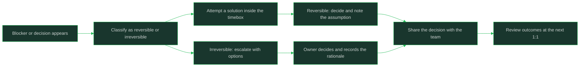

# Autonomy and Supervision

> **Core skill:** Deciding when to ask, when to decide, and when to escalate

## What Changes from Junior to Mid

A junior engineer's default is to ask before moving; a mid-level engineer's default is to decide, note the assumption, and keep moving. The mid-level skill is not "never ask" — it is routing each question to the right channel: self-serve decision, quick check-in, or formal escalation. Supervision decreases as your decisions become predictable and reversible, and as your manager learns that nothing important reaches them late.

| Aspect | Junior | Mid |
|--------|--------|-----|
| Default action when unsure | Stop and ask | Decide on the reversible path and record it |
| Blockers | Wait for help to arrive | Timeboxed attempt, then routed with options |
| Escalation | Used for most unknowns | Reserved for irreversible or cross-team calls |
| Manager's role | Step-level direction | Boundary-setting and unblocking |
| Uncertainty | Hidden until it explodes | Made visible the moment it appears |

## Core Frameworks

### Ask, Decide, or Escalate

| Route | Use When | Cost If Wrong | Example |
|-------|----------|---------------|---------|
| Decide yourself | The decision is reversible inside a sprint and inside your team's code | Low: revert and note it | Variable naming, test layout, which logging library to try |
| Decide, then inform | Reversible but visible to others; someone may care about the direction | Low to medium: rework if there is disagreement | API shape within your team, which metric to add to a dashboard |
| Ask before deciding | Reversible but expensive to reverse in hours, or touches a shared convention | Medium: a day or two of rework | Schema changes, shared component APIs, coding-standard exceptions |
| Escalate immediately | Irreversible, security- or data-affecting, contractual, or cross-team commitments | High: trust, money, or user harm | Data deletion, public API breaks, committing the team to a date |

### Two-Way Doors vs One-Way Doors

| Property | Two-Way Door | One-Way Door |
|----------|--------------|--------------|
| Reversibility | Cheap to undo within days | Undoing costs a project, a customer, or trust |
| Who should decide | The person closest to the work: you | The person who owns the risk: lead or manager |
| Information needed | Enough to pick a reasonable option | Full picture of constraints and second-order effects |
| Speed priority | Fast decide, note the choice | Slow decide, gather input first |
| Documentation | One line in a ticket or decision note | Written decision record with options and rationale |
| Typical examples | Internal refactors, tooling choices, test strategy | Data migrations, contract terms, security posture, hiring |

### The Timebox Rule for Being Stuck

| Stage | Duration | Action | Output |
|-------|----------|--------|--------|
| Self-serve attempt | One focused block (about 30-60 minutes) | Read the code, reproduce the issue, try one hypothesis | Notes on what you tried |
| Targeted research | One more block | Docs, source code, past tickets, search | One concrete question |
| Peer ask | Same day | Ask one person with your context and attempts attached | Answer or pointer |
| Escalate | Same day if it blocks a commitment | Bring the manager the problem, the attempts, and options | Decision or unblock |

### Decision Boundaries With Your Manager

| Boundary Type | What To Agree | Example Agreement |
|---------------|---------------|-------------------|
| Technical scope | Which decisions you make alone | "Anything inside the service, you decide and note it" |
| Schedule | When a slip must be raised | "Any risk to a committed date gets flagged the day it appears" |
| Cross-team | When you may speak for the team | "You can agree on file formats; loop me in on commitments" |
| Reversal | What you promise after deciding alone | "If a solo decision is disputed, I revert first and discuss after" |
| Review | What still gets reviewed and why | "Design docs for anything over a week; code review as usual" |



## In Practice

**Default to deciding when the door is two-way.** Reversible decisions made close to the work are usually better than delayed decisions made in meetings. Pick the reasonable option, write one line about the assumption you made, and keep moving. The note is what converts a solo decision into a trustworthy one: anyone can see what you assumed and correct it early.

**Timebox being stuck before asking for help.** Being stuck is normal; being stuck silently is not. Follow the stage table: one focused attempt, one research block, then a targeted ask with your attempts attached. This sequence builds your problem-solving muscle while guaranteeing that no blocker hides for more than a day.

**Escalation is information flow, not failure.** Escalating means "this decision's risk belongs to someone else," not "I could not handle it." Bring the problem, what you tried, and two or three options with your recommendation. Managers reward this because it lets them make the call fast instead of excavating context.

**Agree decision boundaries explicitly instead of inferring them.** Most over-asking and most over-reaching come from an unstated contract about what is yours to decide. Spend one 1:1 writing down five boundary lines: technical scope, schedule, cross-team representation, reversal rules, and what still gets reviewed. Revisit them when the level or team changes.

**Make uncertainty visible early, in writing, with impact.** The message is not "I'm worried" but "X is uncertain, it affects Y, I suggest Z until we know more." Visibility early is cheap; visibility late is a postmortem. Write it in the channel where the affected people already read, and address the person who owns the outcome.

**Calibrate reversals as the price of autonomy.** Decide alone and you accept a duty: if the decision is disputed or wrong, revert first and discuss second. Engineers who defend solo decisions instead of reverting lose their autonomy quickly. The habit that grows autonomy is not boldness; it is cheap reversals and honest notes.

## Practical Exercise

Map a live decision this week through the full routing process:
1. List every decision and blocker you hit in the last two weeks
2. Classify each as reversible or irreversible using the door table
3. For one reversible decision, practice deciding alone and write a one-line decision note
4. For one blocker, run the full timebox: attempt, research, targeted ask, escalate if needed
5. Record how long you were stuck before the ask, and what made the ask effective
6. Bring the boundary table to your manager and propose five explicit boundary lines
7. Two weeks later, review whether any decision needed reversal and what that cost

## Practical Applications

- [ ] Keep a decision log: date, decision, reversibility, assumption, who you informed
- [ ] Attach your attempts and context to every help request; never ask without them
- [ ] Escalate with options and a recommendation, never with a bare problem
- [ ] Flag schedule risk in writing the day it appears, with the affected commitment named
- [ ] Re-run the boundary conversation whenever your manager or team changes
- [ ] End solo decisions with one line in the team channel or ticket
- [ ] Review your escalation list each month: should each one have been yours?

Fill-in boundary agreement template:

```text
Manager:
Date:
Technical scope I decide alone:
Decisions I must ask about first:
What I must escalate immediately (irreversible):
What I promise after deciding alone:
What still gets reviewed:
Schedule-risk rule:
Revisit date:
```

## Common Pitfalls

| Pitfall | Why It Fails | Better Approach |
|---------|--------------|-----------------|
| Asking about every decision | Signals junior autonomy and trains the manager to supervise closely | Classify reversibility first; decide two-way doors yourself |
| Staying stuck in silence to prove effort | Hidden blockers become surprise slips | Timebox, then ask with attempts attached |
| Escalating as "I give up" | Invites micromanagement and erodes trust | Escalate as "this risk is yours; here are the options" |
| Deciding one-way doors alone | Cheap-to-make, expensive-to-unwind commitments damage trust | Slow down and gather input for irreversible calls |
| Defending a solo decision that turned out wrong | Doubles the cost and makes the manager reclaim the boundary | Revert first, discuss after; log what you learned |
| Vague uncertainty statements ("something feels off") | Nobody can act on it; it reads as noise | State the risk, the affected outcome, and your proposed mitigation |

## Success Indicators

- Your manager says "you should have just decided that" at most rarely
- Escalations arrive with options and a recommendation, and get answered fast
- Nothing you own reaches your manager as a surprise
- Your decision log shows mostly reversible calls made and noted without drama
- You can name your current decision boundaries without hesitation

## Related

- [[02_Junior_vs_Mid_Level_Expectations]]
- [[04_Working_With_Ambiguity]]
- [[05_Impact_and_Visibility]]
- [[06_Feedback_and_Self_Assessment]]

## Sources

- *The Missing README* (Chris Riccomini, Dmitriy Ryaboy)
- *An Elegant Puzzle* (Will Larson)
- *The Pragmatic Programmer* (David Thomas, Andrew Hunt)
- *Staff Engineer* (Will Larson)
