# Working With Ambiguity

> **Core skill:** Reducing ambiguity before it becomes rework

## What Changes from Junior to Mid

A junior engineer receives work already clarified and asks for missing pieces; a mid-level engineer takes a request that is half-formed, identifies exactly which parts are uncertain, and converts them into testable statements before writing code. The mid-level skill is narrowing uncertainty cheaply and early, so the expensive work (building) happens against assumptions that are written down and agreed.

| Aspect | Junior | Mid |
|--------|--------|-----|
| Input quality | Acceptance criteria present | "Can we make X better?" |
| Response to vagueness | Ask for the whole spec | Split into what is known, what is assumed, what must be asked |
| Assumptions | Held in your head | Logged, dated, and shared |
| Rework | Common after review | Caught at the plan stage |
| Definition of done | Given | Negotiated and written |

## Core Frameworks

### Types of Ambiguity and How Each Hides

| Type | What Is Uncertain | Typical Symptom | First Move |
|------|-------------------|-----------------|------------|
| Requirements | What the user or business actually needs | Conflicting asks, "just do what makes sense" | Write candidate acceptance criteria and get one confirmation |
| Technical | Whether and how it can be built | Unknown performance, unclear integrations | Timeboxed spike: build the riskiest slice first |
| Schedule | How long and in what order | Optimistic deadlines, hidden dependencies | Break into steps, mark unknowns, give a range with named risks |
| Scope | Where the work starts and stops | Endless "while you are in there" additions | Write the out-of-scope list alongside the in-scope list |
| Success | How anyone will know it worked | No metric, no acceptance test | Agree one observable signal of done before coding |

### Clarifying Question Patterns

| Pattern | The Question | What It Unlocks |
|---------|--------------|-----------------|
| Concrete example | "What is one real case this should handle?" | Turns abstract wishes into testable behavior |
| Counterexample | "What should this NOT do?" | Reveals hidden constraints faster than the positive ask |
| Priority | "If we could only do one part, which part?" | Exposes the real core under a broad request |
| Source of truth | "Where is this decided or documented today?" | Finds constraints you were about to re-litigate |
| Reversal | "How wrong is it if we ship the simple version first?" | Tests whether the ambiguity is worth resolving now |
| Success signal | "How will we know this worked in a month?" | Forces an observable outcome |
| Owner | "Who else is affected if we choose this way?" | Surfaces hidden cross-team constraints |

### Slicing a Vague Request Into Verifiable Increments

| Slice | Purpose | Done Means | Example |
|-------|---------|------------|---------|
| Discovery slice | Reduce the biggest unknown first | Written answer to one question | Spike: can the API return the data at all? |
| Walking skeleton | Prove the path end to end | One trivial case flows through all layers | One record saved, read, displayed |
| Core slice | Deliver the primary behavior | The main acceptance criterion passes | The common case works for real users |
| Edge slices | Handle the named exceptions | Edge cases listed and covered | Empty input, large input, permission denied |
| Polish slice | Finish the contract | Monitoring, docs, rollout complete | Dashboards and runbook exist |

### Definition-of-Done Negotiation

| DoD Element | Question To Agree | Where To Record It |
|-------------|-------------------|--------------------|
| Behavior | What exactly should work? | Acceptance criteria in the ticket |
| Verification | How will we prove it? | Test plan or manual check list |
| Non-goals | What are we explicitly not doing? | Out-of-scope note in the ticket |
| Quality bar | What "good enough" means here | Checklist: tests, review, docs |
| Rollout | How it reaches users and how we watch it | Rollout plan or feature-flag note |
| Handover | Who owns it after ship | Ticket assignee and runbook link |

```mermaid
%%{init: {'theme':'base','themeVariables':{'primaryColor':'#19362D','primaryTextColor':'#CDD3D1','primaryBorderColor':'#1FB854','lineColor':'#1FB854','background':'#1B1717','mainBkg':'#19362D','clusterBkg':'#161212','edgeLabelBackground':'#161212','titleColor':'#1FB854','fontSize':'14px'}}}%%
flowchart LR
    A["Vague request arrives"] --> B["Split known, assumed, unknown"]
    B --> C["Ask the highest-value questions"]
    C --> D["Log remaining assumptions"]
    D --> E["Slice into verifiable increments"]
    E --> F["Agree definition of done"]
    F --> G["Build the riskiest slice first"]
    G --> H["Re-check assumptions as evidence arrives"]
    H --> E
```



## In Practice

**Separate what is known, what is assumed, and what is unknown before writing any code.** Take ten minutes with the request text and sort every statement into those three buckets. The knowns give you your first slice; the assumptions become your log entries; the unknowns become your question list. This single sort prevents the most common failure mode: building confidently on an untested guess.

**Ask questions in patterns, not in free-form streams.** A question like "what do you want?" invites a vague answer and annoys the requester. Concrete-example and counterexample questions force specifics: "give me one real case" and "what should this not do." Two or three patterned questions usually resolve what five anxious messages cannot.

**Keep an assumptions log; it is the cheapest insurance in engineering.** Write each assumption as a dated line: what you assumed, why, and what would prove it wrong. Share the log with the requester in the ticket or doc. When an assumption breaks, the log turns "how did we get here?" into a thirty-second read instead of a blame session.

**Slice work so the riskiest uncertainty dies first.** Most rework comes from discovering the hard unknown after building the easy parts. Invert the order: a discovery slice that answers the scariest question, a walking skeleton that proves the path, then core and edge slices. Each slice ends with something verifiable, so progress is evidence, not percent-complete.

**Negotiate definition of done explicitly, including non-goals.** Ambiguity lives in the edges of "done": does done include monitoring, docs, migration, the second locale? Write the out-of-scope list with the same care as the scope list. Non-goals written down are decisions; non-goals left implied become arguments in review.

**Stop clarifying when the next question costs more than the next slice.** Clarifying has diminishing returns: after the core behavior and success signal are agreed, building the walking skeleton answers questions no meeting can. The rule: when your remaining unknowns would be resolved by building something small, build it. When they would be resolved by a decision only someone else can make, ask that one question and continue.

## Practical Exercise

Take one live vague request and run it through the full pipeline:
1. Write the request exactly as it arrived, without interpretation
2. Sort its statements into known, assumed, and unknown
3. Ask the requester three questions using the pattern table, and record the answers
4. Open an assumptions log and record every remaining assumption with what would disprove it
5. Slice the work into discovery, walking skeleton, core, and edge slices
6. Agree the definition of done including an explicit non-goals list
7. Build only the discovery slice this week, then re-read the log and update it

## Practical Applications

- [ ] Start every new request with a known/assumed/unknown sort before estimating
- [ ] Keep a standing assumptions log per project, visible in the ticket or doc
- [ ] Draft acceptance criteria yourself and get one written confirmation round
- [ ] Write the non-goals list next to every scope list
- [ ] Timebox discovery spikes and end them with a written answer
- [ ] Ask one counterexample question in every requirements conversation

Assumptions log template:

```text
Project / request:
Date opened:

| # | Assumption | Why I believe it | What would disprove it | Status | Checked on |
|---|------------|------------------|------------------------|--------|------------|
| 1 |            |                  |                        | open   |            |

Definition of done:
Non-goals:
Success signal:
```

## Common Pitfalls

| Pitfall | Why It Fails | Better Approach |
|---------|--------------|-----------------|
| Demanding a full spec before starting | Blocks progress and reads as rigidity; specs are never complete anyway | Clarify the core, log assumptions, build the smallest slice |
| Endless clarification meetings | Questions without building resolve fewer unknowns than a walking skeleton | Stop clarifying when a small build would answer faster |
| Silent assumptions | Everyone discovers the same guess at different times, at high cost | Log and share assumptions the day you make them |
| Building the easy part first | Defers the scary unknown to when the budget is already spent | Build the riskiest slice first |
| Letting scope grow during work | "While you are in there" turns a week into a quarter | Maintain the non-goals list and route additions to the backlog |
| Treating done as "code complete" | Ships unverified behavior and creates support work | Agree the done contract, including verification and handover |

## Success Indicators

- Your features finish with fewer than two rounds of scope correction
- Requesters confirm your acceptance criteria without long negotiation
- When an assumption breaks, you find it in your log within one message
- Reviewers comment on design trade-offs, not on "this was not what we meant"
- You can name exactly which unknowns remain open at any point in a project

## Related

- [[02_Junior_vs_Mid_Level_Expectations]]
- [[03_Autonomy_and_Supervision]]
- [[05_Impact_and_Visibility]]
- [[career-path/01_Software_Engineer/00_overview|Software Engineer Path]]

## Sources

- *The Missing README* (Chris Riccomini, Dmitriy Ryaboy)
- *The Pragmatic Programmer* (David Thomas, Andrew Hunt)
- *The Staff Engineer's Path* (Tanya Reilly)
