# Impact and Visibility

> **Core skill:** Connecting daily work to observable outcomes

## What Changes from Junior to Mid

A junior engineer's report is a list of tasks completed; a mid-level engineer's report is a chain of reasoning from change to outcome. The jump is from output ("what I did") to impact ("what changed because I did it") and from visibility by proximity (your manager happens to see you) to visibility by artifacts (anyone can see what happened, later, without you present). This note covers both halves, and the line where visibility becomes credit-stealing.

| Aspect | Junior | Mid |
|--------|--------|-----|
| Status content | Tasks done, tasks left | Change, expected outcome, observed result |
| Success measure | Code merged | Behavior changed, verified |
| Visibility channel | Being seen working | Artifacts: docs, updates, metrics |
| Risk handling | Mentions problems if asked | Names risks with impact early |
| Credit | Owns own patches | Names collaborators; team outcome is the win |

## Core Frameworks

### The Impact Chain

| Chain Step | The Question | Evidence | Example |
|------------|--------------|----------|---------|
| Change | What did you actually change? | Diff, config, doc | Reduced retries in the sync job |
| Immediate effect | What behaves differently now? | Logs, test output | Failed syncs no longer hammer the API |
| Team metric | What team-level number moves? | Dashboard, ticket data | Less time spent on sync incidents |
| Product outcome | What does the user or business see? | Support load, product metric | Data arrives on time for morning reports |
| Durability | Will it hold without you? | Monitoring, docs, runbook | Alert exists; runbook documents the fix |

### Visibility Through Artifacts vs Assertions

| Channel | Assertion Form | Artifact Form | Who Can Verify It |
|---------|----------------|---------------|-------------------|
| Standup | "Made good progress on the migration" | "Migration: two of four services cut over; risk on the third is X" | Anyone reading the board |
| 1:1 | "Things are going well" | "Here are the three decisions I made and the one risk I flagged" | Your manager, later |
| Code review | "This is solid" | PR description links the outcome and how to verify it | Reviewers and future readers |
| Design | "I think this will be faster" | Design doc states the expected effect and how it will be measured | The whole team, in search |
| After ship | Silence | Short write-up: what changed, what we observed | The next person who touches it |

### Visibility vs Credit-Stealing: The Line

| Behavior | Reads As | Test |
|----------|----------|-----|
| Writing what happened and who contributed | Visibility | Would the named people be pleased to read this? |
| Reporting the team's outcome with the "we" and the names | Leadership signal | Does the account survive asking everyone involved? |
| Presenting joint work as your solo effort | Credit-stealing | Would collaborators recognize your description? |
| Attaching your name to every update regardless of role | Noise, then distrust | Were you the driver, the helper, or the reporter? |
| Detailing problems you prevented with evidence | Strong visibility | Can someone confirm it from the artifact? |
| Quietly doing unglamorous work and never writing it | Invisible impact | Would anyone know if you stopped? |

### Impact Language in Status Updates

| Instead Of | Write | Why It Is Stronger |
|------------|-------|--------------------|
| "Worked on the checkout bug" | "Checkout bug root-caused: retry loop. Fix shipped Tuesday; error rate back to baseline" | Names change and observed effect |
| "Finished the migration ticket" | "Migration of service X complete; verification attached; next is Y, blocked on Z decision" | Shows outcome and forward plan |
| "Helped the team" | "Reviewed three PRs and unblocked the search change by pairing on the schema question" | Makes the contribution concrete |
| "Everything is fine" | "No new risks this week; the one risk from last week is closed" | States what was checked |
| "Fixed a bunch of small things" | "Closed five small issues; the one that mattered was A because it affected B" | Sorts signal from noise |

```mermaid
%%{init: {'theme':'base','themeVariables':{'primaryColor':'#19362D','primaryTextColor':'#CDD3D1','primaryBorderColor':'#1FB854','lineColor':'#1FB854','background':'#1B1717','mainBkg':'#19362D','clusterBkg':'#161212','edgeLabelBackground':'#161212','titleColor':'#1FB854','fontSize':'14px'}}}%%
flowchart LR
    A["Task lands in your queue"] --> B["Name the outcome it should cause"]
    B --> C["Pick one observable signal"]
    C --> D["Build and ship the change"]
    D --> E["Verify the signal moved"]
    E --> F["Write the chain in an artifact"]
    F --> G["Name collaborators and risks"]
    G --> H["Feeds evidence and promotion stories"]
```



## In Practice

**Every task starts with its intended outcome, not its code.** Before you open an editor, write one line: "this should change X, and we will know by Y." If you cannot name X and Y, the task is not ready to build — that is an ambiguity problem to fix first. This habit alone converts task lists into impact chains over time.

**Report in chains, not in lists.** A status update that says "change, expected effect, observed effect, remaining risk" is worth five task lines. It lets your manager forward it unchanged, lets teammates see where to help, and leaves an artifact that later becomes evidence. Practice until the chain format is your default written voice.

**Visibility comes from artifacts you leave behind, not from talking about yourself.** Write the decision note, the post-ship summary, the updated runbook. These survive meetings, are verifiable by anyone, and cost nothing in social capital. Engineers known for good artifacts get trusted with larger scope because their work explains itself.

**Name collaborators and share the frame, or your visibility turns against you.** The line is simple: describe the work as it happened, with roles and names. "We" for joint outcomes, "I" for what you personally drove, names for who unblocked you. People who consistently do this are trusted with visibility; people who hoard credit get it withdrawn.

**Make risk visible as part of impact, not as an apology.** "On track" that later slips destroys more trust than "at risk on X, mitigation is Y" ever will. Risk language names the commitment threatened, the cause, and what you propose. Writing risk into the same status artifact as impact makes you the person who sees around corners.

**Distinguish prevented impact from delivered impact, with proof.** The bug you stopped before ship, the migration you prevented by checking first — these are real impact but invisible unless written down. Record them as short incident notes: what could have happened, how you found it, what changed as a result. Prevention claims without evidence read as self-promotion; with evidence they read as judgment.

## Practical Exercise

Rebuild one recent piece of work as a full impact chain:
1. Take the last task you marked done
2. Write the chain: change, immediate effect, team metric, product outcome, durability
3. For each step where you have no evidence, write what you would need to verify it
4. Rewrite your last status update in chain form instead of task-list form
5. Identify everyone who contributed and write their names into the account
6. Write one risk you noticed this week in impact language: threatened commitment, cause, proposal
7. Send the rewritten update and ask one colleague if the account matches their view

## Practical Applications

- [ ] Start every task with one line naming the intended outcome and its observable signal
- [ ] Keep a running "chain notebook": task, chain, evidence links
- [ ] Rewrite status updates in change-to-outcome form before sending
- [ ] Write a short post-ship note for anything you are proud of: change, effect, collaborators
- [ ] Record prevented problems as incident notes with what you caught and how
- [ ] Name at least one collaborator in every impact account
- [ ] Attach risk statements to the status update where they belong, not in DMs

Impact chain template:

```text
Task:
Change I made:
Immediate effect (evidence):
Team metric affected (where it lives):
Product outcome (how we would observe it):
Durability (monitoring, docs, handover):
Collaborators and their roles:
Risks flagged (what, impact, proposal):
```

## Common Pitfalls

| Pitfall | Why It Fails | Better Approach |
|---------|--------------|-----------------|
| Reporting tasks instead of outcomes | Managers calibrate on outcomes; task lists read as busywork | Write the chain: change to effect to outcome |
| Assuming good work speaks for itself | Invisible work cannot calibrate levels or earn scope | Leave artifacts that let the work speak without you |
| Claiming joint work as solo credit | One round of it undoes years of trust | Name collaborators and describe roles honestly |
| Waiting for the annual review to show impact | Memories are short; the review reads the last few weeks | Keep artifacts dated and continuous |
| Hiding risk to look reliable | The slip arrives with double force and your credibility attached | State risk early with impact and mitigation |
| Inflating prevention stories | Unverifiable heroics read as noise and undermine real claims | Record what, how you found it, and what changed |

## Success Indicators

- Your status updates need no follow-up questions to convey state and risk
- A teammate could reconstruct your impact from artifacts without asking you
- Collaborators confirm your accounts of shared work
- You can name the observable outcome of your last three tasks
- Your manager forwards your updates upward without rewriting them

## Related

- [[02_Junior_vs_Mid_Level_Expectations]]
- [[04_Working_With_Ambiguity]]
- [[07_The_Brag_Document]]
- [[career-path/02_Senior_Software_Engineer/09_Promotion_Evidence_and_Capstone/03_Impact_Quantification||Impact Quantification]]
- [[career-path/02_Senior_Software_Engineer/00_overview|Senior Software Engineer]]

## Sources

- *Staff Engineer* (Will Larson)
- *The Staff Engineer's Path* (Tanya Reilly)
- *Radical Candor* (Kim Scott)
- *The Missing README* (Chris Riccomini, Dmitriy Ryaboy)
