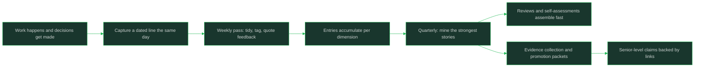

# The Brag Document

> **Core skill:** Building evidence habits from the first month on the job

## What Changes from Junior to Mid

A junior engineer trusts memory to recall their work at review time and discovers it remembers only the last month and only the loudest project. A mid-level engineer keeps a dated record of decisions, outcomes, feedback, and saves as they happen, and turns it into reviews and promotion evidence without a recall exercise. The brag document is the raw-material habit behind every later claim you will make about your work.

| Aspect | Junior | Mid |
|--------|--------|-----|
| Review time recall | Reconstructed from memory | Assembled from dated notes |
| What gets remembered | Recent and dramatic work | All work, sorted by impact |
| Evidence for claims | "I think I did well" | Linked entries with dates and effects |
| Time cost at review | Days of archaeology | An afternoon of summarizing |
| Feedback retention | Felt, then lost | Quoted verbatim, dated |

## Core Frameworks

### What To Record

| Category | What It Looks Like | Why It Is Evidence |
|----------|--------------------|--------------------|
| Decisions | "Chose A over B for the sync layer; reverted C after test X" | Shows judgment and autonomy |
| Outcomes | "Change shipped; error rate back to baseline by Thursday" | Shows impact chain, not output |
| Feedback | Verbatim quote: "your review comments made the migration easier" | Third-party voice you cannot invent |
| Saves | "Caught the retry loop before ship; incident note attached" | Shows prevention and judgment |
| Mentoring | "Paired with two engineers on schema design; they shipped it solo after" | Shows scope beyond your own tickets |
| Scope growth | "Carried feature across three services; first time on the rollout" | Shows the ladder dimension that moves levels |
| Risk flags | "Flagged the data loss risk on the 12th; migration plan changed" | Shows seeing around corners |

### Weekly Habit: The Minimum That Works

| Step | Time | Action | Output |
|------|------|--------|--------|
| Capture | 2 minutes, same day | Drop an entry when something happens | Raw dated line |
| Weekly pass | 10-15 minutes, fixed slot | Sort the week's entries, fill gaps, quote feedback | One tidy weekly block |
| Tag | Inside the weekly pass | Mark each entry by dimension and impact size | Sortable entries |
| Review | End of quarter | Read the quarter; name the three strongest stories | Promotion-ready material |

### How The Document Feeds Later Cycles

| Cycle | What You Need | What The Document Provides |
|-------|---------------|----------------------------|
| Performance review | A narrative of the period | Chronological, dated, impact-tagged entries |
| Promotion packet | Evidence per ladder anchor | Entries sorted by dimension with links |
| 1:1s | Topics and asks | Open threads, feedback received, targets |
| Interview stories | Specific, honest examples | Situations with details you would have forgotten |
| Self-assessment | Evidence per dimension | The raw material for the rating table |

### Honesty and Privacy Rules

| Rule | Why | Practice |
|------|-----|----------|
| Record facts, not adjectives | "Great work" is not evidence; "shipped X, effect Y" is | One action, one effect, one date |
| Keep it private by default | It is working memory, not a performance | Personal notes, not the shared drive |
| Quote others with care | Feedback is data about you, not gossip about them | Quote the words about your behavior; leave names off |
| Include the misses | A document of only wins is not trustworthy to you | Note what you learned from what failed |
| Name collaborators | Joint work claimed solo collapses under scrutiny | "With X on Y" in every shared entry |
| Date everything | Undated claims cannot be placed in a period | Date at capture, never retroactively guessed |



## In Practice

**Write the entry the day it happens or it does not happen.** Memory compresses, flattens, and drops the details that make evidence convincing: what the risk was, what you chose, what the effect turned out to be. Two minutes at capture saves a day of archaeology and preserves the specifics that reviewers actually weigh. The habit matters more than the tool; a plain dated list beats a beautiful empty template.

**Record decisions and saves, not just shipped features.** The most level-relevant work is often invisible: the design call you made, the incident you prevented, the scope you trimmed wisely. These map directly to autonomy and ambiguity dimensions. If your document only holds tickets, it will only support claims about output.

**Quote feedback verbatim and date it.** Paraphrase loses both meaning and credibility: "my manager said I was doing great" is worthless; "your review comments on the migration saved us a rollback" is a citation. Verbatim quotes also survive context changes: managers move, teams reorganize, and the quote still stands.

**Include the misses with what you learned.** A document that records only wins is not honest evidence, and reviewers can smell it. One line about what failed and what you changed reads as judgment at mid level and beyond. It also protects you: when the same miss appears twice, your own document will tell you before anyone else does.

**Name collaborators in every shared entry.** Joint work recorded as solo work is a debt that comes due at the worst moment: in a calibration where someone else's account exists. "With Priya on the schema migration" costs nothing and makes every claim stronger. Your document should be readable by the people in it without embarrassment.

**Keep it private and treat it as working memory.** This document exists for your recall and your preparation; it is not a status report and not shared by default. Privacy keeps it honest: you can record misses, doubts, and unpolished observations. Share the summaries you distill from it, never the raw log.

## Practical Exercise

Start the habit and produce one review-ready story this month:
1. Create one private note and copy the weekly template below into it
2. Backfill the last two weeks from memory and your calendar, dating each entry
3. Set a fixed 15-minute weekly slot; write it into your calendar now
4. For one entry, ask the person who gave you feedback for the exact words they used
5. Tag every entry by dimension: scope, autonomy, ambiguity, impact, communication
6. At the end of the month, pick the strongest entry and expand it into a short story: situation, action, effect, evidence
7. Show the story to a trusted peer and ask if any claim lacks support

## Practical Applications

- [ ] Capture entries same-day in a private note; never rely on the weekly pass for details
- [ ] Keep the weekly slot fixed and short: tidy, tag, quote
- [ ] Tag entries by the five dimensions so quarterly mining takes minutes
- [ ] Store feedback as verbatim quotes with dates
- [ ] Name collaborators in every shared entry
- [ ] Record at least one miss per quarter and what you changed
- [ ] Review the quarter and name your three strongest stories before any review cycle

Weekly brag document template:

```text
Week of: YYYY-MM-DD

## Decisions
- (date) decision, options considered, why, effect so far

## Outcomes
- (date) change shipped, observable effect, where the evidence lives

## Feedback (verbatim)
- (date) "..." — context

## Saves and risk flags
- (date) what could have gone wrong, how I caught it, what changed

## Mentoring and collaboration
- (date) who, what, effect (with names)

## Misses and lessons
- (date) what happened, what I changed

Tags per entry: scope / autonomy / ambiguity / impact / communication
```

## Common Pitfalls

| Pitfall | Why It Fails | Better Approach |
|---------|--------------|-----------------|
| Relying on memory at review time | Memory keeps the recent and loud, drops the rest | Capture same-day; the document remembers for you |
| Recording only shipped features | Misses the judgment work that levels reward | Record decisions, saves, and risk flags too |
| Inflating entries with adjectives | "Did amazing work" supports no claim | One action, one effect, one date |
| Sharing the raw document | Turns working memory into a political artifact | Keep it private; distill summaries for others |
| Claiming joint work without names | Collapses when collaborators tell their version | Name everyone in shared entries |
| Starting at promotion time | The period the packet covers is already gone | Start in the first month; the habit is the asset |

## Success Indicators

- Your weekly pass takes under fifteen minutes and rarely misses anything
- Review preparation is summarizing dated entries, not reconstructing a year
- Every claim you make about your work has a linked, dated entry behind it
- Your document contains feedback quotes, misses, and named collaborators
- You can produce three strong, honest stories in under an hour

## Related

- [[05_Impact_and_Visibility]]
- [[06_Feedback_and_Self_Assessment]]
- [[career-path/02_Senior_Software_Engineer/09_Promotion_Evidence_and_Capstone/02_Evidence_Collection||Evidence Collection]]
- [[career-path/02_Senior_Software_Engineer/09_Promotion_Evidence_and_Capstone/07_Mid_to_Senior_Promotion||Mid to Senior Promotion]]
- [[career-path/02_Senior_Software_Engineer/00_overview|Senior Software Engineer]]

## Sources

- *The Staff Engineer's Path* (Tanya Reilly)
- *The Missing README* (Chris Riccomini, Dmitriy Ryaboy)
- *Thanks for the Feedback* (Douglas Stone, Sheila Heen)
- *Staff Engineer* (Will Larson)
