# Documentation As You Go

> **Core skill:** Writing just enough documentation while the context is fresh

## What Changes from Junior to Mid

A junior engineer writes docs when told to, usually at the end, mostly restating the code. A mid-level engineer documents decisions, surprises, and how-tos at the moment they happen — when the context is free instead of expensive — and skips what the code already says. The standard is not word count; it is whether the next person (including future you) can act without asking anyone.

| Aspect | Junior | Mid |
|--------|--------|-----|
| Timing | End of the project, from memory | As it happens, while the context is free |
| What gets written | What the code does, restated | Decisions, surprises, how-tos, runbooks |
| What gets skipped | Nothing or everything, arbitrarily | Anything the code says better |
| Comments | Narrate the next line | Explain why and constraints |
| Freshness | Written once, never revisited | Owner, review date, updated with the change |
| Success measure | Document exists | Someone used it without asking a question |

## Core Frameworks

### What Deserves Documentation

| Category | Form | Why It Cannot Live in Code |
|----------|------|----------------------------|
| Decisions and trade-offs | Short decision record or PR description link | The code shows what won, not what was rejected or why |
| Surprises and gotchas | Note near the code, or a "sharp edges" section | Surprises are invisible in the code by definition |
| How-tos | Task-focused guide: setup, deploy, add a feature | Operational sequences are not expressible in source |
| Runbooks | Symptom to action steps | On-call response must be executable under stress |
| Concepts and boundaries | Module or system overview with a small map | Architecture intent spans files and repos |
| Not this | Explicit non-goals or "do not use X for Y" | Prevents the mistake that the code allows |

### What Does Not Deserve Documentation

| Skip This | Because |
|-----------|---------|
| Line-by-line restatement of the code | Code and docs diverge instantly; the code is the truth |
| Auto-generated API dumps in prose | The generated reference already covers it |
| Vanity architecture essays nobody links to | Unlinked docs rot fastest and mislead later |
| Step lists that duplicate a script | Put the steps in the script; document the script's purpose |
| Elaborate docs for code about to be deleted | Delete the code and the question together |

### Keeping Docs Fresh

| Mechanism | How It Works |
|-----------|--------------|
| Owner and review date in the doc header | Someone is accountable and knows when to look |
| Docs updated in the same PR as the change | The doc cannot drift from the behavior |
| Doc links from the code or README | Discoverability beats quality; unfindable docs do not exist |
| "Last verified" line on runbooks | Readers know if the steps were tested this year |
| Deleting stale docs deliberately | A wrong doc is worse than no doc |

```mermaid
%%{init: {'theme':'base','themeVariables':{'primaryColor':'#19362D','primaryTextColor':'#CDD3D1','primaryBorderColor':'#1FB854','lineColor':'#1FB854','background':'#1B1717','mainBkg':'#19362D','clusterBkg':'#161212','edgeLabelBackground':'#161212','titleColor':'#1FB854','fontSize':'14px'}}}%%
flowchart LR
    A["Learn something or hit a surprise"] --> B["Decide if it deserves a doc"]
    B --> C["Write it while context is fresh"]
    C --> D["Explain why, link from code"]
    D --> E["Give it an owner and review date"]
    E --> F["Update it with the change"]
    F --> G["Delete or fix what goes stale"]
```



## In Practice

**Document what surprised you.** If a behavior contradicted your expectation, the next reader will hit the same wall. Write one line where they will find it — in the README, next to the code, or in a gotchas list. The surprise rule costs minutes and saves the same debugging session from repeating across the team.

**Write decisions, not transcripts.** The valuable record is why this approach and not the alternative, what constraint decided it, and what would make you revisit. Three sentences of decision context outperforms three pages of meeting narration. Link the decision where the code implementing it lives.

**Comments explain why, not what.** The code already says what; a comment that paraphrases it rots and misleads. Use comments for constraints, invariants, workarounds with an issue link, and the reason a natural-looking approach was rejected. If the why needs a paragraph, that paragraph is a doc and the comment links to it.

**Write while the context is fresh.** The cost of documenting is mostly reconstruction cost; the same paragraph takes minutes today and an hour in three weeks. Write the how-to as you do it the first time, the runbook step as you execute it, the decision note as the debate ends. Freshness is the whole game.

**Keep READMEs as entry points, not archives.** A good README answers: what is this, how do I run it, how do I test it, where do I go next. Move depth to linked pages and delete what duplicates them. If the README cannot be read in two minutes, it is a filing cabinet pretending to be a door.

**Give every doc an owner and a freshness signal.** Name who keeps the doc true and when it is next due for review; for runbooks, add a "last verified" date. Docs without owners drift into fiction, and readers cannot tell the difference until the doc fails them during an incident.

**Delete stale documentation deliberately.** A confidently wrong runbook is worse than an absent one. When you touch an area and the doc is wrong, fix it or delete it in the same change; do not leave known-wrong text behind. Deletion is documentation work.

## Practical Exercise

Document the work you just finished, in the smallest useful forms:

1. List what you learned in your current task that would cost a teammate time: a decision, a surprise, a how-to, or an operational step.
2. Write the surprise first: one line, placed where the next person will hit the same wall.
3. Write a short decision note for any design choice you made: context, choice, rejected alternative, revisit condition.
4. Turn anything you did for the first time (setup, deploy, data fix) into a how-to while the steps are fresh; run it from your own doc once cold.
5. Check the comments you added in this change: rewrite any comment that says what into one that says why.
6. Add owner and review date to any doc you created or adopted; add a "last verified" date to any runbook step you executed.
7. Find one stale doc in the area you touched and either correct it or delete it in the same PR.

## Practical Applications

- [ ] Every surprise I hit this week has a one-line note where the next person will find it
- [ ] Design decisions in my recent work have a short why-and-alternatives note linked from the code
- [ ] My comments explain constraints and reasons, not what the next line does
- [ ] How-tos I wrote were validated by following them cold, with no memory of the task
- [ ] The READMEs I own answer run, test, and next-step in under two minutes
- [ ] Docs I own carry an owner and a review date; runbooks carry a "last verified" line
- [ ] I update docs in the same PR as the behavior change
- [ ] I deleted or corrected at least one stale doc this month instead of leaving it

Doc header template:

```text
# <Title: what this helps someone do>

Owner: <name>
Last reviewed: <YYYY-MM-DD>
Applies to: <service / module / environment>

## When you need this
<the situation this doc serves>

## Steps / Decision / Gotchas
<the content; for runbooks: steps plus "last verified" per section>

## Links and references
<links to code entry points, other docs, tickets>
```

## Common Pitfalls

| Pitfall | Why It Fails | Better Approach |
|---------|--------------|-----------------|
| Documenting after the fact, from memory | Cost is high, accuracy is low, motivation is gone | Write as you go, while context is free |
| Restating the code in prose | Docs drift instantly and mislead later | Document why, surprises, and how-tos only |
| Comments that narrate what the code does | Noise that rots; readers learn to skip comments | Comments carry constraints and reasons |
| Writing a doc nobody links to | Unfindable docs do not exist for the team | Link from README, code, or runbook index |
| Docs without owners or dates | Drift into fiction with no signal | Owner, review date, "last verified" on runbooks |
| Leaving known-stale docs in place | A wrong runbook fails during the incident | Fix or delete in the same change |
| Epic docs for everything | Effort goes to prose nobody reads | Small, task-focused, linked artifacts |

## Success Indicators

- New teammates use your docs and stop asking you the same questions
- Your decision notes end "why did we do it this way?" archaeology
- You can follow your own runbook cold, months later, without improvising
- Comments you wrote still read as reasons after the code around them changed
- Docs in your area carry owners, dates, and working links
- Your PRs routinely include a doc touch when behavior or operations changed

## Related

- [[00_overview]]
- [[01_Reading_Unfamiliar_Codebases]]
- [[02_Debugging_Method]]
- [[career-path/02_Senior_Software_Engineer/01_Technical_Ownership/00_overview|Technical Ownership]]
- [[software-engineering-note/07_Software_Maintenance/Software Maintenance Overview]]
- [[SWEBOK v4 - Overview]]

## Sources

- *The Pragmatic Programmer* (David Thomas, Andrew Hunt)
- *A Philosophy of Software Design* (John Ousterhout)
- *Software Engineering at Google* (Titus Winters, Tom Manshreck, Hyrum Wright)
