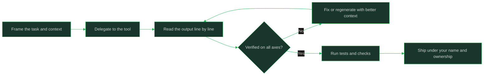

# AI Assisted Engineering

> **Capability area:** Using coding assistants and agents as part of a normal engineering workflow: delegating safely, verifying output, and keeping security, licensing, and real productivity in view.

## What Changes from Junior to Mid

A junior engineer accepts generated code with light review because it "looks right". A mid-level engineer treats AI output like a fast, overconfident junior teammate: useful for volume and drafts, never trusted without verification, and always owned by the human who ships it. In 2026 this is daily workflow, not a specialty.

Judgment at this level shows in:
- Knowing which tasks to delegate to agents and which to keep (see [[06_When_Not_to_Use_AI]])
- Reviewing generated code for correctness, security, and license provenance
- Giving tools the context that makes output usable instead of plausible
- Measuring whether assistance actually improved delivery, not just activity

## Topics in This Area

| # | Topic | Core skill |
|---|-------|------------|
| 01 | [[01_Working_With_Coding_Agents]] | Delegating well-scoped work to agents and reviewing what returns |
| 02 | [[02_Reviewing_AI_Generated_Code]] | Verifying correctness, security, and style of generated changes |
| 03 | [[03_Context_and_Prompting_for_Code_Tasks]] | Assembling the context that makes generated code usable |
| 04 | [[04_AI_Security_Licensing_and_Privacy_Risks]] | Keeping secrets, vulnerable patterns, and licenses out of AI output |
| 05 | [[05_Measuring_Real_Productivity]] | Distinguishing real delivery gains from perceived speed |
| 06 | [[06_When_Not_to_Use_AI]] | Choosing deterministic work and learning paths over generation |
| 07 | [[07_An_AI_Assisted_Daily_Workflow]] | Integrating assistance into the daily craft loop end to end |

## The Verification Loop

## Scope Boundary

This area covers AI as a development tool for working engineers. It does not cover building AI products (owned by [[career-path/18_Applied_AI_Engineer/00_overview|Applied AI Engineer]]), team-level tooling policy (owned by [[career-path/05_Tech_Lead/06_Process_and_Quality_Stewardship/00_overview|Process and Quality Stewardship]]), or AI security testing depth (owned by [[career-path/08_Security_Engineer/00_overview|Security Engineer]]).

## Key Principles

- You own every line you ship, regardless of who or what wrote it
- Generated code is untrusted input until verified: correct, secure, licensed, and understood
- Context quality determines output quality more than prompt cleverness
- Assistance should be measured by outcomes (lead time, defect escape), not by keystrokes saved
- Some work (learning a system, security-critical paths, novel design) is better done without generation

## Common Anti-Patterns

| Anti-Pattern | Why It Fails | Better Approach |
|-------------|-------------|-----------------|
| Shipping generated code after a skim | Plausible-looking bugs and vulnerabilities enter production | Line-by-line review with tests before merge |
| Pasting secrets or customer data into tools | Data leaves your trust boundary | Redact inputs; use approved tooling only |
| Accepting generated code wholesale into unfamiliar systems | You cannot maintain what you do not understand | Read, trace, and explain every change before accepting |
| Measuring success by lines generated | Activity rises while outcomes stall | Track delivery and defect metrics around the change |
| Using generation to avoid learning fundamentals | Skill atrophy compounds over years | Do the core work yourself first; delegate what you have mastered |

## Maturity Signals

- You can explain every line of any AI-assisted change in review without hedging
- Your team's secret-scanning and license checks pass on all AI-assisted merges
- You have a personal list of tasks you delegate and tasks you refuse to delegate
- Your delivery metrics around AI-assisted work show real improvement, and you can show the numbers
- You have caught and corrected a plausible-but-wrong generated change before it merged

## Connections

- [[career-path/01_Software_Engineer/02_Daily_Engineering_Craft/00_overview|Daily Engineering Craft]]: the loop this area plugs into
- [[career-path/18_Applied_AI_Engineer/00_overview|Applied AI Engineer]]: building AI-powered products (different job)
- [[career-path/02_Senior_Software_Engineer/00_overview|Senior Software Engineer]]: setting norms for AI-assisted work at team level
- [[SWEBOK v4 - Overview]]: professional practice and ethics foundations

## Sources

- *The Pragmatic Programmer* (David Thomas, Andrew Hunt): ownership and verification habits
- *Software Engineering at Google* (Titus Winters, Tom Manshreck, Hyrum Wright): code review and testing discipline that AI output must also pass
- OWASP guidance on AI-generated code risks (owasp.org)
