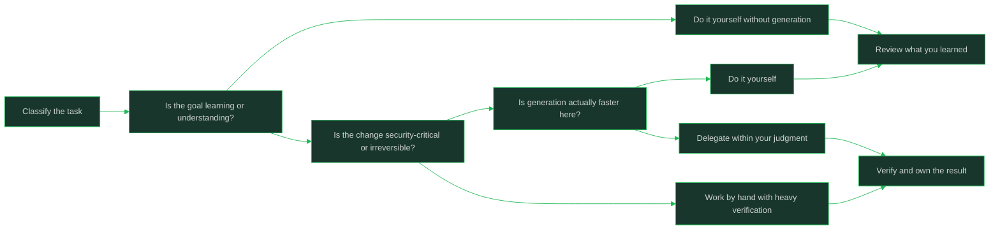

# When Not to Use AI

> **Core skill:** Choosing deterministic work and learning paths over generation

## What Changes from Junior to Mid

A junior engineer reaches for generation whenever it is available, because generation always produces something. A mid-level engineer knows that producing something is not the goal (understanding, correctness, and judgment are), and that some work is damaged by early plausible output. Choosing not to use AI is a positive skill: it protects learning, protects irreversible and security-critical changes, and keeps your fundamentals from decaying into prompt-reading.

| Aspect | Junior | Mid |
|--------|--------|-----|
| Default | Generate first, think later | Choose per task type; generation is one tool among several |
| Learning a system | Asks the tool what the system does | Reads and traces the code personally first |
| Irreversible changes | Generates and applies | Works by hand or with heavy verification; no blind application |
| Novel design | Adopts the first plausible design | Thinks first; avoids anchoring on generated options |
| Skill maintenance | Fundamentals erode unnoticed | Deliberately practices the core skills without assistance |
| Speed judgment | Assumes generation is always faster | Estimates both paths; sometimes doing is faster |

## Core Frameworks

### Task Decision Matrix

| Task Characteristic | Use AI? | Reason |
|---------------------|---------|--------|
| You are learning the system or domain | No, or only after first pass | You must build the mental model yourself; shortcuts skip exactly that |
| Security-critical or irreversible change | Heavily gated or none | One wrong plausible line in auth, migrations, or crypto is disproportionately costly |
| Novel architecture or design | Think first; generate later at most | First plausible design anchors you badly and crowds out better options |
| Well-understood, repetitive, high-volume work | Yes | Your judgment supplies the constraints; generation supplies the volume |
| Small, obvious, done in under a few minutes | Usually no | Prompting, reviewing, and fixing takes longer than doing |
| Debugging root-cause work | Sometimes, as a hypothesis source | The evidence-gathering and judgment stay yours |
| Work whose point is your own skill growth | No | Delegating the reps removes the training effect |
| Exploratory throwaway code | Yes | Low stakes, low review cost, learning from the output is the goal |

### Anchoring Risk in Design Work

| Situation | Risk If You Generate First | Alternative |
|-----------|----------------------------|-------------|
| Choosing an architecture for a new service | The first plausible design feels settled; alternatives stop appearing | Sketch two designs by hand before any generation |
| Naming and module boundaries | Generic structure that does not fit your domain's shape | Design from your domain model; use AI to critique, not to originate |
| API contracts with other teams | Invented shapes become commitments | Draft contracts yourself; they encode human agreements |
| Performance or concurrency design | Plausible patterns that are subtly wrong under load | Reason from measurements and constraints yourself |
| Data model and migrations | Convenient shapes that are expensive to unwind | Design deliberately; irreversible changes get no shortcuts |

### Keeping Fundamentals Sharp

| Skill | Why It Erodes | How to Practice Deliberately |
|-------|---------------|------------------------------|
| Reading unfamiliar code | Tools summarize instead of you tracing | Regularly trace a path through the system with no tool in the loop |
| Writing code fluently | Autocomplete replaces recall | Timed exercises or side work written by hand |
| Debugging | Generation guesses fixes before diagnosis | Run the hypothesis loop yourself before consulting anything |
| Design judgment | Plausible defaults replace tradeoff thinking | Write design docs with options and tradeoffs in your own words |
| Testing instincts | Generated tests pass by construction | Write the failing test first, by hand, before any generation |
| Estimation | Speed illusions distort your sense of effort | Keep estimating by decomposition and compare to actuals |



## In Practice

**Learning work must not be delegated.** When you are new to a system, domain, or codebase, the struggle to trace and understand it is the deliverable: the mental model you build is what makes every future task faster. A tool-generated summary feels like learning and produces none of its durable structure. Do the first pass yourself; use AI afterward to check your understanding or fill specific gaps.

**Security-critical and irreversible changes get the slow path.** Auth logic, permission models, data migrations, destructive operations, and cryptographic code have error costs far beyond their line counts. These are changes where you work by hand or with exhaustive verification, where another human reviews closely, and where generation at most drafts alternatives you evaluate deliberately. The asymmetry is the point: a wrong plausible line here is not a bug, it is an incident.

**Do not let generated design anchor you.** Plausible first options crowd out the design space; once you have seen a workable shape, imagining better ones gets harder. For novel design, think through the constraints and sketch options before any tool runs; then, if you like, use generation to critique or stress-test your designs rather than to originate them. The design is the part that is yours to do.

**When generation is slower, do the work.** For a tiny fix or an obvious change, composing a prompt, reviewing the output, and correcting its mismatches costs more than typing the change. Estimate both paths honestly; "the tool is fast" is not the same as "the task is faster with the tool." Two minutes of typing beats ten minutes of prompting and un-guessing.

**Guard against plausible output that replaces your thinking.** Early exposure to a decent answer measurably changes how you approach a problem afterward; it feels like help and works like an anchor. When the value of the task is your own judgment (debugging, designing, understanding), think first and consult later. Consultation is a checkpoint, not a starting gun.

**Practice fundamentals on purpose, on a schedule.** Fluency in reading code, debugging, testing, and design decays when tools carry those loads daily. Set deliberate reps: trace a code path by hand, write a failing test before any generation, do a small exercise with the tool closed. Maintaining these skills is what lets you evaluate output you did not write.

**Keep a written list of what you never delegate.** Codify the categories: learning passes on unfamiliar systems, security-critical paths, irreversible changes, design origination on novel problems. A written list converts a judgment you feel into a policy you follow under deadline pressure. Review the list as tools and your skills change, but change it deliberately.

## Practical Exercise

Audit one week of your work for delegation judgment:

1. List every task you worked on in a recent week and mark each: delegated to AI, partially delegated, or done by hand.
2. For each delegated task, answer one question: what was the goal: shipping, or building my understanding? Flag any learning work that was delegated.
3. Identify any security-critical or irreversible change in the list; check whether its handling matched the slow-path standard.
4. Pick one recent design decision you made with generated input and redo it cold: sketch two alternative designs by hand before looking at the generated one; note where the anchor pulled.
5. Time two small tasks both ways (with generation and by hand) and record which was genuinely faster and why.
6. Write your personal never-delegate list: at least four categories, each with one sentence of rationale.
7. Schedule one deliberate fundamentals rep per week for the next month (hand-tracing, failing-test-first, no-tool debugging) and note what you relearned.

## Practical Applications

- [ ] My first pass on any unfamiliar system is done by hand, tool-free
- [ ] Security-critical and irreversible changes follow a written slow-path standard
- [ ] Novel design is sketched by hand before any generated option enters my head
- [ ] I time both paths on small tasks instead of assuming generation wins
- [ ] I keep a written never-delegate list and follow it under deadline
- [ ] Weekly deliberate practice keeps reading, debugging, testing, and design sharp
- [ ] I can name the last thing I deliberately did without AI and why

Never-delegate list template:

```text
# My never-delegate list

## Category: <e.g. first-pass learning on unfamiliar systems>
<rationale: what capability or judgment this protects>

## Category: <e.g. security-critical change design>
<rationale>

## Category: <e.g. irreversible data migrations>
<rationale>

## Category: <e.g. novel design origination>
<rationale>

## Review date: <revisit as tools and skills change>
```

## Common Pitfalls

| Pitfall | Why It Fails | Better Approach |
|---------|--------------|-----------------|
| Generating summaries instead of reading code | Feels like learning; leaves no mental model | First pass by hand; tools check understanding later |
| Applying generated migrations or destructive ops blind | Irreversible mistakes with plausible shape | Slow path: hand work, exhaustive verification, close review |
| Accepting the first plausible design | Anchoring crowds out better options | Sketch alternatives before consulting any tool |
| Prompting for two-minute changes | Overhead exceeds the doing | Estimate both paths; just do it |
| Letting fundamentals decay | You lose the ability to judge what you did not write | Scheduled tool-free practice |
| Believing speed illusions | Perceived speed hides verify-and-fix cost | Measure outcomes on comparable tasks |
| Keeping no never-delegate list | Deadline pressure erodes judgment quietly | Write the categories down and follow them |

## Success Indicators

- You regularly do first passes on unfamiliar code with no tool in the loop
- Your security-critical changes follow a slow path you can describe precisely
- You can show a design decision where your hand sketch beat the generated option
- You have declined generation on a task because doing was faster, and you were right
- A written never-delegate list guides your daily tooling choices
- Your fundamentals pass periodic check-ins: hand debugging, failing-test-first, code tracing

## Related

- [[00_overview]]
- [[01_Working_With_Coding_Agents]]
- [[04_AI_Security_Licensing_and_Privacy_Risks]]
- [[05_Measuring_Real_Productivity]]
- [[career-path/01_Software_Engineer/02_Daily_Engineering_Craft/00_overview|Daily Engineering Craft]]
- [[career-path/18_Applied_AI_Engineer/00_overview|Applied AI Engineer]]

## Sources

- *A Philosophy of Software Design* (John Ousterhout)
- *Working Effectively with Legacy Code* (Michael Feathers)
- *The Pragmatic Programmer* (David Thomas, Andrew Hunt)
- *The Mythical Man-Month* (Fred Brooks)
