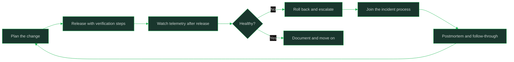

# Production Basics

> **Capability area:** Working safely with running systems (reading telemetry, following runbooks, joining incidents, and shipping releases), as a contributing engineer, not yet as the system's owner.

## What Changes from Junior to Mid

A junior engineer is shielded from production and learns about it secondhand. A mid-level engineer has been through at least a few release cycles and incidents, can read dashboards and logs to answer "is it my change?", follows runbooks correctly under pressure, and contributes constructively during and after incidents without being asked twice.

Judgment at this level shows in:
- Using telemetry to answer questions before asking humans
- Knowing the blast radius of your change before you release it
- Communicating clearly and calmly during incidents
- Turning postmortem action items into actual fixes

## Topics in This Area

| # | Topic | Core skill |
|---|-------|------------|
| 01 | [[01_The_Production_Mindset]] | Treating running systems as user-facing responsibility |
| 02 | [[02_Reading_Dashboards_and_Logs]] | Answering operational questions from telemetry first |
| 03 | [[03_Runbooks_and_Operational_Documentation]] | Following and improving operational procedures under pressure |
| 04 | [[04_Shadowing_On_Call]] | Learning on-call by observing and assisting safely |
| 05 | [[05_Participating_In_Incidents]] | Contributing to incident response without adding noise |
| 06 | [[06_Blameless_Postmortem_Participation]] | Giving honest accounts and turning findings into fixes |
| 07 | [[07_Releases_Deployments_and_Rollbacks]] | Shipping changes with verifiable, reversible steps |

## The Production Loop

## Scope Boundary

This area covers the contributing engineer's production responsibilities. It does not cover SRE-level reliability engineering (owned by [[career-path/07_SRE_and_Platform_Engineer/00_overview|SRE and Platform Engineer]]), incident command roles (owned by [[career-path/05_Tech_Lead/07_Incident_Leadership_and_Production_Excellence/00_overview|Incident Leadership and Production Excellence]]), or production architecture (owned by [[career-path/02_Senior_Software_Engineer/01_Technical_Ownership/00_overview|Technical Ownership]]).

## Key Principles

- Production is where users live; every change is a promise to them
- Verify before asking: dashboards and logs answer most "is it broken?" questions
- Reversibility is a feature: prefer changes you can undo in minutes
- Incidents are team problems; accurate information matters more than fast opinions
- Postmortems are for systems, not blame; your honest account is the raw material

## Common Anti-Patterns

| Anti-Pattern | Why It Fails | Better Approach |
|-------------|-------------|-----------------|
| "It works on my machine" as evidence | Production state is the only state users feel | Check dashboards before claiming health |
| Silent releases with no verification step | Failures are discovered by users, not engineers | Deploy with explicit checks and watch windows |
| Fixing forward blindly during incidents | Compounding unknowns widen the outage | Prefer rollback first, diagnosis second |
| Postmortem silence or blame-shifting | Root causes stay hidden | State what you saw and did, in order |
| Action items that never get scheduled | The same incident recurs | Convert items into tickets with owners and dates |

## Maturity Signals

- You can tell within minutes whether an incident involves your recent change
- Your releases include a documented verification step and a rollback path
- During incidents you communicate facts, timelines, and uncertainties clearly
- You have closed at least one postmortem action item you volunteered for
- New engineers learn the release process from documentation you improved

## Connections

- [[career-path/01_Software_Engineer/02_Daily_Engineering_Craft/00_overview|Daily Engineering Craft]]: the development side of the same loop
- [[career-path/07_SRE_and_Platform_Engineer/00_overview|SRE and Platform Engineer]]: the reliability specialization
- [[software-engineering-note/06_Software_Engineering_Operations/Software Engineering Operations Overview]]: operations fundamentals
- [[career-path/02_Senior_Software_Engineer/05_Quality_Reliability_Security/00_overview|Quality, Reliability, Security]]: senior-level production ownership

## Sources

- *Site Reliability Engineering* (Beyer, Jones, Petoff, Murphy): free at sre.google; incident and operations fundamentals
- *The Site Reliability Workbook* (Beyer, Jones, Petoff, Murphy): practical procedures
- *Release It!* (Michael T. Nygard): production failure modes and safe release design
