# Reading Dashboards and Logs

> **Core skill:** Answering operational questions from telemetry first

## What Changes from Junior to Mid

A junior engineer opens a dashboard, sees a wall of graphs, and asks a teammate what it means. A mid-level engineer reads telemetry methodically: establish what normal looks like, find what changed, pin down when it changed, and only then interpret. They answer "is it my change?" from metrics and logs within minutes instead of escalating on instinct, and they know which signals lie so they do not chase them.

| Aspect | Junior | Mid |
|--------|--------|-----|
| First move | Ask someone "is the system okay?" | Open the dashboard and establish the baseline yourself |
| Reading a graph | Looks at the current value | Compares current shape to normal shape and notes the change point |
| Log use | Reads the newest lines and hopes | Filters by time range, service, level, and correlation ID |
| Misleading signals | Chases whatever moved most | Cross-checks a second signal before believing the first |
| Answer quality | "Something looks off" | "Errors on endpoint X started at 14:32, right after my deploy" |
| When stuck | Escalates immediately or flails for hours | Escalates with findings: what is checked, what is ruled out |

## Core Frameworks

### The Three Telemetry Pillars

| Pillar | Answers | Best Question | Typical Failure to Spot | Weakness Alone |
|--------|---------|---------------|-------------------------|----------------|
| Metrics | Aggregate state over time | Is the service healthy, fast, and error-free right now? | Error-rate spikes, latency creep, saturation, traffic drops | Tells you that something is wrong, not which request |
| Logs | Individual events and their detail | What exactly happened to this request or this user? | Exceptions, stack traces, bad input shapes, downstream refusals | Volume hides the signal; sampling can hide the one event you need |
| Traces | One request's path across services | Where in the call chain does the request slow or fail? | The slow hop, the failing dependency, the retry storm | Sparse traces miss what was never recorded |

### Methodical Dashboard Reading

| Step | Question | Action | Done When |
|------|----------|--------|-----------|
| 1. Establish normal | What does healthy look like? | Widen the time range to a week; note the daily shape, noise band, and peak hours | You can say what the graph normally looks like at this hour |
| 2. Find what changed | Which panels deviate? | Scan for shape changes, not just big numbers: new spikes, flat lines, missing traffic | One to three deviating panels are named |
| 3. Pin the time | When did it change? | Zoom to the change point; correlate with deploys, config changes, and traffic shifts | A change time is on the clock, not "sometime today" |
| 4. Correlate | What else changed at that moment? | Check the deploy log, feature flag log, dependency dashboards, and error logs at the same minute | At least one plausible trigger sits at the change point |
| 5. Verify | Does a second signal agree? | Cross-check errors against latency, traffic, and downstream status | Two independent signals tell one consistent story |

### Log Anatomy and Useful Filters

| Component | Example Fields | Why It Matters |
|-----------|----------------|----------------|
| Timestamp | ISO time with timezone | The anchor for correlating logs with metric spikes and deploys |
| Severity level | DEBUG, INFO, WARN, ERROR, FATAL | Filtering to WARN and above usually removes the noise floor |
| Service and instance | service name, pod or host ID | Separates "one bad instance" from "the whole service" |
| Correlation or request ID | trace ID, request ID | Joins log lines across services into one request's story |
| Message and structured fields | error text, tenant, endpoint, latency_ms | Structured fields are filterable; free text is not |
| Error context | exception type, stack, upstream status | Names the failing contract instead of just "request failed" |

```mermaid
%%{init: {'theme':'base','themeVariables':{'primaryColor':'#19362D','primaryTextColor':'#CDD3D1','primaryBorderColor':'#1FB854','lineColor':'#1FB854','background':'#1B1717','mainBkg':'#19362D','clusterBkg':'#161212','edgeLabelBackground':'#161212','titleColor':'#1FB854','fontSize':'14px'}}}%%
flowchart LR
    A["Establish what normal looks like"] --> B["Find the deviating panels"]
    B --> C["Pin the change time"]
    C --> D["Check deploys and config at that minute"]
    D --> E["Answer is it my change"]
    E --> F["Cross-check a second signal"]
    F --> G["Report findings or escalate with context"]
```



## In Practice

**Establish normal before you interpret anything.** A graph is only meaningful relative to its own baseline: the same error rate can be fine at 3 a.m. and alarming at noon. Widen the time range first, learn the daily shape and the noise band, then zoom in. Engineers who skip this step misread every routine fluctuation as an incident.

**Ask "is it my change?" as a timed question, not a guilty feeling.** Find the exact minute the metric deviated, then pull the deploy and config-change log for the window around it. If your release sits inside the window, say so plainly in the channel and check the error logs for your service's signature; if it does not, you have cleared yourself with evidence instead of anxiety.

**Filter logs along one dimension at a time.** Start with time range and severity, then add service, then correlation ID; each filter should remove noise while keeping the event you are hunting. Dumping an unfiltered stream into a search box or filtering five fields at once both hide the signal. When you find one bad request, take its correlation ID and follow it end to end.

**Read the shape of the graph, not just the number.** A flat line where there was noise is as suspicious as a spike: it can mean the reporter stopped, not that the system got calm. Look for change points, missing traffic, step functions after deploys, and gradual slopes that signal slow leaks. The shape usually tells you the failure class before any log does.

**Cross-check before you believe a single signal.** Metrics can be wrong because instrumentation broke; logs can be sampled; a dashboard can be pointing at the wrong environment. Confirm a suspicion with a second, independent signal: errors against latency, one instance against the fleet, logs against traces. One signal is a hypothesis; two agreeing signals are a finding.

**Know when to stop looking and escalate.** If after a bounded effort (say, twenty focused minutes), you have established the timeline but cannot localize the cause, escalate with your findings: what changed, when, what you checked, what you ruled out. Escalating with a clean summary is useful; escalating with "something is broken" is not. The escalation is a handoff of context, not a handoff of the problem.

**Write down the query that found the answer.** The log filter or metric query that cracked the question is a team asset: paste it into the incident channel, the ticket, or the runbook. Telemetry skill compounds only when the queries survive past the person who wrote them.

## Practical Exercise

Practice a full telemetry investigation on a real or simulated problem:

1. Pick a service dashboard and widen the time range to seven days; write three sentences describing what normal looks like, including peak hours and the noise band.
2. Choose one recent anomaly (a spike, a dip, or a deploy window) and pin its change time to the minute using the graph.
3. Pull the deploy or config-change log for the window fifteen minutes either side of that time and list what shipped.
4. Open the log system and build a filter step by step: time range, then severity, then service; record each filter and what it removed.
5. Find one failing request, take its correlation ID, and follow it through the logs across every service it touched; write the request's story in order.
6. Answer "is it my change?" in one sentence with evidence, and state one second signal you used to cross-check it.
7. Write a short findings summary (timeline, evidence, ruled-out causes, open questions) as if you were escalating to a senior engineer.

## Practical Applications

- [ ] I can describe what normal looks like on my service's main dashboard before interpreting any alert
- [ ] When something looks wrong, my first question is "when did it change?", not "who broke it?"
- [ ] I have a saved log query per service that filters to actionable errors
- [ ] I check the deploy timeline at the change minute before speculating about causes
- [ ] I verify suspicions with a second independent signal before reporting them as findings
- [ ] I can clear or implicate my recent change with evidence within minutes
- [ ] My escalations include what I checked and what I ruled out, not just the symptom
- [ ] The queries that answered hard questions are saved where the team can find them

Telemetry findings template:

```text
## What I observed
<metric or log signal, with the exact time it changed>

## Timeline
- <HH:MM> <event: deploy, config change, traffic shift, first error>
- <HH:MM> <event>

## Is it my change?
<yes / no / unclear — with the evidence, e.g. deploy window, error signature>

## Cross-check
<second signal that agrees or disagrees>

## Ruled out
<what I checked and eliminated>

## Open questions / next step
<what remains unknown and what I would try next>
```

## Common Pitfalls

| Pitfall | Why It Fails | Better Approach |
|---------|--------------|-----------------|
| Reading current values without a baseline | Routine noise looks like an incident and real incidents look routine | Widen the time range and learn the daily shape first |
| Trusting one dashboard panel | Instrumentation can be wrong or point at the wrong environment | Cross-check with a second independent signal |
| Chasing the largest visible spike | The loudest signal is often a downstream symptom | Find the earliest change point in time, not the biggest number |
| Unfiltered log scrolling | Volume buries the event that matters | Filter by time, severity, then service, one dimension at a time |
| Treating a flat line as good news | The reporter may have died, not the problem | Missing data is a signal; verify the emitter is alive |
| Speculating publicly before checking telemetry | Rumor sets the incident narrative and wastes everyone's attention | Check the timeline first; label hypotheses as hypotheses |
| Flailing past the point of diminishing returns | The incident runs longer while the context decays in your head | Escalate with findings after a bounded effort |

## Success Indicators

- You can state what normal looks like on your service's dashboards from memory
- You localize "when did it change?" to a minute before forming any theory
- You answer "is it my change?" with evidence in minutes, most of the time
- You follow a correlation ID across services without asking how
- Your escalations arrive with a timeline and a ruled-out list
- You catch misleading signals instead of chasing them

## Related

- [[00_overview]]
- [[01_The_Production_Mindset]]
- [[05_Participating_In_Incidents]]
- [[career-path/07_SRE_and_Platform_Engineer/00_overview|SRE and Platform Engineer]]
- [[software-engineering-note/06_Software_Engineering_Operations/Software Engineering Operations Overview]]

## Sources

- *Site Reliability Engineering* (Beyer, Jones, Petoff, Murphy)
- *The Site Reliability Workbook* (Beyer, Jones, Petoff, Murphy)
- *Debugging: The 9 Indispensable Rules for Finding Anything* (David Agans)
