# Blameless Postmortem Participation

> **Core skill:** Giving honest accounts and turning findings into fixes

## What Changes from Junior to Mid

A junior engineer treats the postmortem as a verdict waiting to happen and protects themselves with vague timelines. A mid-level engineer understands that blameless review is a search for system causes, and that their honest, ordered account of what they did is the raw material for finding them. The mature contribution is a factual timeline, a willingness to say "I did X at 14:32 because Y", and follow-through on the action items that come out.

| Aspect | Junior | Mid |
|--------|--------|-----|
| Framing | A hearing about who failed | A study of how the system allowed the failure |
| Your account | Defensive, approximate, shortened | Factual, timestamped, including the wrong turns |
| Root cause | "I made a mistake" | "The system made that mistake easy to make and hard to notice" |
| Action items | Volunteered for none, or volunteered and forgot | Owns items with dates and closes them |
| Comfort level | Afraid to be wrong in the record | Understands honest error accounts are what make fixes possible |
| Output | Attends the meeting | Improves tests, alerts, docs, or code as the incident's residue |

## Core Frameworks

### Why Blameless Works

| Approach | What It Finds | What It Misses | Long-Term Effect |
|----------|---------------|----------------|------------------|
| Blameful | Who touched the failing component last | Why the system made the error possible and invisible | People hide mistakes; the same failure recurs |
| Blameless | The system conditions: missing tests, unclear alerts, risky defaults, tight coupling | Nothing about systems is off limits | Honest reporting; fixes land where they prevent recurrence |
| Blameless is not consequence-free | Accountability for follow-through stays | — | People own actions without fearing the account |

### The Five-Whys Style Loop

| Step | Question | Good Answer Looks Like | Trap to Avoid |
|------|----------|------------------------|---------------|
| 1 | What happened, factually? | "Users received 500s on checkout from 14:32 to 15:10" | Conclusions instead of observations |
| 2 | Why did it happen technically? | "A null field in the new payload format crashed the serializer" | Stopping at "a bug" |
| 3 | Why did that reach production? | "The test suite covered the old payload shape only" | Blaming the person who merged |
| 4 | Why did the gap exist? | "The schema change had no test requirement in the checklist" | Treating "oversight" as a cause |
| 5 | Why did it take 38 minutes to notice? | "No alert on checkout 5xx; found via a user complaint" | Skipping detection entirely |
| 6 | What change prevents the class? | "Schema-change checklist item plus an alert on checkout error rate" | A fix that addresses only step 2 |

### What a Good Postmortem Document Contains

| Section | Contents | Quality Bar |
|---------|----------|-------------|
| Summary | Impact, duration, severity, one-paragraph story | Readable by someone outside the team in two minutes |
| Impact | Users affected, requests failed, duration, data integrity | Numbers where they exist; honest gaps where they do not |
| Timeline | Ordered events with timestamps: detection, actions, decisions, resolution | Fact vs interpretation clearly separated |
| Root cause | The system-level cause chain from the whys loop | Ends in a condition, not a person |
| What went well | Detection that worked, mitigations that landed | Reinforces what to keep doing |
| Action items | Fixes with named owners and target dates | Each item prevents recurrence of a step in the cause chain |
| Lessons | Transferable takeaways for other services | Generalizable beyond this one incident |

```mermaid
%%{init: {'theme':'base','themeVariables':{'primaryColor':'#19362D','primaryTextColor':'#CDD3D1','primaryBorderColor':'#1FB854','lineColor':'#1FB854','background':'#1B1717','mainBkg':'#19362D','clusterBkg':'#161212','edgeLabelBackground':'#161212','titleColor':'#1FB854','fontSize':'14px'}}}%%
flowchart LR
    A["Reconstruct the factual timeline"] --> B["State what you did and why"]
    B --> C["Ask why until a system cause appears"]
    C --> D["Name the detection gap"]
    D --> E["Turn findings into owned action items"]
    E --> F["Ship the fixes"]
    F --> G["Confirm the recurrence is prevented"]
```



## In Practice

**Give your account as a timeline, not a defense.** Write what you did, in order, with times and the reasoning you had at each moment — including the reasoning that turned out wrong. "At 14:40 I restarted the worker because the queue looked stuck; that was based on the dashboard, and it did not help" is exactly what the review needs. Defense hides information; timelines build it.

**Describe your reasoning as it was, not as it looks now.** Hindsight makes every decision look obvious, and rewriting history with what you later learned destroys the evidence of how the system actually behaves under pressure. State what you knew at the time and what you believed; that is how reviewers find misleading dashboards and missing context, not just missing skills.

**Push the whys past the person to the system.** "I forgot to run the tests" is where blameless analysis begins, not where it ends: why was it possible to forget, why did the pipeline not catch it, why did the alert not fire? The loop stops when you reach a condition you can change — a checklist, a guardrail, an alert, a default. If your last why names a person, you stopped early.

**Name the detection gap explicitly.** Every incident is really two failures: the thing that broke and the slowness of noticing it. Ask why the monitoring, alerting, or dashboarding surfaced the problem only after users felt it, and treat improving detection as first-class action item material. Faster detection shrinks every future incident, whatever its cause.

**Turn findings into action items with owners and dates, or they do not exist.** "We should add tests" in a document changes nothing; "Add serializer tests for the new payload shape, owner: me, due Friday" does. Each item should map to a step in the cause chain, so the class of failure is prevented, not just this instance. An action item without an owner and a date is a wish.

**Own at least one action item per postmortem you participate in.** Follow-through is where postmortem participation becomes a maturity signal: closing the alert, shipping the guardrail, fixing the runbook. Track your items to completion and report when they land. The person who closes their items is the person whose future incident accounts everyone trusts.

**Keep the review a study, even when the record is uncomfortable.** If the conversation drifts toward "who approved this", redirect to "what made this approvable". Blameless is not about being soft — it is about keeping every fact on the table so the analysis can reach the system conditions. The strictest honesty and the kindest framing are the same practice here.

## Practical Exercise

Run a postmortem contribution cycle on an incident you witnessed or can reconstruct:

1. Reconstruct the timeline from your own notes, chat history, or deploy logs: every observation, action, and decision with a timestamp.
2. Write your personal account as three to five timeline entries, including the reasoning you held at each moment and any wrong turns.
3. Run the five-whys loop from the technical failure; write each answer and stop only when you reach a system condition someone can change.
4. Name the detection gap: why did users or dashboards notice this when they did, and not earlier?
5. Propose three action items, each mapped to one step of the cause chain, each with an owner and a due date.
6. Write the summary paragraph as if for a reader outside your team: impact, duration, cause chain, and the fixes in two minutes of reading.
7. Volunteer for one action item and track it to completion; report back in the postmortem thread when it ships.

## Practical Applications

- [ ] My postmortem accounts are factual timelines with timestamps, not defenses
- [ ] I state what I knew at the time, not just what I know now
- [ ] My five-whys loop ends at a system condition, never at a person
- [ ] I name the detection gap in every incident I write about
- [ ] Action items I propose have owners and dates before the meeting ends
- [ ] I close at least one action item per postmortem I join
- [ ] I separate facts from interpretations in the timeline I hand the scribe
- [ ] The fixes I ship prevent the failure class, not just this instance

Postmortem contribution template:

```text
## My timeline entries
- <HH:MM> I observed <fact from signal X>
- <HH:MM> I did <action> because I believed <reasoning at the time>
- <HH:MM> Result: <what actually happened, including non-results>

## Cause chain (five whys)
1. <technical failure>
2. Why? <...>
3. Why? <...>
4. Why? <system condition>

## Detection gap
<why this was noticed at T and not earlier>

## Proposed action items
- <fix mapped to cause-chain step N> — owner: <name> — due: <date>
```

## Common Pitfalls

| Pitfall | Why It Fails | Better Approach |
|---------|--------------|-----------------|
| Defending yourself instead of reporting | The review loses the evidence only you hold | Give the factual timeline, wrong turns included |
| Rewriting your reasoning with hindsight | Hides how the system misled you at the time | State what you knew then and why |
| Root cause = a person's mistake | Recurrence is guaranteed; systems stay unchanged | Push the whys to a changeable system condition |
| Skipping the detection question | Every incident stays as long as this one | Name why notice came late and fix that too |
| Action items with no owner or date | The document performs accountability without producing fixes | Owner and date before the meeting ends |
| Volunteering and vanishing | The same failure class returns and trust erodes | Track your items to completion and report |
| Blameless as silence about mistakes | Facts get softened until they are useless | Blameless means honest and specific, never vague |

## Success Indicators

- You volunteer a full, timestamped account without being pressed
- Your cause chains end in system conditions and named guardrails
- Action items you own are closed on schedule and verified
- Reviewers treat your accounts as the factual backbone of the timeline
- You ask "why was this easy to do and hard to notice?" as a reflex
- Incidents you participated in leave behind shipped fixes, not just documents

## Related

- [[00_overview]]
- [[05_Participating_In_Incidents]]
- [[03_Runbooks_and_Operational_Documentation]]
- [[career-path/05_Tech_Lead/07_Incident_Leadership_and_Production_Excellence/00_overview|Incident Leadership and Production Excellence]]
- [[SWEBOK v4 - Overview]]

## Sources

- *Site Reliability Engineering* (Beyer, Jones, Petoff, Murphy)
- *The Site Reliability Workbook* (Beyer, Jones, Petoff, Murphy)
- *The Phoenix Project* (Gene Kim, Kevin Behr, George Spafford)
