# Releases Deployments and Rollbacks

> **Core skill:** Shipping changes with verifiable, reversible steps

## What Changes from Junior to Mid

A junior engineer treats the deploy button as the finish line and hopes the next hours go well. A mid-level engineer designs the release before shipping: what verifies success, what proves rollback works, how far the change spreads on the way to everyone, and what happens in the watch window. Deploying is an event; releasing is a controlled experiment with an undo button — and the rollback decision is made before the release, not during the panic.

| Aspect | Junior | Mid |
|--------|--------|-----|
| Definition of done | Code is merged and deployed | Verification passed and the watch window is clean |
| Rollback | Thought about after things break | Planned before the release, with a trigger written down |
| Rollout shape | Everything at once | Canary or gradual, sized to the blast radius |
| During the window | Moves on to the next task | Watches the dashboards that answer "is this healthy?" |
| When things go wrong | Diagnoses first, rolls back last | Rolls back first, diagnoses second |
| Communication | Silent ship | Release notes and a stated verification plan |

## Core Frameworks

### Release vs Deployment

| Concept | What It Is | What Success Means | Failure Mode When Confused |
|---------|------------|--------------------|-----------------------------|
| Deployment | The mechanical act of putting code into an environment | The code is running | "Deployed" is read as "working"; users discover the truth |
| Release | The controlled delivery of a change to users, with verification and an undo path | Users get the intended behavior, verified in production | Changes reach users with no plan to confirm or reverse them |
| Rollout | The shape and pace of exposure: canary, gradual, or full | Exposure grows only as evidence stays good | Full exposure with a bad change is a full outage |
| Rollback | Reversing the change to the last known good state | Users stop feeling the bad change, fast | Diagnosis during the outage burns the minutes rollback would have saved |

### Designing a Release

| Element | Question to Answer | Written Where |
|---------|--------------------|---------------|
| Intent | What user-visible change is this, and what should improve? | Release notes |
| Blast radius | Which endpoints, tenants, or flows feel it if this fails? | Release description |
| Verification steps | What exact signal proves success, checked when? | Release checklist |
| Rollout shape | Canary, gradual by percentage, or all at once — and why that size? | Release plan |
| Rollback plan | What is the exact undo, who can execute it, how long does it take? | Release checklist |
| Rollback trigger | What observed condition says "roll back now", stated numerically? | Release checklist |
| Watch window | Who watches which dashboard, for how long after each step? | Release plan |
| Communication | Who is told the release is happening, done, or reverted? | Release notes and channel |

### Rollout Shapes

| Shape | Exposure | Good For | Watch Closely |
|-------|----------|----------|---------------|
| Canary | One instance or a small slice of traffic first | Changes with real but uncertain risk | Canary metrics vs fleet baseline |
| Gradual rollout | Percentage steps: 1, 10, 50, 100 | Most user-facing changes | Error rate and latency at every step boundary |
| All at once | Full fleet instantly | Trivial, fully reversible changes only | Everything, immediately |
| Feature-flag exposure | Code ships dark; users see it via flag | Risky behavior changes decoupled from deploys | Flag-cohort metrics; the flag's rollback is instant |

```mermaid
%%{init: {'theme':'base','themeVariables':{'primaryColor':'#19362D','primaryTextColor':'#CDD3D1','primaryBorderColor':'#1FB854','lineColor':'#1FB854','background':'#1B1717','mainBkg':'#19362D','clusterBkg':'#161212','edgeLabelBackground':'#161212','titleColor':'#1FB854','fontSize':'14px'}}}%%
flowchart LR
    A["Design the release with verification and rollback"] --> B["Roll out to a canary slice"]
    B --> C["Watch the named metrics"]
    C --> D["Hold or expand exposure"]
    D --> E["Complete the watch window"]
    E --> F["Publish release notes"]
    F --> G["Roll back first if triggers fire"]
    G --> H["Diagnose after users are safe"]
```



## In Practice

**Design the release before you ship the code.** The verification step, the rollback path, and the trigger belong in the plan while you are calm, because nobody writes good rollback triggers mid-incident. A release designed this way is boring to execute: the checklist says what to watch, when to hold, and when to undo. If you cannot write the rollback plan, the change is not ready to release.

**Make verification specific and timed.** "Check that it works" is not a verification step; "error rate on checkout stays below baseline and p95 latency does not regress, checked at 5 and 15 minutes after each rollout step" is. Name the signal, the threshold, and the time, and assign the watching. Verification that lives in someone's head gets skipped when the release window gets busy.

**Size the rollout to the blast radius.** The bigger the audience that feels a failure, the smaller the first exposure should be. A change to a shared serializer earns a tiny canary and a long watch; a change to one internal tool might justify a faster path. When unsure, choose the smaller step — the cost of patience is minutes, the cost of overexposure is the outage.

**Watch the window like it is part of the deploy.** The release is not done when the pipeline goes green; it is done when production evidence has stayed good through the watch window. Keep the dashboards open, resist the pull of the next task, and have the rollback command ready to run. The window is where your plan meets reality, and reality speaks in metrics.

**Roll back first, diagnose second.** When the rollback trigger fires, execute the rollback and investigate afterward; users are not served by your understanding of the failure. Diagnosis can continue against the rolled-back system with far less pressure. The instinct to "fix forward quickly" is how a small release problem becomes a long incident.

**Write rollback triggers as numbers, not feelings.** "If it looks bad" cannot be acted on under stress; "if checkout error rate exceeds 2% for five minutes, or p95 latency regresses 30% over baseline, roll back" can. Pre-committed triggers remove the debate that happens when people are tired and hopeful. Define them before the release and honor them during it.

**Communicate the release like a change to users' world.** Release notes should say what changed for users, what to watch, and what to do if something looks wrong — written for whoever is on call and whoever is curious. Announce the window, announce completion, announce any rollback without spin. Silent ships turn every later surprise into a guessing game.

## Practical Exercise

Plan and execute a real or rehearsal release with the full discipline:

1. Take a change — real, or a hypothetical "new validation on the checkout endpoint" — and write its user-facing intent in one sentence.
2. Map the blast radius: which endpoints, tenants, and downstream flows feel it if the change is wrong.
3. Write the verification steps as named signals with thresholds and check times, for each rollout step.
4. Choose the rollout shape — canary, gradual, or full — and justify it from the blast radius in one sentence.
5. Write the rollback plan: exact command or action, who executes it, how many minutes it takes; confirm it is tested or testable.
6. Write numeric rollback triggers and pre-commit to honoring them; put them in the release checklist before deploying.
7. Execute the rollout step by step with the watch window staffed; record what each verification showed, and publish release notes including any holds or rollbacks.

## Practical Applications

- [ ] Every release I run has a written verification step and a rollback plan before it starts
- [ ] Rollback triggers are numeric and written down before the rollout, not improvised during it
- [ ] Rollout size matches blast radius: small first steps for wide-impact changes
- [ ] Someone is explicitly watching the named metrics during the watch window
- [ ] I hold or roll back the moment a trigger fires; diagnosis comes after users are safe
- [ ] Release notes state user-facing impact, verification results, and any rollback
- [ ] Feature flags decouple risky behavior changes from deploy timing where possible
- [ ] My release records let the next engineer repeat the process without me

Release checklist template:

```text
## Release: <change name>

### Intent
<one sentence, user-facing effect>

### Blast radius
<endpoints, tenants, flows affected if this fails>

### Rollout plan
- Step 1: <canary 5%> — verify <signal> at <+5 min, +15 min>
- Step 2: <50%> — verify <signal>
- Step 3: <100%> — watch window <duration> with <who watching>

### Rollback
- Command/action: <exact undo>
- Execution time: <minutes>
- Triggers: <numeric conditions that mean roll back now>

### Communication
- Announce start: <channel>
- Release notes: <link or location>
- Announce done / reverted: <channel>
```

## Common Pitfalls

| Pitfall | Why It Fails | Better Approach |
|---------|--------------|-----------------|
| Treating "deploy succeeded" as done | Pipeline health is not user health | Define and run verification in production |
| Full rollout of high-blast-radius changes | A bad change reaches everyone before evidence exists | Size first exposure to the blast radius |
| Rollback plan and triggers invented during the incident | Panic produces slow, debatable decisions, and vague triggers like "if it looks bad" are never acted on | Write numeric triggers and the undo path before shipping |
| Diagnosing before rolling back | Users stay broken while understanding grows | Roll back first, diagnose second |
| No watch window | The next task distracts from the only moment signals are fresh | Staff the window; keep dashboards open |
| Silent releases | On-call and stakeholders cannot correlate symptoms with the change | Announce the window and publish notes |
| Irreversible steps bundled into releases | Mistakes become permanent | Separate irreversible work; make the rest reversible |

## Success Indicators

- Your releases are boring: checklist executed, verification clean, window watched
- Rollback triggers fire your rollback without a debate when they hit
- You have rolled back within minutes of a trigger, at least once, without drama
- On-call engineers know what you shipped and when, from your notes alone
- Your canary catches problems before the full fleet ever sees them
- New engineers follow your release checklist as the team's standard example

## Related

- [[00_overview]]
- [[01_The_Production_Mindset]]
- [[02_Reading_Dashboards_and_Logs]]
- [[career-path/02_Senior_Software_Engineer/05_Quality_Reliability_Security/00_overview|Quality, Reliability, Security]]
- [[career-path/07_SRE_and_Platform_Engineer/00_overview|SRE and Platform Engineer]]

## Sources

- *Release It!* (Michael T. Nygard)
- *The Site Reliability Workbook* (Beyer, Jones, Petoff, Murphy)
- *Site Reliability Engineering* (Beyer, Jones, Petoff, Murphy)
