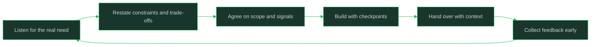

# Collaboration and Teamwork

> **Capability area:** Working effectively with product managers, designers, QA engineers, and your own manager — turning cross-functional friction into shared understanding and better software.

## What Changes from Junior to Mid

A junior engineer participates in cross-functional conversations and follows the agreed plan. A mid-level engineer shapes those conversations: pushes back on requirements with evidence, tells design what is cheap and what is expensive, gives QA the context they need to test well, and runs a 1:1 agenda instead of waiting for one. Software is a team sport at every level; at mid-level you start setting the tone.

Judgment at this level shows in:
- Translating business language into technical constraints and back
- Disagreeing with specifics and proposing alternatives, not just objecting
- Writing handoffs that let other people move without you
- Managing your manager's information needs proactively

## Topics in This Area

| # | Topic | Core skill |
|---|-------|------------|
| 01 | [[01_Working_With_Product_Managers]] | Turning fuzzy requests into shared, buildable understanding |
| 02 | [[02_Working_With_Designers]] | Collaborating on what is desirable and what is feasible |
| 03 | [[03_Working_With_QA_and_Test_Engineers]] | Giving testers context and using their findings well |
| 04 | [[04_One_On_Ones_With_Your_Manager]] | Running your own growth and feedback agenda |
| 05 | [[05_Giving_Feedback_to_Peers]] | Reviewing work and behavior with specifics and respect |
| 06 | [[06_Writing_For_Technical_Stakeholders]] | Status, decisions, and updates people actually read |
| 07 | [[07_Handoffs_and_Knowledge_Sharing]] | Transferring context so work continues without you |

## The Collaboration Loop

## Scope Boundary

This area covers individual cross-functional collaboration skills. It does not cover stakeholder management at senior scope (owned by [[career-path/02_Senior_Software_Engineer/02_Problem_Framing_and_Requirements/00_overview|Problem Framing and Requirements]]), team leadership (owned by [[career-path/05_Tech_Lead/00_overview|Tech Lead]]), or product discovery methods (owned by [[career-path/14_Product_Manager/00_overview|Product Manager]]).

## Key Principles

- Other disciplines are not obstacles; they hold information you do not have
- Disagreement is useful when it is specific, evidenced, and paired with an alternative
- Written context outlives meetings; handoffs are acts of respect
- Your manager is a tool for your growth, not just an evaluator of it
- Feedback delayed is feedback wasted — give it while the context is alive

## Common Anti-Patterns

| Anti-Pattern | Why It Fails | Better Approach |
|-------------|-------------|-----------------|
| Saying yes to every request quietly | Scope explodes; trust erodes when you slip | Surface trade-offs and renegotiate openly |
| Treating QA as the quality gate | Quality becomes someone else's job | Share context and own the tests with them |
| Silent 1:1s where the manager talks | Your growth agenda goes unmanaged | Bring a written agenda and asks |
| Feedback as personality judgment | Defensiveness, no change | Describe behavior, impact, and a concrete alternative |
| Handing off by dropping a repo link | The next person stalls on missing context | Handoffs include purpose, state, and known traps |

## Maturity Signals

- Product and design colleagues request you for early problem conversations
- Your pushback arrives with data and a proposal, not just concern
- Your manager's 1:1s spend time on growth because status is already handled in writing
- Peers thank you for reviews that changed their approach, not just their code
- Work you hand off continues without a chain of clarifying messages

## Connections

- [[career-path/01_Software_Engineer/02_Daily_Engineering_Craft/00_overview|Daily Engineering Craft]]: review and documentation skills this area applies cross-functionally
- [[career-path/02_Senior_Software_Engineer/06_Communication_and_Influence/00_overview|Communication and Influence]]: the senior version of these skills
- [[career-path/14_Product_Manager/00_overview|Product Manager]]: the other side of the PM partnership
- [[software-engineering-note/14_Software_Engineering_Professional_Practice/Professionalism of Software Engineering Overview]]: professional practice foundations

## Sources

- *Crucial Conversations* (Patterson, Grenny, McMillan, Switzler) — high-stakes discussion structure
- *The Missing README* (Chris Riccomini, Dmitriy Ryaboy) — cross-functional collaboration for engineers
- *Debugging Teams* (Brian Fitzpatrick, Ben Collins-Sussman) — team dynamics and feedback habits
