# Working With QA and Test Engineers

> **Core skill:** Giving testers context and using their findings well

## What Changes from Junior to Mid

A junior engineer treats QA as the checkpoint that proves their work is done: they throw code over the wall and wait for a verdict. A mid-level engineer treats QA as a partner who knows the product's failure surface better than anyone: they give testers context about what changed and what worries them, involve testability in design decisions, respond to bug reports with investigation instead of debate, and share ownership of regression coverage. The shift is from "QA finds my mistakes" to "we are both responsible for what ships."

| Aspect | Junior | Mid |
|--------|--------|-----|
| View of QA | The gate that blocks or clears the ticket | A partner holding knowledge the code does not show |
| Context given | "It's in the QA environment" | What changed, what to watch, what the risky paths are |
| Bug report response | Argues severity or asks "is it reproducible?" | Reproduces it, isolates it, and posts findings |
| Testability | Hopes the flow is testable | Demands it in design: seams, seams, stable identifiers |
| Regression coverage | Hopes nothing broke | Adds cases with QA and names what is now protected |
| Who owns quality | QA | The team, with QA as its specialist |

## Core Frameworks

### QA as Partner, Not Gate

| Behavior | Gate Mindset | Partner Mindset | Payoff |
|----------|--------------|-----------------|--------|
| When QA hears about a change | At test time, from the ticket | Before or during the build, with context | Testers plan coverage instead of rediscovering the change |
| What QA receives | A build number | What changed, what to watch, known risks, feature flags | Testing effort lands where risk actually lives |
| Bug triage | Verdict: pass or fail | Shared root-cause investigation | Fewer re-opens and less duplicate work |
| Test design | QA writes all cases | Engineer and QA design cases together | Cases reflect real code paths; coverage compounds |
| Regression | QA's memory | Shared suite both sides maintain | Regressions get caught by machines, not by customers |
| Relationship | Adversarial by default | Collegial by default | Honest risk conversations before the deadline |

### Context Package for Testers

| Element | What to Include | Why It Helps |
|---------|-----------------|--------------|
| What changed | Modules, endpoints, or flows touched; anything refactored without behavior change | Focuses testing on the delta instead of the whole product |
| What to watch | The behavior most likely to break and why you think so | Your hunch plus their method finds bugs faster than either alone |
| Known risks | Incomplete areas, deferred edge cases, flaky dependencies | Prevents surprise failures being read as carelessness |
| Testability notes | Feature flags, test accounts, seeded data, how to force error states | Removes the twenty minutes of setup that blocks every test session |
| Environment truth | What is deployed where, and what is mocked | Stops false bugs caused by environment gaps |
| Time box | When the build is testable and when you need feedback by | Lets testers sequence work and gives you a real signal date |

### Bug Report Lifecycle

| Stage | Your Job | What Good Looks Like |
|-------|----------|----------------------|
| 1. Receive | Read the full report before reacting | You know the reproduction steps, environment, and severity claim |
| 2. Reproduce | Follow their steps exactly once | "Reproduced on build X with their steps" is already half the diagnosis |
| 3. Isolate | Narrow to the smallest failing case | Minimal input, minimal config, one clear boundary |
| 4. Fix or route | Fix it, or explain precisely why it is not a code defect | A precise environment or requirement finding beats "works on my machine" |
| 5. Follow up | Post what was wrong and what now covers it | The reporter learns; the case joins the regression suite |
| 6. Close the loop | Tell the reporter what shipped and when | Trust builds when reports visibly change the product |

```mermaid
%%{init: {'theme':'base','themeVariables':{'primaryColor':'#19362D','primaryTextColor':'#CDD3D1','primaryBorderColor':'#1FB854','lineColor':'#1FB854','background':'#1B1717','mainBkg':'#19362D','clusterBkg':'#161212','edgeLabelBackground':'#161212','titleColor':'#1FB854','fontSize':'14px'}}}%%
flowchart LR
    A["Plan the change"] --> B["Tell QA what changed and what to watch"]
    B --> C["Build with testability in mind"]
    C --> D["Hand over with context and flags"]
    D --> E["Receive and reproduce bug reports"]
    E --> F["Fix and add regression coverage"]
    F --> G["Share what the team now protects"]
    G --> A
```



## In Practice

**Send testers context before they ask for it.** A short message — what changed, what to watch, what worries you, how to force the risky states — moves testing effort directly onto the risk. Testers cannot read your commit log's mind: the refactor that "changed nothing" is invisible without your help, and it is exactly where breakage hides. The message costs five minutes and routinely shortens the whole test cycle.

**Describe risk in terms of user behavior, not just code.** "The retry logic in the payment client changed" is weaker than "double-submitting the form is the risky path now." QA thinks in user-visible behavior and consequences; meeting them there gets you better coverage than a diff summary ever will. Code-level detail can follow, but lead with what the user can do and what could go wrong.

**Build testability in, do not request it later.** Feature flags, stable element identifiers, seeded test data, and seams to force error states decide whether a flow can be tested at all. If testing requires heroic setup, the coverage will be thinner than the risk deserves. Raise testability during design, next to the states and flows, and treat a hard-to-test flow as a design defect.

**Reproduce before you opine.** When a bug report lands, run their steps exactly — same build, same environment, same data if possible. Reproducing takes you from opinion to observation, and it shows respect for the reporter's work. Half the arguments about whether a bug is real end the moment someone actually follows the steps.

**Treat severity as a discussion about users, not about your schedule.** "It only happens sometimes" is not a downgrade if it loses user data; "it happens always" is not a catastrophe if it is cosmetic and visible. Negotiate severity against impact on the user and the product, with evidence. If you disagree with the reporter's call, bring the scenario, not the adjective.

**Share ownership of regression coverage explicitly.** Every fixed bug is a future regression candidate until a test protects it. Agree with QA which cases join the automated suite, which stay as documented manual checks, and who maintains each. Coverage you can point at is what lets both of you say "that cannot happen again" and mean it.

**Close the loop on every report.** Tell the reporter what the root cause was, what shipped, and what now covers it. Testers who never learn what happened stop writing detailed reports; the detail in their reports is exactly what made your fixes fast. Feedback loops that visibly change the product are how a test partnership compounds.

## Practical Exercise

Simulate one full QA partnership cycle around a small change:

1. Pick a change with real risk — say, a modified checkout validation — and write the context package: what changed, what to watch, known risks, and how to force each risky state.
2. Write the same message twice: once in code-level terms, once in user-behavior terms, and compare which one you would send.
3. Invent a realistic bug report for your change with reproduction steps, environment, and a severity claim; then follow those steps yourself and write what you would find.
4. Isolate the bug to a minimal case and decide: code defect, environment gap, or requirement ambiguity — and write the precise one-paragraph explanation for the reporter.
5. Design the regression coverage for the fix: name the automated cases, the manual checks, and who maintains each.
6. Write a severity negotiation reply where you disagree with the reporter's severity using user impact evidence.
7. Write the closing message: root cause, what shipped, what now covers it.

## Practical Applications

- [ ] QA hears about risky changes from me before the test cycle, not during it
- [ ] My context messages name what to watch in user-behavior terms
- [ ] Feature flags and error-state hooks exist so testers can force the hard paths
- [ ] I reproduce every bug report with the reporter's exact steps before diagnosing
- [ ] Severity discussions cite user impact, not my delivery pressure
- [ ] Every fixed bug leaves behind a regression case with a named maintainer
- [ ] Reporters hear back what the root cause was and what now protects it

Test handoff note template:

```text
## What changed
<modules, flows, or endpoints touched; behavior-neutral refactors named>

## What to watch
<the riskiest user behavior and why I think so>

## Known risks and deferred edges
<what is incomplete or deliberately deferred>

## How to test the hard paths
<flags, test accounts, seeded data, how to force error states>

## Environment truth
<what is deployed where, what is mocked>

## When I need feedback by
<time and what decision depends on it>
```

## Common Pitfalls

| Pitfall | Why It Fails | Better Approach |
|---------|--------------|-----------------|
| Dropping builds with no context | Testers spread effort over everything and miss the actual risk | Send what changed, what to watch, and how to force risky states |
| Treating QA as the quality gate | Quality becomes someone else's job and ownership fragments | Share test design and regression coverage with QA |
| Debating a bug report before reproducing it | Arguments replace evidence and the reporter loses motivation | Follow their steps exactly once, then discuss |
| Defending severity with schedule pressure | Trust erodes and reporters start inflating to be heard | Negotiate severity with user-impact evidence |
| Shipping fixes with no regression case | The same bug returns and the fix history repeats | Agree who adds the case and where it lives |
| Designing flows no one can force into error states | Testing stays shallow exactly where risk is highest | Build testability in during design: flags, hooks, seeded data |
| Never closing the loop on reports | Reporting detail decays and future bugs arrive vaguer | Post the root cause and what now covers it |

## Success Indicators

- QA asks for your read on risk before starting a test cycle
- Your bug reports come back with fewer re-opens because fixes are confirmed
- The regression suite covers your recent fixes and you can name the cases
- Testers can force your error states without asking you for setup help
- Severity disagreements are short and evidence-based, not personal
- Reports on your code arrive detailed and early, because reporters trust the loop

## Related

- [[00_overview]]
- [[04_One_On_Ones_With_Your_Manager]]
- [[career-path/10_Quality_and_Test_Engineering/00_overview|Quality and Test Engineering]]
- [[career-path/01_Software_Engineer/02_Daily_Engineering_Craft/00_overview|Daily Engineering Craft]]
- [[software-engineering-note/14_Software_Engineering_Professional_Practice/Professionalism of Software Engineering Overview]]

## Sources

- *The Missing README* (Chris Riccomini, Dmitriy Ryaboy)
- *Debugging Teams* (Brian Fitzpatrick, Ben Collins-Sussman)
- *Crucial Conversations* (Kerry Patterson, Joseph Grenny, Ron McMillan, Al Switzler)
