# One-On-Ones With Your Manager

> **Core skill:** Running your own growth and feedback agenda

## What Changes from Junior to Mid

A junior engineer attends 1:1s and answers the manager's questions. A mid-level engineer runs the meeting: brings a written agenda, spends status time in writing beforehand, asks directly for feedback and growth opportunities, and raises the awkward topics (compensation, career doubts, team friction) before they calcify. The manager is a resource for your growth; a 1:1 is the standing appointment where you spend that resource on purpose.

| Aspect | Junior | Mid |
|--------|--------|-----|
| Agenda | Waits for the manager's topics | Brings a written agenda and owns most of the time |
| Status updates | Recites the week in the meeting | Delivers status in writing; 1:1 time goes to judgment and growth |
| Feedback | Hopes it arrives | Requests it directly with a specific question |
| Hard topics | Avoids compensation, doubts, friction | Raises them early, framed with specifics |
| Career conversation | "How am I doing?" | Brings a concrete direction and asks for the path to it |
| Between meetings | Treats 1:1 topics as time-boxed | Notes items as they occur and brings them next session |

## Core Frameworks

### What the 1:1 Is For

| Topic | Purpose | Your Preparation | Time Share |
|-------|---------|------------------|------------|
| Progress and judgment | Give your manager the story behind the status | What shipped, what you decided, what surprised you | Small if status is written |
| Blockers and support | Extract help only your manager can give | The blocker, what you tried, the specific ask | As needed |
| Growth and skill building | Direct your development deliberately | The skill you want, the opportunity that would build it | Large, recurring |
| Feedback requests | Improve while the context is alive | A specific situation and a specific question | Recurring |
| Team and org context | Understand what is happening above your level | Curious questions about priorities, changes, strategy | Recurring |
| Career trajectory | Keep direction current | Where you want to be in a year and what is missing | Periodic |
| Compensation and recognition | Ensure the record matches the work | Concrete contributions and their impact, dated | Periodic, prepared |
| Friction and concerns | Resolve issues while they are small | Specific behavior, specific impact, what you have tried | When it arises |

### The Agenda Discipline

| Move | What It Looks Like | Why It Works |
|------|--------------------|--------------|
| Keep a running note | One document, append items as they occur during the week | Nothing important waits for a lucky memory on meeting day |
| Send status in writing | Short written update before the meeting: shipped, in flight, risks | Frees the meeting for what text cannot do well |
| Rank your items | Order the agenda by what matters most, not by what is easiest | The awkward item never gets crowded out by the comfortable one |
| Name the ask | Every topic ends in a request or a decision, not just narration | Your manager acts on asks; they cannot act on impressions |
| Time-box deliberately | Decide in advance how much goes to status, growth, feedback | The meeting reflects your priorities instead of drift |
| Follow up in writing | One message after: decisions, asks, and who owns what | Promises survive the week in writing |

### Topics People Avoid and How to Open Them

| Avoided Topic | Why It Fears You | Opening Move |
|---------------|------------------|--------------|
| Compensation | Feels greedy or premature | "I would like to understand how my level maps to compensation and what moves it" |
| Career doubts | Sounds like disloyalty | "I want to stay and grow here, and I am unsure between these two directions" |
| Team friction | Feels like complaining | "There is a working pattern that is slowing us down; can I describe it and get your read?" |
| Feedback on the manager | Feels risky | "What is one thing I could do differently in how I work with you?" invites reciprocity |
| Feeling underused | Sounds like entitlement | "I have capacity for more; here are the areas where I could take more ownership" |
| Wanting to leave or transfer | Feels like a bomb | Raise the underlying condition first: growth, scope, or direction that is missing |

```mermaid
%%{init: {'theme':'base','themeVariables':{'primaryColor':'#19362D','primaryTextColor':'#CDD3D1','primaryBorderColor':'#1FB854','lineColor':'#1FB854','background':'#1B1717','mainBkg':'#19362D','clusterBkg':'#161212','edgeLabelBackground':'#161212','titleColor':'#1FB854','fontSize':'14px'}}}%%
flowchart LR
    A["Note agenda items through the week"] --> B["Send status in writing before the meeting"]
    B --> C["Rank topics with the hard ones first"]
    C --> D["Work each topic to an ask or decision"]
    D --> E["Raise feedback and growth deliberately"]
    E --> F["Write down decisions and owners"]
    F --> G["Act between meetings and bring results back"]
```



## In Practice

**Bring your own agenda; the meeting is yours.** A 1:1 without an agenda becomes your manager's status check, and status is the least valuable use of a live hour with someone who can change your trajectory. Keep a running note all week, rank the items, and open the meeting with your list. Managers consistently adapt to whoever brings structure; be that person.

**Handle status in writing so the meeting can do what writing cannot.** Send a short update before the meeting (shipped, in flight, risks) and walk in ready to talk about judgment calls, growth, and friction. Written status also protects you: your manager has a record of your work when promotion and review conversations happen. If the meeting keeps sliding back into status, say so and renegotiate the format.

**Ask for feedback with a specific question attached.** "How am I doing?" invites a kind, vague answer; "in the design review last week, was my pushback on the API too blunt?" invites something you can act on. Specific questions lower the effort of answering honestly and make the feedback about behavior, not about you. Ask repeatedly; feedback you request regularly stops being an event and starts being a tool.

**Turn each topic into an ask or a decision.** Blockers become "can you unblock the identity team's review?"; growth becomes "can I own the next migration plan?"; friction becomes "what would you want me to try first?" Managers act on explicit requests far more reliably than on hints. If a topic has no ask attached, it probably belongs in your status update instead.

**Raise the avoided topics early and with specifics.** Compensation, career doubts, and team friction get harder the longer they wait, and surprise topics at review time have the least leverage. Bring concrete contributions to compensation talks, a real direction to career talks, and observed behavior to friction talks. Specifics turn a risky conversation into a solvable one.

**Prepare for compensation conversations like a work product.** List your contributions with dates and impact, and know the leveling expectations your work maps to. The conversation goes better when you present evidence instead of feelings, and even when the answer is "not now," you learn exactly what would change it. Never accept a password or personal data exchange in chat while arranging such logistics; keep them in the proper system.

**Handle a status-only meeting by renegotiating it.** If your manager defaults to project updates every week, propose the split explicitly: status in the tracker or a written note, 1:1 time for growth, feedback, and blockers. Frame it as making their time more useful, not as rejecting their format. Most managers want the same thing and lack the prompt.

## Practical Exercise

Run a complete 1:1 cycle for one week:

1. Keep a running agenda note for five workdays; record at least six items the moment they occur, tagged as status, blocker, growth, feedback, or concern.
2. Write the pre-meeting status update: what shipped, what is in flight, what risks exist, under one page.
3. Rank your agenda with the most important or hardest item first, and attach one concrete ask to every topic.
4. Draft the opening sentence for one avoided topic (compensation, career doubt, or team friction), using specific behavior and impact.
5. Prepare one specific feedback question about a real recent situation, narrow enough to answer honestly.
6. Simulate the meeting: cover the ranked agenda in order, and notice which items would have been dropped if the meeting ran short.
7. Write the follow-up message: decisions made, asks raised, who owns each next step, and when.

## Practical Applications

- [ ] I bring a written agenda to every 1:1 and open with my topics
- [ ] Status reaches my manager in writing before the meeting, not during it
- [ ] Every agenda item ends in an explicit ask or a recorded decision
- [ ] I request feedback at least monthly with a specific question
- [ ] Compensation, career, and friction topics are raised while they are still small
- [ ] Decisions and owners from the meeting are confirmed in writing
- [ ] What I promised between meetings comes back as results at the next one

1:1 agenda template:

```text
## Status in one breath
<shipped / in flight / at risk — detail lives in the written update>

## Blockers where I need you
<blocker, what I tried, the specific ask>

## Growth
<skill I am building, opportunity that would build it, ask>

## Feedback request
<specific recent situation + the question I want answered>

## Topic I have been avoiding
<behavior or concern, its impact, what I have tried>

## Decisions and owners from last time
<what was decided, who acts, by when>
```

## Common Pitfalls

| Pitfall | Why It Fails | Better Approach |
|---------|--------------|-----------------|
| Letting the manager set the whole agenda | Your growth topics never reach the table | Bring a ranked written agenda and open with it |
| Spending the hour on status recital | The only unique use of the meeting is wasted | Send status in writing; talk about judgment and growth |
| Asking "how am I doing?" | Invites vague comfort, not actionable feedback | Ask a specific question about a specific situation |
| Saving hard topics for review season | Surprises at review time have the least leverage | Raise compensation, doubts, and friction while they are small |
| Bringing problems with no ask attached | Your manager cannot act on impressions | End every topic with a request or a decision |
| Never following up in writing | Promises and decisions dissolve before next week | Confirm decisions, owners, and dates after each meeting |
| Treating 1:1s as optional when busy | Your trajectory quietly goes unmanaged in exactly the busy periods | Keep the cadence; shrink the agenda before you skip the meeting |

## Success Indicators

- You walk into 1:1s with a ranked agenda and mostly your own topics
- Status is a written artifact; live time goes to growth, feedback, and judgment
- You can name the feedback you received in the last month and what changed because of it
- Hard topics reach the table before they become emergencies
- Your manager knows your career direction and can state it back to you
- Decisions from 1:1s show up as actions, confirmed in writing

## Related

- [[00_overview]]
- [[05_Giving_Feedback_to_Peers]]
- [[06_Writing_For_Technical_Stakeholders]]
- [[career-path/01_Software_Engineer/01_Leveling_and_Growth/00_overview|Leveling and Growth]]
- [[career-path/11_Engineering_Manager/00_overview|Engineering Manager]]

## Sources

- *The Manager's Path* (Camille Fournier)
- *Thanks for the Feedback* (Douglas Stone, Sheila Heen)
- *Radical Candor* (Kim Scott)
