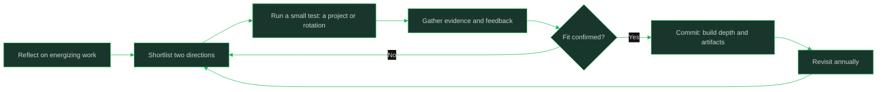

# Choosing a Path

> **Capability area:** Reading the career map deliberately — matching what you enjoy and do well to a specialization or leadership direction, and testing the choice with evidence instead of vibes.

## What Changes from Junior to Mid

A junior engineer samples everything. A mid-level engineer has enough exposure to notice patterns in what energizes them and what drains them, and starts steering deliberately: choosing assignments, learning, and evidence that point toward a direction. No choice is permanent — this vault's paths are maps, not rails.

Judgment at this level shows in:
- Describing what you actually liked about past work, not the job titles
- Testing a direction with a small commitment before a big one
- Keeping breadth while adding depth (the T-shaped ideal)
- Revisiting the choice as evidence accumulates

## Topics in This Area

| # | Topic | Core skill |
|---|-------|------------|
| 01 | [[01_Reading_The_Career_Path_Map]] | Using this vault's map to frame options and trade-offs |
| 02 | [[02_Incidents_and_Reliability_Leaning]] | Testing fit for SRE, security, and quality work |
| 03 | [[03_Systems_and_Design_Leaning]] | Testing fit for architecture and staff-track work |
| 04 | [[04_People_and_Process_Leaning]] | Testing fit for tech lead, management, and program work |
| 05 | [[05_Product_and_Customer_Leaning]] | Testing fit for product, field, and advocacy work |
| 06 | [[06_Data_and_AI_Leaning]] | Testing fit for data, ML, and applied AI work |
| 07 | [[07_Staying_T_Shaped]] | Building depth without burning your breadth |

## The Direction Test Loop

## Scope Boundary

This area covers career-direction exploration for early-career engineers. It does not cover promotion mechanics (owned by [[career-path/01_Software_Engineer/07_Readiness_for_Senior/00_overview|Readiness for Senior]] and [[career-path/02_Senior_Software_Engineer/09_Promotion_Evidence_and_Capstone/00_overview|Promotion Evidence and Capstone]]), job search artifacts (resume, interviews — covered in companion career resources), or any path's technical depth (each path owns its own).

## Key Principles

- Directions are hypotheses to test, not identities to defend
- Enjoyment and aptitude are different signals; good fits need both
- Every path in this map is reachable from software engineering; none is mandatory
- Breadth first, then depth: narrow too early and options shrink
- The best time to test a direction is with a small project, not a job change

## Common Anti-Patterns

| Anti-Pattern | Why It Fails | Better Approach |
|-------------|-------------|-----------------|
| Choosing a path for salary headlines | Daily misery ignores compensation | Weight the actual day-to-day work first |
| Waiting for certainty before moving | Certainty comes from testing, not thinking | Run small experiments quarterly |
| Copying a mentor's path exactly | Their strengths and timing are not yours | Borrow selectively; test fit yourself |
| Dropping breadth to specialize overnight | Fragile skills and fewer options | Keep a breadth habit alongside depth work |
| Treating the choice as one-way | Career paths are reversible | Set annual revisit points on purpose |

## Maturity Signals

- You can describe two candidate directions with specific evidence for each
- You have completed at least one small project that tested your leading choice
- Your learning plan shows depth in one area without abandoning breadth
- You can explain why a direction fits you without putting down the alternatives
- You revisit the choice on a schedule instead of only when frustrated

## Connections

- [[00_Career_Path_Overview|Career Path Overview]]: the full map these tests draw from
- [[career-path/01_Software_Engineer/01_Leveling_and_Growth/00_overview|Leveling and Growth]]: growth mechanics that work in any direction
- [[career-path/01_Software_Engineer/07_Readiness_for_Senior/00_overview|Readiness for Senior]]: the near-term milestone regardless of direction
- [[career-path/05_Tech_Lead/05_Team_Development_and_Mentoring_Leadership/02_Growing_Engineers_at_Levels|Growing Engineers at Levels]]: level expectations across directions

## Sources

- *The Staff Engineer's Path* (Tanya Reilly) — IC track choices and trade-offs
- *The Manager's Path* (Camille Fournier) — what management track work actually involves
- Public engineering ladders collected at progression.fyi — how companies define each direction
