# Incidents and Reliability Leaning

> **Core skill:** Testing fit for SRE, security, and quality work

## What Changes from Junior to Mid

A junior engineer treats incidents as interruptions and hardening work as overhead. A mid-level engineer who leans toward reliability finds the interruption is the interesting part: the puzzle of why a system misbehaved, the design of the guardrail that prevents the next recurrence, the satisfaction of a service that stays quiet because of work nobody sees. This note helps you test whether the incident-and-reliability family of work — SRE and platform, security, and quality — is genuinely energizing for you before you commit to it.

| Aspect | Junior | Mid |
|--------|--------|-----|
| During an incident | Freezes or fixes blindly under pressure | Works the problem methodically and communicates a timeline |
| After an incident | Glad it is over; moves on | Wants the postmortem and the follow-up actions |
| Hardening work | Treats it as a tax on feature work | Treats prevention as the highest-leverage output |
| On-call | Sees it as punishment | Weighs it honestly as a job-design feature before choosing the path |
| Boring quiet periods | Interprets quiet as "nothing to do" | Reads quiet as "the guardrails worked" and invests anyway |
| Adversarial tasks | Finds threat modeling or fuzzing tedious | Finds attacker-shaped thinking genuinely absorbing |
| Career direction | "I want to be good at everything" | "I want to be the person trusted when it breaks or when it must not break" |

## Core Frameworks

### What the Work Actually Looks Like Day to Day

| Path | A Normal Week | Signature Artifacts | What You Are Judged On |
|------|---------------|---------------------|------------------------|
| SRE and Platform Engineer | On-call rotation, incident response, dashboards and alerts, capacity and reliability projects, toil removal, platform tooling for other teams | SLOs and error budgets, runbooks, postmortems, automation, internal platforms | Uptime, incident quality, reduced toil, developer velocity through the platform |
| Security Engineer | Threat modeling, design and code review for risk, vulnerability triage, detection and response, security tooling, guidance and training | Threat models, severity ratings, hardening plans, detection rules, security reviews | Reduced risk, time to remediate, response quality, secure defaults shipped |
| Quality and Test Engineer | Test strategy, automation frameworks, release confidence, flaky-test elimination, exploratory testing, quality metrics and gates | Test plans, automation suites, quality dashboards, release criteria | Escape rate, test signal quality, release confidence, cycle time preserved |

### Energizing Versus Draining Signals

| Element | Energizing If | Draining If | Implication |
|---------|---------------|-------------|-------------|
| Incident pressure | You think faster and clearer when something is broken now | You replay incidents for days and dread the pager | Pressure tolerance is a real prerequisite, not a mindset trick |
| Deep investigation | You will chase a root cause for hours and feel rewarded by the thread | You want the answer handed over once it stops being fun | Reliability work is mostly the middle of the investigation, where it is not yet fun |
| On-call and off-hours | Knowing exactly when you carry the pager suits you | Unpredictable interruption wrecks your evenings and sleep | On-call load varies hugely; weigh the specific rotation, not the idea |
| Adversarial thinking | Imagining how something fails or is attacked is a hobby-grade interest | Negative framing and failure focus feel pessimistic | Security and reliability both demand comfort with brokenness |
| Prevention and process | You enjoy building guardrails nobody will notice | Invisible work feels like wasted effort | Quality and platform work is largely invisible when it succeeds |
| Repetition and rigor | Consistent, methodical repetition feels like craft | Repetition quickly feels like drudgery | Quality especially rewards patience with regression and edge cases |

### Fit Tests You Can Run Inside Your Current Job

| Test | How to Run It | Evidence For | Evidence Against |
|------|---------------|--------------|------------------|
| Own one service's reliability | Take the SLOs, dashboards, and on-call for a service for one quarter | You volunteer for the follow-up actions and the numbers improve | You dread rotation weeks and skip the follow-ups |
| Join incident reviews | Attend every postmortem for two months and write one yourself | You find the timeline reconstruction satisfying | The writing feels like blame paperwork |
| Run a security-focused project | Threat-model one feature and drive its fixes to done | You keep imagining attack paths afterwards | You close the review and never think about it again |
| Run a quality-focused project | Own the flaky-test cleanup or a release gate for one release train | The discipline of the suite feels worthwhile | The grinding repetition drains you quickly |
| Remove toil | Automate one recurring manual task end to end | Automation design holds your attention past the interesting part | You lose interest once the clever part is done |
| Shadow an on-call week | Volunteer to be secondary for one rotation | The responsibility feels clarifying | The anticipation alone degrades your week |

```mermaid
%%{init: {'theme':'base','themeVariables':{'primaryColor':'#19362D','primaryTextColor':'#CDD3D1','primaryBorderColor':'#1FB854','lineColor':'#1FB854','background':'#1B1717','mainBkg':'#19362D','clusterBkg':'#161212','edgeLabelBackground':'#161212','titleColor':'#1FB854','fontSize':'14px'}}}%%
flowchart LR
    A["Recall incidents and hardening work that energized you"] --> B["Shortlist reliability, security, or quality"]
    B --> C["Read the matching path overview"]
    C --> D["Run one fit test for a quarter"]
    D --> E["Log energizing and draining moments"]
    E --> F["Compare evidence against the shortlist"]
    F --> G["Commit to one direction or rerun a test"]
    G --> H["Revisit after each on-call season"]
    H --> B
```



## In Practice

**Describe the work, not the title, when you weigh this family.** "I want to be an SRE" is not a testable statement; "I want my week to be one-third incident response, one-third reliability projects, one-third platform tooling" is. Each of the three paths has a different weekly texture, and the fit question is about that texture. Pull the actual week from the path overview before you decide anything.

**Treat pressure tolerance as a prerequisite you measure, not a personality you hope for.** Some people genuinely come alive when the pager fires: thinking narrows, communication sharpens, and the aftermath is a good story. Others can perform in an incident but pay for it in sleep and rumination for days. Neither is a virtue or a flaw; both are data about which jobs will cost you more than they pay.

**Weight the invisible-work problem honestly.** Reliability, security, and quality succeed quietly: the attack that did not happen, the outage that did not occur, the regression that never shipped. If your motivation depends on visible applause and feature launches, this family will starve you; if a quiet dashboard and a clean quarter are their own reward, it compounds.

**Security fit is a specific taste, not a general good intention.** Security work rewards adversarial imagination — thinking about how a system fails or is abused — plus the patience to chase remediation across teams who did not ask for your opinion. Engineers who find threat modeling absorbing often find the cross-team enforcement part heavy. Test both halves: the puzzle and the persuasion.

**Quality fit is patience with rigor.** Quality and test engineering is strategy plus grinding discipline: deciding what deserves automation, chasing flaky tests, holding a release gate against schedule pressure. The energizing core is conviction that confidence in behavior is a product, not paperwork. If maintaining a test suite over months feels like craft rather than chore, this path has a place for you.

**Run fit tests before you reorganize your career.** Every test in the framework above runs inside your current job: own a service's reliability, join incident reviews, take a security or quality project for one quarter. A job change is a six-month experiment with expensive rollback; a quarter-long duty is cheap and just as informative. Collect the moments of energy and dread while the stakes are small.

## Practical Exercise

Run a quarter-long fit test on the incident and reliability family:

1. Write three sentences on the most energizing incident or hardening task of your past year, and three on the most draining one; name the specific element in each (pressure, investigation, prevention, repetition).
2. Choose one of the three paths and read its overview; write out what a normal week would look like in hours, including on-call if it applies.
3. Take on one fit test for a quarter: own a service's reliability, sit in on every incident review, or drive one security or quality project to done.
4. Keep a two-column log during the test: energizing moments and draining moments, with the task and the hour of day.
5. Shadow one on-call rotation if you have not recently, and record how the anticipation, the page itself, and the recovery each felt.
6. Write the verdict as evidence: what the test showed, what remains unknown, and which of the three paths the evidence points to.
7. Decide: commit to building depth in one path, or run one different test next quarter.

## Practical Applications

- [ ] I can describe the weekly work of SRE, security, and quality separately, in my own words
- [ ] I know how incident pressure affects my sleep and my thinking, from evidence, not hope
- [ ] I have run at least one fit test from the framework and logged the results
- [ ] I know whether invisible prevention work motivates me, based on a task nobody noticed
- [ ] My view of on-call is based on a real rotation I have experienced or shadowed
- [ ] I have named the specific element I find absorbing: investigation, adversarial thinking, or rigor
- [ ] My decision includes what this path costs me, not only what it offers
- [ ] A revisit point exists, ideally aligned with the end of an on-call season

Fit-test log template:

```text
## Test and duration
<which fit test, start and end dates>

## Energizing moments
- <date, task, what specifically gave energy>

## Draining moments
- <date, task, what specifically cost energy>

## Pressure and recovery
<how incidents felt, and how long recovery took>

## Verdict
<continue / rerun a test / rule it out — with the evidence>
```

## Common Pitfalls

| Pitfall | Why It Fails | Better Approach |
|---------|--------------|-----------------|
| Choosing reliability work for the hero story | The incident is one hour; prevention and toil are the other thirty-nine | Judge the ordinary week, not the highlight reel |
| Ignoring the on-call line item | Rotation load varies enormously and is the top lifestyle cost here | Ask about the specific schedule before accepting an offer or role |
| Confusing puzzle enjoyment with job fit | Investigation is the fun part; follow-through and process are the job | Test the follow-through too: run a postmortem to completion |
| Assuming security is "careful engineering" | It is adversarial thinking plus cross-team enforcement | Test threat modeling and remediation driving separately |
| Treating quiet as a reason to leave | Quiet means the guardrails worked; visible firefighting is not the goal | Measure recurrence rates and follow-ups, not incident counts |
| Committing after one bad or one good rotation | Single samples under- or over-fit the decision | Collect evidence across a full quarter and multiple contexts |
| Dropping feature skills to specialize early | Reliability careers still need delivery credibility | Keep shipping product work alongside the specialty tests |

## Success Indicators

- You can say which of the three paths matches your energy pattern and why
- A quarter of fit-test evidence supports your leaning, with named moments
- You know your pressure tolerance from real incidents, not self-image
- You have completed one prevention task through follow-up, including the boring parts
- Your decision accounts for on-call and recovery honestly
- You can name what this family costs you and have accepted it deliberately

## Related

- [[00_overview]]
- [[03_Systems_and_Design_Leaning]]
- [[07_Staying_T_Shaped]]
- [[career-path/07_SRE_and_Platform_Engineer/00_overview|SRE and Platform Engineer]]
- [[career-path/08_Security_Engineer/00_overview|Security Engineer]]
- [[career-path/10_Quality_and_Test_Engineering/00_overview|Quality and Test Engineering]]

## Sources

- *The Staff Engineer's Path* (Tanya Reilly)
- *Staff Engineer* (Will Larson)
- *So Good They Can't Ignore You* (Cal Newport)
- *Range* (David Epstein)
