# Systems and Design Leaning

> **Core skill:** Testing fit for architecture and staff-track work

## What Changes from Junior to Mid

A junior engineer thinks of design as the diagram you draw before coding. A mid-level engineer who leans toward systems and design starts noticing the real work: the trade-off nobody has named, the design review that goes sideways because the problem was never framed, the subsystem that keeps absorbing rework because its boundaries are wrong. This note helps you test whether the architecture and staff-track family — Staff Engineer, Principal and Distinguished Engineer, Software Architect — matches how you want to spend your attention.

| Aspect | Junior | Mid |
|--------|--------|-----|
| Design documents | Writes a diagram of the chosen solution | Frames the problem, states options and trade-offs, and records the decision |
| Trade-offs | Treats them as compromises to hide | Makes them explicit so others can review the reasoning |
| Influence | Argues from code they wrote | Argues from evidence, precedent, and clear writing |
| Ambiguity | Wants a defined problem before starting | Can hold an undefined problem and sharpen it over weeks |
| Time horizon | Optimizes the current sprint | Considers what this decision costs in two years |
| Mentoring | Explains answers | Reviews designs so others' judgment grows |
| Success | Features shipped | Better technical decisions made across the team |

## Core Frameworks

### What the Work Actually Looks Like Day to Day

| Path | A Normal Week | Signature Artifacts | What You Are Judged On |
|------|---------------|---------------------|------------------------|
| Staff Engineer | Design reviews, cross-team technical alignment, one deep project, mentoring through critique, writing, meeting stakeholders | Design documents, technical strategy notes, postmortems and memos | Quality of technical outcomes across teams, not just your own commits |
| Principal and Distinguished Engineer | Technical strategy at organization scale, long-horizon bets, standards and direction, senior stakeholder alignment, sponsoring other engineers | Strategy papers, architecture principles, roadmaps, talks and reviews | Whether the organization makes better technology decisions over years |
| Software Architect | System structure and boundaries, design review boards, trade-off documentation, quality attributes, alignment across teams or vendors | Architecture descriptions, ADRs, decision records, reference designs | Coherence of the system and the explainability of its trade-offs |

### Energizing Versus Draining Signals

| Element | Energizing If | Draining If |
|---------|---------------|-------------|
| Ambiguity | An undefined problem is an invitation to frame it | You need a clear spec before your thinking starts |
| Influence without authority | Persuading peers and other teams is a puzzle you enjoy | You want decisions to follow from your formal authority |
| Long horizons | Working on something that pays off next year feels worthwhile | Unfinished work and delayed feedback wear you down |
| Writing and documentation | A well-reasoned memo is a satisfying output | Writing feels like overhead after the thinking is done |
| Review load | Reviewing other people's designs feels like teaching | Critique is exhausting and you would rather build it yourself |
| Reduced coding | Staying current while coding less is a trade you accept | Giving up daily building feels like losing the craft |

### Fit Tests You Can Run Inside Your Current Job

| Test | How to Run It | Evidence For | Evidence Against |
|------|---------------|--------------|------------------|
| Write ADRs | Record every significant decision your team makes for one quarter, with options and trade-offs | The reasoning, not just the outcome, holds your attention | The documents feel like compliance paperwork |
| Run a design review | Facilitate one real design review: frame the problem, list options, drive to a decision | You enjoy shaping others' thinking | You end up redesigning it yourself |
| Own a subsystem's evolution | Take one subsystem and plan its next two changes, including what you will not do | Boundary and cost thinking absorbs you | You only want to write the next feature |
| Draft a technical strategy | Write one page on where a technical area should go in the next year and socialize it | Direction-setting, not just problem-solving, motivates you | The stakeholder conversations drain you |
| Mentor through design | Coach a junior engineer's design from problem framing to decision | Their better decision feels like your output | You re-do their design and move on |

```mermaid
%%{init: {'theme':'base','themeVariables':{'primaryColor':'#19362D','primaryTextColor':'#CDD3D1','primaryBorderColor':'#1FB854','lineColor':'#1FB854','background':'#1B1717','mainBkg':'#19362D','clusterBkg':'#161212','edgeLabelBackground':'#161212','titleColor':'#1FB854','fontSize':'14px'}}}%%
flowchart LR
    A["Recall design work that energized you"] --> B["Shortlist staff track or architecture"]
    B --> C["Read the matching path overviews"]
    C --> D["Run one fit test for a quarter"]
    D --> E["Collect feedback and artifacts"]
    E --> F["Judge the trade-offs, not the applause"]
    F --> G["Commit to depth or rerun a test"]
    G --> H["Revisit at each leveling checkpoint"]
    H --> B["Shortlist staff track or architecture"]
```



## In Practice

**Design work is mostly writing, framing, and persuasion.** The diagram is the smallest part; the value is in framing the problem so the right options appear, writing the trade-offs so others can challenge them, and persuading people who do not report to you. If you dislike writing and stakeholder conversation, you dislike the actual job, however much you enjoy elegant structures.

**Make trade-offs explicit, because that is the skill being hired for.** Staff-track and architecture work is judged on the quality of reasoning: why this option and not the cheaper one, what you are trading away, what would make you reverse the decision. Practice writing decisions as options and consequences, not as fait accompli. Engineers who only draw the chosen design cannot be reviewed; engineers who lay out the trade-offs multiply the team's judgment.

**Test your tolerance for influence without authority.** In this family your leverage comes from credibility, writing, and relationships; the fastest way to learn whether that suits you is to drive one decision that requires three teams to agree. If the negotiation feels like the interesting part, the staff track fits; if it feels like politics you endure to get back to coding, look at deeper IC or specialist work instead.

**Long horizons change the reward schedule.** Architecture and strategy pay off in avoided rework and coherent systems measured in quarters, and your name may be attached to outcomes you can no longer trace to a single commit. Engineers who need visible weekly output to feel productive often suffer in these roles despite being good at them. Check what evidence of progress you need to stay motivated.

**Expect coding to shrink, not vanish.** Senior design roles keep technical credibility through selective deep work — spikes, reviews, prototypes — not through full feature load. If you stop touching systems entirely, your judgment decays; if you insist on a full coding load, the design work gets starved. Decide deliberately what your coding floor will be.

**Run fit tests before you chase the title.** All five tests in the framework run inside a current software engineering job and cost nothing but attention. The evidence you collect — how ADR writing, review facilitation, and subsystem ownership actually felt — predicts the role far better than the prestige of the title does.

## Practical Exercise

Test the systems and design direction for one quarter:

1. Write three sentences on the best design decision you influenced and what specifically you enjoyed: the framing, the options, the persuasion, or the structure.
2. Choose one real decision your team is making and write a one-page ADR: context, at least two options, trade-offs, decision, and what would reverse it.
3. Facilitate one design review: open by framing the problem, force at least two options onto the table, and drive to an explicit decision with a recorded rationale.
4. Pick one subsystem and write a half-page on how it should evolve over the next two changes, including what you will deliberately not do.
5. Socialize one technical recommendation with someone who does not report to you and record how the persuasion went.
6. Collect feedback from the review participants on whether your framing helped their decision.
7. Judge the quarter: name what energized you, what drained you, and which of the two tracks the evidence supports.

## Practical Applications

- [ ] I can state the trade-off behind my last three technical decisions in one sentence each
- [ ] Every significant decision my team makes leaves a written record with options
- [ ] I have facilitated a design review where framing the problem was my contribution
- [ ] I can name my coding floor and how I keep judgment current while coding less
- [ ] My satisfaction does not depend on weekly visible output, or I know that it does
- [ ] I have driven one decision across at least two teams without formal authority
- [ ] My quarter includes one artifact: an ADR, a strategy note, or an evolution plan
- [ ] A revisit point exists at my next leveling or role conversation

Design decision template:

```text
## Problem framing
<what we are actually solving, and for whom>

## Constraints
<non-negotiables: scale, cost, time, team skill, legacy>

## Options considered
1. <option> — gains <X>, costs <Y>
2. <option> — gains <X>, costs <Y>

## Decision and trade-off accepted
<chosen option>; we accept <cost> to get <gain>

## What would reverse this
<evidence or event that would make us decide differently>

## Review
<date and people who challenged this reasoning>
```

## Common Pitfalls

| Pitfall | Why It Fails | Better Approach |
|---------|--------------|-----------------|
| Confusing diagrams with design | The picture skips the framing and trade-offs that carry the value | Write the options and costs first, diagram second |
| Falling in love with structure | Elegant systems that solve no problem are expensive art | Anchor every design to the problem and its cost |
| Avoiding the politics entirely | Cross-team work is the job, not a distraction from it | Budget explicit time for alignment and persuasion |
| Keeping a full coding load | The design work gets the leftover hours and quality drops | Set a coding floor and protect design time as real work |
| Judging yourself by commits | Your output is other people's better decisions | Track decisions improved, reviews conducted, and rework avoided |
| Waiting for the architect title | Scope follows demonstrated judgment, not the reverse | Do the design work first and let the title catch up |

## Success Indicators

- Your design documents frame problems and trade-offs before proposing solutions
- Colleagues bring you designs early because your review improves them
- You can name what you gave up for a longer horizon and accept it
- You influence decisions across teams without escalating to authority
- Your coding floor keeps your judgment current while your scope grows
- You chose this direction from tested evidence, not from the aura of the title

## Related

- [[00_overview]]
- [[02_Incidents_and_Reliability_Leaning]]
- [[04_People_and_Process_Leaning]]
- [[career-path/03_Staff_Engineer/00_overview|Staff Engineer]]
- [[career-path/04_Principal_and_Distinguished_Engineer/00_overview|Principal and Distinguished Engineer]]
- [[career-path/06_Software_Architect/00_overview|Software Architect]]

## Sources

- *The Staff Engineer's Path* (Tanya Reilly)
- *Staff Engineer* (Will Larson)
- *Range* (David Epstein)
