# Common Mid Level Stalls And Recoveries

> **Core skill:** Recognizing and fixing the patterns that stall mid-level careers

## What Changes from Junior to Mid

A junior engineer's growth is mostly additive: learn the tools, learn the codebase, learn to finish. A mid-level engineer has usually mastered that loop, and the next jump is not more of the same practice — it is a change in the kind of work they take on and the kind of risk they accept.

That is why mid-level careers stall. The behaviors that produced competent delivery are rewarded, so they get repeated past the point where they produce growth. The stall is rarely dramatic; it looks like being busy, reliable, and slightly bored for a year.

| Aspect | Junior | Mid |
|--------|--------|-----|
| Growth source | Acquiring skills and context | Choosing scope and exposure |
| Comfort | Wants tasks that are clearly doable | Should be seeking tasks at the edge of ability |
| Failure response | Learns from correction | Must seek correction deliberately |
| Career ownership | Manager directs the next step | Engineer proposes the next area |
| Stagnation signal | Struggling with basics | Comfortable for too long |
| Risk appetite | Low; correctness matters most | Must take on some ambiguity to grow |

At senior, the same stall risk returns at a larger scale: comfortable scope, familiar problems, and a title that makes it easy to stop stretching.

## Core Frameworks

### The Classic Stalls

| Stall | Early warning signs | What it costs | First recovery move |
|-------|--------------------|---------------|---------------------|
| Comfort-zone trap | A year of similar tickets; you are the fastest at the old work; nothing surprises you | Skills age while the market and codebase move | Ask for one unfamiliar problem in the next planning cycle |
| Context hopping | Many half-finished areas; you know a little about everything | No depth, no ownership, no attributable outcome | Finish one area before starting another; decline the next shiny request |
| Title waiting | "Once I am senior, I will..." appears in your reasoning | You delay the behavior that would earn the level | Pick one senior behavior and do it at your current title |
| Lone-wolf habits | You solve it alone, then present it finished; reviews feel like friction | No team lift, no review of your judgment, bus factor of one | Bring work in progress to review; ask one person to challenge the design |
| Avoiding ambiguity | You wait for clearer requirements before starting | You become the person work is handed to, not the person who frames it | Write the first draft of the requirements yourself |
| Feedback avoidance | You cannot remember the last critical thing a manager said | You optimize against an imagined scorecard | Ask one specific question in the next 1:1 and write down the answer |

### Recovery Plans

| Stall | Next two weeks | Next month | Next quarter |
|-------|----------------|------------|--------------|
| Comfort-zone trap | List the skills your current work does not exercise | Volunteer for one task that requires one of them | Ship something in the new area and get it reviewed |
| Context hopping | Close or hand off every half-finished thread | Choose one area and write its charter | Show a completed outcome and a maintained backlog |
| Title waiting | Write the senior delta and score yourself | Practice one behavior weekly | Review the evidence with your manager |
| Lone-wolf habits | Add a draft PR or design note per week | Ask a peer to co-own one piece | Hand over a finished piece end to end |
| Avoiding ambiguity | Rewrite one vague request as a problem doc | Run the framing review with the requester | Own the framing for a whole feature |
| Feedback avoidance | Ask one specific question in the next 1:1 | Act on it visibly within a month | Ask for a comparison against the level definition |

### When the Stall Is the Environment

| Signal | Environmental cause | What you control |
|--------|--------------------|------------------|
| No one above you does the work you want to grow into | The team has no senior scope to practice | Ask for a stretch area elsewhere, or a mentor outside the team |
| Every ambiguous problem is routed to one person | Ownership is concentrated by habit or hierarchy | Ask for a defined slice, in writing, with a decision right |
| Feedback is only "looks good" | Managers are overloaded or avoidant | Ask specific comparison questions; seek peer and cross-team input |
| Delivery pressure leaves no room for framing | The team is rewarded for output volume only | Frame the smallest possible version; show the cost of rework |
| The roadmap has been the same for a year | The product or platform is not changing | Build depth, document, teach — or plan a move |
| You are the most senior person in the room | No calibration and no challenge | Find an external peer group or a mentor at the next level |

```mermaid
%%{init: {'theme':'base','themeVariables':{'primaryColor':'#19362D','primaryTextColor':'#CDD3D1','primaryBorderColor':'#1FB854','lineColor':'#1FB854','background':'#1B1717','mainBkg':'#19362D','clusterBkg':'#161212','edgeLabelBackground':'#161212','titleColor':'#1FB854','fontSize':'14px'}}}%%
flowchart LR
    A["Notice a repeating frustration"] --> B["Name the stall precisely"]
    B --> C["Decide whether it is you or the environment"]
    C --> D["Choose one intervention"]
    D --> E["Run it for a quarter"]
    E --> F["Review with your manager"]
    F --> G["Adjust the plan or change the environment"]
```



## In Practice

**Name the stall out loud, in specific terms.** "I feel stuck" is not actionable; "I have shipped the same kind of CRUD endpoint for four quarters and have not made a design decision outside that pattern" is. Naming the pattern converts a mood into a target, and it makes the conversation with your manager possible.

**Distinguish a skill gap from an opportunity gap.** If you have never framed a problem because nobody let you, more practice will not help — you need scope. If you have the scope but avoid the discomfort, more scope will not help — you need practice. The intervention is different, and applying the wrong one wastes a quarter.

**Change one variable at a time.** Stalls usually have several contributing habits, and trying to fix all of them at once produces a vague resolution that survives two weeks. Pick the single behavior with the largest effect, define what you will do differently, and give it a quarter before judging it.

**Use 1:1s for diagnosis, not status.** Bring one sentence describing the stall and one question you cannot answer alone: "I think I am context hopping; which area would you have me commit to?" A manager who knows the organization can see opportunities and constraints you cannot. Ask for their read before you announce a plan.

**Make the recovery visible in artifacts.** A stall breaks when the evidence changes: a charter, an ADR, a completed outcome, a piece of work someone else now owns. If the recovery produces no artifact, it is indistinguishable from intention, both to you and to the people evaluating your level.

**Set a review date and be willing to change the diagnosis.** A quarter is enough to see whether an intervention is working. If the same frustration persists after a genuine attempt, the diagnosis was probably wrong — it may be the environment, or a different stall underneath. Update the plan instead of grinding harder.

**Treat leaving as a legitimate recovery, not a failure.** Some environments cannot offer the scope you need, and no amount of personal discipline creates a senior role that does not exist. A move made with a clear diagnosis and a specific goal is a career decision; a move made out of frustration is a coin flip. Do the diagnosis first.

## Practical Exercise

1. Write down the last three things that frustrated you at work, in concrete terms.
2. Match each frustration to a stall in the table, or note that none fits.
3. For the strongest match, list the evidence for and against the diagnosis over the last two quarters.
4. Decide whether the cause is a skill gap, an opportunity gap, or an environment limit, and write one sentence justifying it.
5. Choose one intervention and define what you will do differently for the next month, in observable terms.
6. Bring the diagnosis and the intervention to your next 1:1; ask your manager whether they see the same pattern.
7. Put a review date on the calendar and write down what would count as progress by then.

## Practical Applications

- [ ] I can name my current stall in one specific sentence
- [ ] I know whether it is a skill gap, an opportunity gap, or an environment limit
- [ ] I have one intervention in flight, not five
- [ ] My manager knows the diagnosis and has given their view
- [ ] The intervention produces an artifact, not just an intention
- [ ] I have a review date and a definition of progress
- [ ] I have considered what I would do if the environment cannot change

1:1 stall conversation template:

```text
## What I am noticing
<the repeating pattern, with two or three concrete examples and dates>

## What I think it costs
<the scope, skill, or evidence I am not building>

## My read on the cause
<skill gap / opportunity gap / environment limit — and why>

## What I am trying
<one intervention, observable, with a time box>

## What I need from you
<access, a decision right, a stretch area, or a specific piece of feedback>

## Review
<date and what progress would look like>
```

## Common Pitfalls

| Pitfall | Why It Fails | Better Approach |
|---------|--------------|-----------------|
| Treating busyness as growth | Activity fills the calendar without changing scope | Ask what the last quarter added to your capability |
| Waiting for the title to change behavior | The behavior is what earns the title | Practice one senior behavior now |
| Blaming the environment immediately | Some stalls are personal habits that travel with you | Rule out your own patterns before deciding to leave |
| Blaming yourself for a structural limit | No individual effort creates scope the organization does not have | Separate what you control from what you do not |
| Fixing five habits at once | Attention splits and nothing becomes automatic | One intervention per quarter |
| Keeping the stall private | Your manager cannot help with a problem they cannot see | Bring a specific diagnosis to the 1:1 |
| Leaving without a diagnosis | The same pattern reappears in the new environment | Write the diagnosis and the goal before you move |

## Success Indicators

- You can name your stall and its evidence without hedging
- You have one intervention with a defined time box
- Your manager's view of the pattern matches yours, or the difference is understood
- The last quarter produced an artifact that would not exist without the intervention
- You can tell the difference between a bad week and a structural limit
- If you changed environment, you did it with a written diagnosis and a target

## Related

- [[00_overview]]
- [[01_What_Senior_Really_Means]]
- [[05_Evidence_For_The_Mid_To_Senior_Case]]
- [[07_Your_First_Year_As_A_Senior]]
- [[career-path/01_Software_Engineer/01_Leveling_and_Growth/00_overview|Leveling and Growth]]
- [[career-path/02_Senior_Software_Engineer/09_Promotion_Evidence_and_Capstone/07_Mid_to_Senior_Promotion|Mid to Senior Promotion]]

## Sources

- *Mindset: The New Psychology of Success* (Carol Dweck)
- *Thanks for the Feedback* (Douglas Stone, Sheila Heen)
- *The Staff Engineer's Path* (Tanya Reilly)
