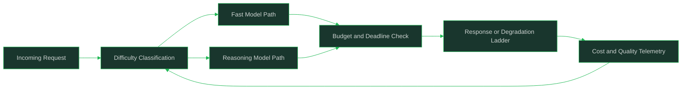

# Reasoning Models and Compute Budgets

> Deciding when reasoning models earn their cost, and budgeting thinking compute and latency across a model portfolio.

## Why This Is a Senior Skill

A mid-level engineer routes every request to the reasoning-tier model because it tops the leaderboards, then discovers the bill and the first-token latency after both have scaled. A senior engineer treats extended reasoning as a purchasable resource: measured on their own task mix, capped per request class, and allocated only where the quality delta pays for the compute and the wait. The interesting engineering is not the reasoning model itself but the portfolio decision behind it: which requests get thinking compute, how much, and what happens when the budget runs out.

The senior question is never "is the reasoning model better?" but "on which of my request classes does the quality delta exceed the cost and latency it adds, and what is the cheapest model that clears the bar on the rest?"

## Core Frameworks

### What Extra Reasoning Changes

| Dimension | Standard Generation | Extended Reasoning | Architectural Implication |
|-----------|--------------------|--------------------|---------------------------|
| Task profile | Pattern-matching, drafting, extraction | Multi-step analysis, planning, hard math and code | Routing by task difficulty, not by model prestige |
| First token | Fast | Slow: thinking tokens precede any visible output | Latency UX must change: progress states, not silent waits |
| Cost structure | Input plus output tokens | Thinking tokens bill as output and can dominate | Per-request cost becomes a variable to cap, not a constant |
| Consistency | Varies with prompt sensitivity | Often steadier on hard tasks; can degrade on trivial ones | Measure both ends of the difficulty range |
| Failure mode | Confident wrong answers | Overthinking simple tasks; budget exhaustion mid-problem | Caps and a defined behavior when the cap is hit |
| Verbosity | Controllable | Long internal traces; output may echo the thinking | Separate the answer contract from the reasoning trace |

### Routing Across the Portfolio

| Request Class | Characteristics | Model Choice | Thinking Budget |
|---------------|-----------------|--------------|-----------------|
| Extraction, classification, formatting | Deterministic-ish, high volume | Smallest model that clears the quality bar | None |
| Drafting and summarization | Open-ended but shallow reasoning | Mid-tier general model | None or minimal |
| Complex analysis, multi-step planning | Deep reasoning, low volume | Reasoning model | Moderate, task-class specific |
| Hard debugging, math, adversarial cases | High difficulty, high stakes | Reasoning model | Generous, with a hard cap |
| Latency-critical interactive turns | User waits in real time | Fast model first, escalate only on detected difficulty | Minimal; escalate rather than block |

### Budget Controls and Failure Modes

| Control | What It Bounds | Behavior at the Limit |
|---------|----------------|-----------------------|
| Thinking-token cap per request class | Cost per request | Stop thinking, emit best current answer, mark truncated |
| Wall-clock deadline | End-to-end latency | Return partial or fast-model answer under a defined fallback |
| Escalation rule | When reasoning is spent at all | Fast model first; escalate only when a difficulty signal fires |
| Degradation ladder | What users get when budget is exhausted | Cached, partial, or simpler-model answer with a visible state |
| Aggregate spend ceiling | Fleet-level cost | Shed or degrade the cheapest request classes first |
| Retry policy | Compounding cost on failures | Cap reasoning retries; a retry with the same budget fails the same way |

## In Practice

**Reason for hard tasks and pay for it explicitly; do not reason by default.** Extended reasoning changes the qualitative shape of the system: slower first token, variable per-request cost, and different failure modes on easy inputs. Decide per request class what quality delta justifies those costs, and record the decision as routing configuration with the evidence behind it, not as a habit inherited from a benchmark.

**Route across a portfolio instead of upgrading one call site.** The durable pattern is a difficulty-aware router: the smallest model that clears the bar handles volume, and reasoning-tier models handle the classes where measurement shows a real delta. Difficulty signals can be explicit (user-selected mode, task type) or cheap heuristics (question complexity, prior failure), and the router belongs in the same layer as the fallbacks described in [[career-path/18_Applied_AI_Engineer/05_Model_and_Inference_Operations/03_Cost_Optimization|Cost Optimization]].

**Cap thinking compute per request class and define the behavior at the cap.** A budget without a defined limit behavior is just a hope. Decide what happens when the cap is hit: emit the best current answer marked as truncated, fall back to a fast model, or escalate to human review for the classes where a truncated answer is unacceptable. Budget exhaustion mid-problem is a normal state, not an edge case.

**Measure whether reasoning pays on your task mix, not on the leaderboard.** Run paired A/B comparisons on your own eval slices: same inputs, fast model versus reasoning model, scored on quality, cost per task, and latency. The result is a per-class decision matrix that you re-derive when the task mix, prices, or models change; a global "reasoning is worth it" verdict is almost always wrong for at least one high-volume class.

**Design the latency UX for thinking models as a distinct mode.** Slow first token with a silent wait feels broken; show that work is underway, stream where possible, and decide explicitly whether users see reasoning traces, a summary, or only the final answer (see [[career-path/18_Applied_AI_Engineer/05_Model_and_Inference_Operations/04_Latency_Engineering|Latency Engineering]] and the interaction patterns in [[career-path/18_Applied_AI_Engineer/02_Context_and_Prompt_Engineering/00_overview|Context and Prompt Engineering]]). Exposed traces can help expert users audit a conclusion; they overwhelm everyone else and leak prompt structure.

**Know when not to pay for reasoning.** Extraction, classification, rewriting, and routine drafting rarely benefit enough to justify thinking tokens or the added latency. High-volume classes dominate spend even at low per-request cost, so a reasoning default on volume traffic is the most expensive configuration error available. Escalate on detected difficulty instead.

**Engineer against the two characteristic failure modes.** Overthinking simple tasks wastes compute and can degrade answers through unnecessary elaboration; budget exhaustion on hard tasks truncates exactly the work that needed the depth. Detect both: caps and escalation rules for the first, truncation behavior and quality checks for the second, and eval slices for trivial and maximal-difficulty inputs to catch regressions at both ends.

## Practical Exercise

Design the reasoning budget for a code-review assistant with high-volume lint-style comments and low-volume deep architectural reviews:
1. Classify the request mix into 3-5 classes by difficulty, volume, and latency tolerance
2. Choose a model per class from a portfolio of a fast model, a mid-tier model, and a reasoning model
3. Run a paired comparison on your eval slices: record quality, cost per task, and time to first token per class
4. Set a thinking-token cap and a wall-clock deadline per class, and write the behavior at each limit
5. Define the escalation rule: which signal promotes a request from fast model to reasoning model
6. Design the degradation ladder for budget exhaustion, and what state the user sees
7. Set a fleet-level spend ceiling and the shedding order when it is approached

## Practical Applications

- [ ] Request classes are defined by difficulty, volume, and latency tolerance
- [ ] Routing assigns the smallest model that clears the quality bar per class
- [ ] Thinking-token caps and wall-clock deadlines exist per class, with defined limit behavior
- [ ] Paired fast-vs-reasoning comparisons run on your own eval slices, not leaderboards
- [ ] Latency UX for thinking mode is explicit: progress, streaming, and trace visibility decisions
- [ ] Degradation ladder defines what users get when the budget is exhausted
- [ ] Overthinking and budget-exhaustion failure modes have dedicated eval slices
- [ ] The per-class decision matrix is re-derived when prices, models, or task mix change

## Common Pitfalls

| Pitfall | Why It Fails | Better Approach |
|---------|--------------|-----------------|
| Reasoning model as the default for all traffic | Volume classes pay thinking cost for negligible quality gain | Route by class; smallest model that clears the bar |
| Trusting leaderboard deltas for the buy decision | Benchmarks measure task mixes that are not yours | Paired A/B on your own eval slices per class |
| No cap on thinking tokens | Per-request cost becomes unbounded on adversarial or runaway inputs | Hard caps per class with defined truncation behavior |
| Silent wait during extended thinking | Users read slow first token as a broken system | Explicit thinking-mode UX: progress, streaming, clear state |
| Exposing full reasoning traces to all users | Overwhelms non-experts; leaks prompt and policy structure | Default to answer-only; traces for audited expert surfaces |
| Retry loops that re-spend the full reasoning budget | Cost compounds on exactly the inputs most likely to fail again | Cap reasoning retries; escalate to review instead |
| Ignoring overthinking on simple inputs | Waste plus verbosity regressions that eval averages hide | Trivial-input eval slice; escalate on difficulty instead of pre-spending |

## Knowledge Connections

- [[03_Cost_Optimization]]: cascades, caching, and the unit economics reasoning budgets plug into
- [[04_Latency_Engineering]]: TTFT and streaming mechanics behind thinking-mode UX
- [[01_Model_Selection_and_Benchmarks]]: why leaderboard evidence does not settle the portfolio decision
- [[06_Provider_Management_and_Model_Routing]]: routing and fallback mechanics across providers
- [[career-path/18_Applied_AI_Engineer/03_Evaluation_and_Observability/06_Regression_Gates_and_Continuous_Evaluation|Regression Gates and Continuous Evaluation]]: gating model-tier changes on measured deltas

## Sources

- AI Engineering (Chip Huyen)
- Hands-On Large Language Models (Jay Alammar and Maarten Grootendorst)
- Designing Machine Learning Systems (Chip Huyen)
