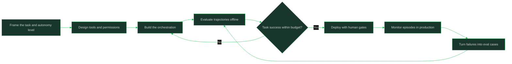

# Agentic Systems

> **Capability area:** Building reliable systems that act over multiple steps — choosing the right degree of autonomy, giving agents tools, memory, and evaluation, and keeping humans in control of what matters.

## Why This Matters at Senior Level

A mid-level engineer gets an agent demo working on a happy path. A senior applied AI engineer decides whether an agent should exist at all, designs the orchestration and tool contracts so failures stay bounded, evaluates trajectories instead of single outputs, and sets autonomy levels so consequential actions still pass through humans. Most 2026 production work on foundation models is agentic, and it fails differently from single-shot generation: errors compound over steps, tool calls have side effects, and cost grows with every trajectory.

Senior judgment shows in:
- Choosing deterministic workflows over agents whenever autonomy is not actually required
- Designing tool contracts and permissions so an agent's blast radius is bounded by construction
- Evaluating end-to-end task success over episodes, including cost and step budgets
- Placing human approval gates where actions are consequential or hard to reverse

## Topics in This Area

| # | Topic | Senior Focus |
|---|-------|--------------|
| 01 | [[01_Agent_Architectures_and_Orchestration]] | Choosing between workflows, single agents, and orchestrated multi-agent designs |
| 02 | [[02_Agent_Memory_and_State]] | Durable memory and resumable state without staleness or poisoning |
| 03 | [[03_Tool_Protocols_and_Integration]] | Tool contracts, standard protocols like MCP, and permissioned integration |
| 04 | [[04_Agent_Evaluation_and_Trajectories]] | Measuring trajectories and task success, not just single outputs |
| 05 | [[05_Human_in_the_Loop_and_Autonomy_Levels]] | Setting autonomy levels and approval gates for consequential actions |
| 06 | [[06_Computer_Use_and_Browser_Agents]] | Delegating screen and browser work safely with verification |

## Agentic System Lifecycle

## Scope Boundary

This area covers the engineering of agentic systems on foundation models: orchestration, memory, tool integration, evaluation, autonomy design, and computer use. It does not cover single-pattern LLM applications (owned by [[career-path/18_Applied_AI_Engineer/01_LLM_Application_Patterns/00_overview|LLM Application Patterns]]), prompt and context mechanics (owned by [[career-path/18_Applied_AI_Engineer/02_Context_and_Prompt_Engineering/00_overview|Context and Prompt Engineering]]), or the security attack surface of agents (owned by [[career-path/18_Applied_AI_Engineer/04_AI_Security_and_Guardrails/00_overview|AI Security and Guardrails]], with [[career-path/08_Security_Engineer/00_overview|Security Engineer]] owning threat modeling depth).

## Key Principles

- Autonomy is a cost, not a feature: use the least that solves the problem
- Tool contracts are the real API of an agent system; design them before prompts
- Errors compound over steps, so every loop needs a bounded budget and a stop condition
- Trajectory quality is the unit of agent evaluation, not single-output quality
- Human gates belong where actions are consequential, irreversible, or ambiguous

## Common Anti-Patterns

| Anti-Pattern | Why It Fails | Better Approach |
|-------------|-------------|-----------------|
| Agent-first design for deterministic work | Cost, latency, and failure modes grow for no benefit | Fixed workflow first; agent only where autonomy is required |
| Unbounded loops with no stop condition | Runaway cost and compounding errors | Step, time, and cost budgets with explicit termination |
| Tools with ambiguous contracts | Agent misuses tools; side effects surprise everyone | Strict schemas, error semantics, idempotent operations |
| Evaluating only final answers | Silent failures in reasoning and tool use | Trajectory and step-level evaluation with regression sets |
| Full autonomy on consequential actions | Irreversible damage before anyone notices | Autonomy ladder with approval gates on what matters |

## Maturity Signals

- Every agent has documented autonomy level, budgets, and stop conditions
- Tool calls are permissioned, idempotent where possible, and covered by contracts
- Trajectory evals gate releases the same way output evals do
- Production failures flow into eval cases automatically
- Humans approve exactly the consequential actions, and nothing else

## Connections

- [[career-path/18_Applied_AI_Engineer/01_LLM_Application_Patterns/00_overview|LLM Application Patterns]]: agent loops are one pattern among several
- [[career-path/18_Applied_AI_Engineer/03_Evaluation_and_Observability/00_overview|Evaluation and Observability]]: the evaluation discipline agents extend
- [[career-path/18_Applied_AI_Engineer/04_AI_Security_and_Guardrails/00_overview|AI Security and Guardrails]]: the threat model of tool-using systems
- [[career-path/01_Software_Engineer/03_AI_Assisted_Engineering/00_overview|AI Assisted Engineering]]: agents as coding tools, the consumer side
- [[computing-foundation-note/Artificial_Intelligence/10_LLM_Production_Patterns]]: production patterns background

## Sources

- OWASP Top 10 for LLM Applications (owasp.org) — agentic risk categories
- *AI Engineering* (Chip Huyen) — building reliable applications on foundation models
- *Designing Machine Learning Systems* (Chip Huyen) — evaluation and production discipline
- Model Context Protocol specification (modelcontextprotocol.io) — tool integration protocol references
