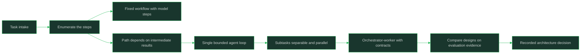

# Agent Architectures and Orchestration

> Designing agentic systems: deterministic workflows, single agent loops, and orchestrated multi-agent structures chosen by required autonomy.

## Why This Is a Senior Skill

A mid-level engineer reaches for a multi-agent framework because it demos well, then spends the quarter taming nondeterminism that the task never required. A senior engineer starts from the opposite end: a deterministic workflow is the default, a single bounded agent loop is the escalation, and orchestrated multi-agent structures are the last resort, justified only when the task's autonomy and decomposition demands actually exceed what the rungs below can deliver. The architecture choice is a decision about failure modes, cost, and reversibility, not about which library is fashionable.

The senior challenge is that every rung up the autonomy ladder multiplies ways to fail: errors compound over steps, tool side effects become harder to attribute, and debugging shifts from reading a stack trace to reconstructing a trajectory. Choosing the simplest architecture that solves the problem, and being able to defend that choice with evaluation evidence, is the skill.

## Core Frameworks

### Workflow vs Agent Decision

| Factor | Fixed Workflow Wins When | Agent Wins When |
|--------|--------------------------|-----------------|
| Determinism | The step sequence is known in advance | The path depends on intermediate results you cannot enumerate |
| Ambiguity | Inputs map to a few well-separated cases | Each request is open-ended or under-specified |
| Reversibility | Actions are cheap or reversible; mistakes are cheap | Exploration is needed and mistakes are contained by permissions |
| Auditability | Regulators or customers need a fixed, explainable path | The explanation is the trajectory itself |
| Cost tolerance | Per-request cost must be predictable | Variable cost is acceptable for variable value |
| Failure behavior | A wrong answer is the worst case | A partial result plus escalation is an acceptable outcome |

### Architecture Patterns

| Pattern | Structure | Failure Behavior | When It Pays |
|---------|-----------|------------------|--------------|
| Deterministic workflow | Code defines steps; model fills them in | Failures are local and debuggable | Steps known, order fixed |
| Single agent loop | One model iterates plan-act-observe within budgets | Errors compound over steps; bounded by budgets | Path genuinely unknown per request |
| Orchestrator-worker | A coordinator delegates subtasks to specialized workers | Delegation errors surface as bad subtask results | Subtasks are separable and parallelizable |
| Supervisor | A supervising agent reviews or gates worker output | Extra latency per gate; catches worker drift | Quality bar high; worker outputs need verification |
| Pipeline multi-agent | Agents hand off in a fixed chain | One bad handoff corrupts downstream agents | Natural stage boundaries with typed handoffs |
| Debate | Agents argue positions; a judge resolves | Cost grows with rounds; can stall on disagreement | High-stakes reasoning where diverse search helps |
| Swarm-style | Many lightweight agents coordinate loosely | Hard to predict or debug globally | Exploration-heavy decomposition at scale; rare in production |

### Delegation Contracts and Loop Budgets

| Element | What to Specify | On Breach |
|---------|-----------------|-----------|
| Delegation contract | Subtask goal, allowed tools, input/output schema, budget | Worker returns partial result with status; orchestrator re-delegates or escalates |
| Step budget | Max iterations per loop and per delegated subtask | Terminate with best-so-far result and a status flag |
| Cost budget | Token or money ceiling per request | Stop tool use; synthesize from what exists |
| Time budget | Latency ceiling per request and per worker | Timeout with partial answer; never hang the caller |
| Stop condition | Explicit finish signal or schema-shaped final output | Required: "no answer found" is a valid, cheap exit |
| Escalation | Human or fallback path when confidence drops | Triggered on budget breach or unresolved contradiction |



## In Practice

**Default to a deterministic workflow and make the agent earn its place.** If the steps can be enumerated — fetch, extract, classify, draft — write them as code and let the model execute each step well. An agent loop adds cost, latency, and a whole class of failures; it is justified only when the next step genuinely depends on results you cannot predict. Evaluate the choice, do not assume it.

**Choose the architecture by required autonomy, not by framework enthusiasm.** Walk the ladder: workflow, routed flow, single bounded loop, orchestrated multi-agent. Each rung buys generality with predictability, so climb only when the rung below demonstrably fails on real cases. The ladder itself is the core mental model; loop internals (plan-act-observe mechanics, budget tuning) live in [[career-path/18_Applied_AI_Engineer/01_LLM_Application_Patterns/03_Agent_Loops_and_Orchestration|Agent Loops and Orchestration]] and are not repeated here.

**Design delegation contracts before you write orchestrator prompts.** Workers fail cleanly when their contract states the goal, the tools they may touch, the output schema, and their budget. Without a contract, the orchestrator's options on a bad subtask result are guessing or re-running everything; with one, it can re-delegate narrowly or escalate.

**Treat compounding error as the defining property of multi-step systems.** A step that is mostly right is wrong at system level when it sits upstream of ten more steps, and orchestrator-worker structures multiply the number of steps that must all land. Reduce steps, verify handoffs, and prefer fewer, better-bounded agents over many loosely supervised ones.

**Give every loop and every worker budgets and stop conditions, defined at the architecture level.** Budgets are not per-loop configuration; they are the architecture's contract with the rest of the system about cost, latency, and failure. A design that cannot state its ceilings and its failure exit is not finished.

**Keep multi-agent structures for decompositions that measurably pay.** Debate and swarm-style designs add coordination cost and make attribution hard; they pay only when parallel exploration or adversarial checking produces better outcomes than one well-prompted bounded loop. Prove that with trajectory evidence before standardizing the topology.

## Practical Exercise

1. Take a real multi-step task from your domain and classify it on the workflow-vs-agent table: determinism, ambiguity, reversibility, auditability.
2. Implement it first as a deterministic workflow with model-per-step; record cost, latency, and quality on five representative inputs.
3. Implement it as a single bounded agent loop (step, cost, and time budgets plus a stop condition); run the same five inputs.
4. Decompose the task into two or three subtasks and build an orchestrator-worker version with an explicit delegation contract per worker.
5. Inject a worker failure (bad result, timeout) in each design and observe where the error surfaces and how far it propagates.
6. Compare quality, cost, latency, and failure behavior across the three designs on the same inputs.
7. Write a one-paragraph architecture decision record stating which design wins, which evidence supports it, and what would have to change to climb the autonomy ladder.

## Practical Applications

- [ ] Every production agent has a documented architecture rationale: why not a workflow, why not fewer agents
- [ ] Delegation contracts exist for every sub-agent: goal, tools, schema, budget
- [ ] Step, cost, and time budgets are set per loop and per worker, with defined failure exits
- [ ] Stop conditions are explicit finish signals or schema-shaped outputs, not model discretion
- [ ] Multi-agent topologies are backed by comparison evidence against single-loop and workflow baselines
- [ ] Error propagation is tested: one bad handoff or tool result does not silently corrupt downstream steps
- [ ] Escalation paths from every autonomous component are documented and reachable

Architecture decision record template:

```text
Task:
Why a workflow is not enough (evidence):
Chosen pattern (workflow / single loop / orchestrator-worker / supervisor / multi-agent):
Budgets (steps, cost, time) and stop condition:
Delegation contracts (if multi-agent):
Failure exit and escalation path:
Evidence that the next rung of the ladder is not earned yet:
```

## Common Pitfalls

| Pitfall | Why It Fails | Better Approach |
|---------|--------------|-----------------|
| Multi-agent design for a task a pipeline handles | Coordination cost, latency, and failure modes grow for zero quality gain | Prove the pipeline fails first; climb the ladder with evidence |
| Orchestration without delegation contracts | Workers drift; orchestrator cannot interpret or repair bad subtasks | Typed contracts: goal, tools, schema, budget, status codes |
| Ignoring compounding error | Per-step "mostly right" becomes system-level "often wrong" | Fewer steps, verified handoffs, budgets, regression sets on trajectories |
| No budgets or stop conditions at the architecture level | Runaway cost and hung requests nobody designed for | Budgets and failure exits as first-class architecture artifacts |
| Debating topologies on intuition | The team argues patterns with no shared evidence | Same inputs across candidate designs; compare quality, cost, latency, failure behavior |
| One giant agent instead of bounded components | Blast radius covers everything; debugging is archaeology | Narrow agents with narrow tool surfaces and explicit interfaces |

## Knowledge Connections

- [[career-path/18_Applied_AI_Engineer/01_LLM_Application_Patterns/03_Agent_Loops_and_Orchestration|Agent Loops and Orchestration]]: loop mechanics this architecture sits above
- [[career-path/18_Applied_AI_Engineer/01_LLM_Application_Patterns/02_Function_Calling_and_Tool_Use|Function Calling and Tool Use]]: the action primitive every pattern here composes
- [[03_Tool_Protocols_and_Integration]]: delegation needs tool contracts to be enforceable
- [[04_Agent_Evaluation_and_Trajectories]]: the evidence that justifies each rung of the ladder
- [[05_Human_in_the_Loop_and_Autonomy_Levels]]: architecture choices set the autonomy ceiling
- [[career-path/18_Applied_AI_Engineer/05_Model_and_Inference_Operations/03_Cost_Optimization|Cost Optimization]]: multi-step systems are where cost compounds

## Sources

- *AI Engineering* (Chip Huyen) — agent patterns and architecture trade-offs on foundation models
- *Designing Data-Intensive Applications* (Martin Kleppmann) — deterministic workflow and reliability thinking
- OWASP Top 10 for LLM Applications (OWASP) — risk categories for autonomous, tool-using systems
