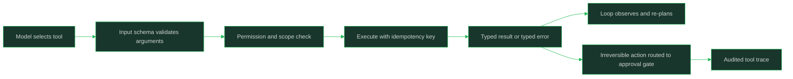

# Tool Protocols and Integration

> Defining tool contracts and integration protocols — schemas, permissions, and error semantics — that make agent actions reliable and governable.

## Why This Is a Senior Skill

A mid-level engineer wraps a few functions in a tool schema, sees the model call them in the demo, and moves on — until production shows the agent inventing arguments, retrying non-idempotent calls, and silently swallowing errors that mean "stop." A senior engineer treats the tool layer as the real API of the agent system: precise input schemas, documented semantics, typed errors the model can act on, explicit side-effect classes, and permissions that bound the blast radius before the first call runs. Tool contracts are designed before prompts, tested like any API, and versioned like any dependency.

The senior challenge is that tools sit between a probabilistic caller and deterministic side effects. The model will misuse whatever you leave ambiguous, and every gap in the contract becomes a runtime incident — so reliability is engineered into the contract, not hoped for in the model.

## Core Frameworks

### Tool Contract Anatomy

| Element | What to Specify | Why It Matters |
|---------|-----------------|----------------|
| Input schema | Typed fields, required/optional, ranges, enums, units | Wrong-argument calls are the most common tool failure a strict schema prevents |
| Semantics | What the tool does, in one unambiguous sentence, plus preconditions | The model selects tools by description; vague descriptions cause misrouting |
| Output schema | Shape of success results, including empty results | Lets the loop parse and verify observations instead of guessing |
| Error semantics | Typed errors: retryable, terminal, permission-denied, not-found, with guidance | The model must distinguish "try again" from "stop and escalate" |
| Side effects | Read-only, reversible, or irreversible; what changes and where | Determines the permission and approval posture |
| Idempotency | Whether re-running is safe; dedupe key if not | Retries and replays are guaranteed; double-writes must not be |
| Budget hints | Typical latency and cost per call | Lets the loop plan within its step and time budgets |

### Integration Protocols

| Approach | Shape | Strength | Weakness |
|----------|-------|----------|----------|
| Ad-hoc function definitions | Schemas passed per request to one provider | Simple; zero infrastructure | Contracts live in prompt code; hard to share or govern |
| Provider-native tool calling | Structured tool calls in the model API | Typed calls, streaming, validation | Tied to provider conventions |
| Model Context Protocol | Standardized server-client protocol for tools, resources, and prompts | Tool servers shared across agents and vendors; one integration surface | Another service to run, version, and secure |
| Internal tool gateway | All calls route through one service enforcing authz and logging | Central permissions, auditing, rate limits | Extra hop; gateway becomes critical path |

The Model Context Protocol is the named standard here: it packages tools, resources, and prompts behind a versioned server interface so an agent's integration surface is a governed registry instead of bespoke glue code per model.

### Side-Effect Classification and Permissions

| Class | Examples | Permission Posture | Failure Handling |
|-------|----------|--------------------|------------------|
| Read-only | Search, fetch, query | Grant broadly within scope | Retry safely; log queries |
| Reversible write | Create draft, update row with undo, send to staging | Grant narrowly; allow undo paths | Retry with dedupe key; verify after write |
| Irreversible | Delete, pay, publish, send externally | Default deny; least privilege; approval gate | Never auto-retry; verify, then escalate on doubt |

Least privilege per agent and per task means each agent sees only the tools its current task needs, with the narrowest scope that task requires — a research agent gets no payment tool at all, and a payment tool is scoped to one account and one ceiling.

## In Practice

**Design tool contracts before prompts; the contract is the real API.** Prompts change weekly, but the tool layer is what the rest of the system integrates against: schemas, semantics, errors, and side effects. Write each contract as if a human teammate would call it, then confirm the model can select and use it from the description alone.

**Make every error typed and actionable.** An undifferentiated "error" string forces the model to guess between retrying and stopping, and it guesses wrong in both directions. Return structured errors that say whether the failure is retryable, terminal, or permission-scoped, and what the caller should do next — including "escalate to a human."

**Classify side effects and set permissions from that classification.** Read-only tools can be generous; irreversible tools get least privilege, scoped credentials, and an approval gate by default. The classification is also the audit record: anyone reviewing the agent should be able to see its blast radius from the tool registry alone.

**Make operations idempotent wherever possible, and dedupe where not.** Agents retry — on parse failures, on loop re-plans, on crash replay — so a non-idempotent tool without a dedupe key will double-charge someone eventually. Give side-effecting tools a caller-supplied idempotency key and return the original result on repeat.

**Version tools like dependencies and never silently change semantics.** Agents learn tools from their contracts; a quietly changed return shape breaks callers that were working yesterday. Additive fields are safe, semantic changes are not: version the tool, deprecate the old one, and re-run trajectory evaluations when the registry changes.

**Test tools in isolation before testing them through the agent.** A tool with clean schemas, deterministic fixtures, and checked error paths can be trusted when a trajectory shows misuse — the bug is then in selection or orchestration, not the tool. Testing only through the agent conflates the two and hides contract bugs inside model noise.

**Debug tool misuse from traces, not from intuition.** When the agent misuses a tool, the trace shows whether the failure was selection (wrong tool), arguments (schema gap), or interpretation (ambiguous semantics). Each points at a different fix, and only the trace tells you which you actually have.

## Practical Exercise

1. Pick three tools an agent in your domain would need; write a full contract for each: input schema, one-sentence semantics, output schema, typed errors, side-effect class, idempotency.
2. Implement the tools with a fixture backend and test them in isolation: happy path, empty result, malformed input, each typed error.
3. Mark one tool irreversible and scope its credentials to the narrowest possible resource and ceiling; document the approval gate it must pass through.
4. Route all calls through a thin gateway or wrapper that logs tool name, arguments, result class, latency, and dedupe key.
5. Change one tool's return shape as a breaking version bump; run the agent's trajectory regression set and confirm the change is caught before deploy.
6. Force a mid-trajectory tool failure (timeout, permission-denied) and verify the loop reacts to the typed error correctly: retry only what is retryable.
7. Review the tool registry and write down each agent's blast radius in one paragraph; tighten anything surprising.

## Practical Applications

- [ ] Every tool has a written contract: schema, semantics, errors, side effects, idempotency
- [ ] Errors are typed and distinguish retryable, terminal, and permission-scoped failures
- [ ] Side effects are classified read-only, reversible, or irreversible, and permissions follow from that class
- [ ] Irreversible tools are least-privilege, ceilinged, and gated behind human approval
- [ ] Side-effecting tools accept idempotency keys; retries cannot double-write
- [ ] The tool registry is versioned; semantic changes bump versions and re-gate trajectory evals
- [ ] Tools are tested in isolation with fixtures before being exposed to any agent
- [ ] Tool-call traces log name, arguments, result class, latency, and budget consumption

## Common Pitfalls

| Pitfall | Why It Fails | Better Approach |
|---------|--------------|-----------------|
| Vague tool descriptions and loose schemas | Model misroutes calls and invents arguments | One-sentence semantics, strict typed schemas, enums and ranges |
| Undifferentiated error strings | Model retries terminal failures or surrenders on retryable ones | Typed errors with explicit next-action guidance |
| Non-idempotent tools without dedupe keys | Retries and replays double-charge or double-write | Idempotency keys on every side-effecting operation |
| Same toolset for every agent | Blast radius grows with capability the task never needed | Per-task tool sets with least-privilege scopes |
| Silent contract changes | Working agents break the day a return shape shifts | Version the registry; additive fields only without a version bump |
| Debugging misuse through the agent only | Contract bugs hide inside model noise | Test tools in isolation first; then read traces to attribute failure |

## Knowledge Connections

- [[career-path/18_Applied_AI_Engineer/01_LLM_Application_Patterns/02_Function_Calling_and_Tool_Use|Function Calling and Tool Use]]: the calling mechanics beneath the contracts
- [[career-path/18_Applied_AI_Engineer/04_AI_Security_and_Guardrails/05_Model_Supply_Chain_and_Tool_Security|Model Supply Chain and Tool Security]]: securing the tool layer against tampering
- [[career-path/18_Applied_AI_Engineer/04_AI_Security_and_Guardrails/02_Prompt_Injection_Defense|Prompt Injection Defense]]: tool outputs as an injection surface
- [[04_Agent_Evaluation_and_Trajectories]]: tool-call validity as a first-class trajectory metric
- [[01_Agent_Architectures_and_Orchestration]]: delegation contracts reuse the same primitives

## Sources

- Model Context Protocol specification — standardized tool, resource, and prompt integration
- OWASP Top 10 for LLM Applications (OWASP) — tool and plugin risk categories
- *AI Engineering* (Chip Huyen) — tool use and integration patterns for foundation-model systems
