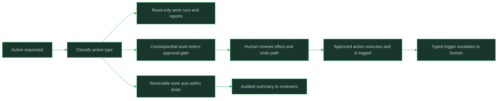

# Human in the Loop and Autonomy Levels

> Deciding how much autonomy an agent gets, where humans approve, and how escalation and interruption work in production.

## Why This Is a Senior Skill

A mid-level engineer ships an agent fully autonomous because approvals "slow it down," or gates every action because the demo was scary — both are failures of design, not of caution. A senior engineer maps action types to an autonomy ladder: propose-only where judgment is the product, act-with-approval where actions are consequential, act-within-limits where the blast radius is capped, and act-and-report where mistakes are cheap and reversible. Autonomy is allocated per action, not per agent, and every level comes with an interrupt path and an escalation trigger.

The senior challenge is the cost side of the loop. Approval gates add latency and queue load, humans rubber-stamp under volume, and interruptions must preserve state to be worth having. The design goal is not maximum human oversight; it is the minimum oversight that keeps consequential actions safe, with everything else automated and observable.

## Core Frameworks

### The Autonomy Ladder

| Level | Agent Does | Human Does | Fits When |
|-------|------------|------------|-----------|
| Propose-only | Prepares drafts, plans, and recommendations | Decides and executes | High-stakes judgment; trust not yet earned |
| Act-with-approval | Executes after a human approves each action | Reviews each gated action | Consequential or irreversible actions |
| Act-within-limits | Acts freely inside a scope, ceiling, and allowlist | Audits; approves anything outside limits | Blast radius can be capped by construction |
| Act-and-report | Acts on everything in scope | Reviews summaries; handles escalations | Cheap, reversible, well-evaluated actions |

### Mapping Action Types to Levels

| Action Type | Level | Rationale |
|-------------|-------|-----------|
| Send external message, publish, pay, delete | Propose-only or act-with-approval | Consequential or irreversible; reputation or money at stake |
| Modify production data or config | Act-with-approval, or act-within-limits with scoped ceiling | Reversible with effort; damage bounded by scope |
| Create drafts, tickets, internal notes | Act-within-limits | Easy to review and undo |
| Read, search, summarize | Act-and-report | No side effects to gate |
| Escalate to a human | Always permitted at every level | The universal safe action |

### Approval Gate Design

| Dimension | Design Choice | Trade-off |
|-----------|---------------|-----------|
| Granularity | Gate the action class, not each call | Per-call gates flood reviewers until they rubber-stamp |
| Context shown | Agent's plan, evidence, exact effect, and undo path | Without the effect spelled out, approval is theater |
| Latency budget | Time-boxed approvals with a default decision | An unbounded gate turns into a hung request |
| Batch mode | Group low-risk actions into one review | Volume kills attention; batching preserves it |
| Audit trail | Who approved what, when, and on what evidence | The record is the accountability story later |

### Escalation, Interruption, and Degradation

| Mechanism | Trigger | Behavior |
|-----------|---------|----------|
| Escalation | Typed terminal error, low confidence, budget breach, contradiction in evidence | Hand off to a human with full trajectory and a recommended action |
| Interruption | User cancel, policy hit, safety stop | Pause at a checkpoint; state preserved; resume or abort cleanly |
| Autonomy degradation | Confidence drops, context shrinks, tools failing | Step down the ladder for this action class; notify; log the reason |
| Review queue | Gated actions waiting on humans | Prioritized by consequence and age; SLA per action class; aging alerts |

## In Practice

**Allocate autonomy per action class, not per agent.** One agent may read freely (act-and-report), draft internal notes (act-within-limits), and propose external sends (propose-only). Defining the level at the action level keeps the blast radius tight while the agent stays useful everywhere else.

**Default consequential and irreversible actions to approval gates, and prove an action safe to ungate.** The burden of proof sits on removing oversight, not adding it: an action graduates to a higher autonomy level when its evaluation record shows consistent safe behavior and its blast radius is bounded. Money, deletion, and anything external-facing start gated.

**Design approval gates for the human's attention, not for the demo.** Show the planned action, the evidence behind it, the exact effect, and the undo path; batch low-risk items; and time-box the decision with an explicit default. A gate that reviewers rubber-stamp under volume is worse than no gate: it launders unsafe actions through a signature.

**Make every agent interruptible at checkpoints, with state preserved.** Interruption is only valuable if pause and resume are clean: the task state must be checkpointed so a stop loses nothing and a resume repeats nothing. Ship the cancel path before shipping the autonomy; nobody can safely run an agent they cannot stop.

**Define escalation triggers as typed conditions, not vibes.** Budget breaches, terminal tool errors, evidence contradictions, and low confidence are enumerable events, and each maps to a handoff that includes the full trajectory and a recommended action. A human receiving an escalation should not have to reconstruct the episode from logs.

**Degrade autonomy gracefully when confidence or context drops.** When tools start failing or the task leaves its evaluated envelope, the agent should step down the ladder for that action class — from act-within-limits to act-with-approval, from approval to propose-only — and say why. Stepping down is a feature: it is how the system stays safe on the inputs nobody predicted.

## Practical Exercise

1. List every action class your agent can perform and classify each: consequential, reversible, read-only.
2. Assign each class a rung of the autonomy ladder and justify the assignment in one sentence per class.
3. Design one approval gate: what context the reviewer sees, the time-box and default decision, and the audit record.
4. Implement checkpointed interruption: pause the agent mid-task, verify state is preserved, resume without repeating side effects.
5. Define three typed escalation triggers and wire them to a handoff that includes the trajectory and a recommended action.
6. Simulate a confidence drop (failing tools, shrinking context) and verify the agent steps down its autonomy level and reports it.
7. Review the audit trail for one gated episode end to end and confirm a third party could reconstruct who approved what and why.

## Practical Applications

- [ ] Every action class has a documented autonomy level and a one-sentence rationale
- [ ] Consequential and irreversible actions default to approval gates until proven safe to ungate
- [ ] Approval gates show plan, evidence, exact effect, and undo path, with time-boxed decisions
- [ ] Agents are interruptible at checkpoints; pause preserves state and resume repeats nothing
- [ ] Escalation triggers are typed conditions that hand off trajectory plus a recommended action
- [ ] Review queues are prioritized by consequence and age, with SLAs and aging alerts
- [ ] Autonomy degrades by action class when confidence or context drops, with the reason logged
- [ ] The audit trail answers who approved what, when, and on what evidence

## Common Pitfalls

| Pitfall | Why It Fails | Better Approach |
|---------|--------------|-----------------|
| One autonomy level for the whole agent | Over-trust on risky actions or over-gating on trivial ones | Map levels per action class |
| Approval gates without context or undo paths | Reviewers rubber-stamp; the gate launders risk | Show effect, evidence, and undo; batch and time-box |
| Per-call approval on high-volume actions | Reviewer attention dies under load; latency explodes | Gate action classes; batch low-risk items |
| No clean interrupt path | The only stop is a kill; state and side effects are lost | Checkpointed pause/resume shipped before autonomy |
| Escalation as "ask the user when unsure" | Unenumerable; humans get noise instead of signal | Typed triggers with trajectory and recommended action |
| Autonomy granted once, never revisited | Silence is mistaken for safety as inputs drift | Graduation evidence to ungate; degradation on confidence drops |

## Knowledge Connections

- [[01_Agent_Architectures_and_Orchestration]]: architecture choices set the autonomy ceiling
- [[02_Agent_Memory_and_State]]: checkpointed task state is what makes interruption real
- [[career-path/18_Applied_AI_Engineer/04_AI_Security_and_Guardrails/01_LLM_Threat_Modeling|LLM Threat Modeling]]: what the gates are defending against
- [[career-path/18_Applied_AI_Engineer/04_AI_Security_and_Guardrails/00_overview|AI Security and Guardrails]]: policy enforcement around autonomous actions
- [[04_Agent_Evaluation_and_Trajectories]]: evaluation evidence is what earns autonomy upgrades
- [[computing-foundation-note/Artificial_Intelligence/13_LLM_Evaluation_and_Guardrails]]: guardrail placement in the lifecycle

## Sources

- OWASP Top 10 for LLM Applications (OWASP) — excessive agency and unsafe action risks
- *AI Engineering* (Chip Huyen) — human oversight and reliability patterns for agentic systems
- *Designing Machine Learning Systems* (Chip Huyen) — production review loops and operational discipline
