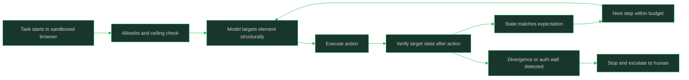

# Computer Use and Browser Agents

> Building agents that operate screen and browser interfaces: fragile by nature, so they demand sandboxing, verification, and narrow permissions.

## Why This Is a Senior Skill

A mid-level engineer points a vision model at a screen, watches it click through a demo site, and assumes the approach generalizes — then production layouts shift, a click lands on the wrong element, and nobody notices until data is corrupted on some third-party site. A senior engineer treats computer use as the integration method of last resort: fragile by nature, expensive per step, and hard to verify, so it is sandboxed, scoped to narrow allowlists, and checked after every side effect. When an API exists, the senior engineer uses it instead.

The senior challenge is honesty about the failure surface. Screen-grounded agents break when layouts change, DOM-based agents break when markup changes, both stall at CAPTCHA and MFA walls, and every action is slower and costlier than a typed API call. The engineering is in bounding that fragility: isolation, verification, narrow permissions, and knowing when to stop and hand back to a human.

## Core Frameworks

### Interaction Models

| Model | How It Sees | Strength | Brittleness |
|-------|-------------|----------|-------------|
| DOM / accessibility tree | Structured elements, roles, and states | Precise targeting; cheap; machine-checkable | Breaks when markup, frameworks, or roles change |
| Pixel / screen grounding | Screenshots plus coordinates | Works on anything a human can see, including legacy apps | Breaks on layout, resolution, and theme changes; slowest |
| Hybrid | DOM for targeting, pixels for visual state | Structural precision plus visual verification | Two failure surfaces to maintain |
| Direct API | Typed requests to a known endpoint | Fast, reliable, idempotent-ready | Requires an API to exist and be permitted |

### Environment Isolation

| Control | What It Does | Why |
|---------|--------------|-----|
| Sandboxed browser profile | Fresh, throwaway session with no personal logins or cookies | Agent actions never touch real user identity by accident |
| VM or container isolation | The agent's environment is disposable and network-scoped | A compromised or confused agent stays contained |
| Network allowlist | Only approved hosts are reachable | Limits where a bad action can go |
| Credential isolation | Logins injected per task from a vault, never stored in agent memory | Stolen context does not carry live credentials |
| Rate and spend ceilings | Hard caps on actions per minute and per task | Confused loops cannot hammer a site or a bill |

### Verification and Scoping

| Practice | Mechanism | Catches |
|----------|-----------|---------|
| Post-action verification | Re-read the target state after acting | Clicks that silently did nothing or hit the wrong control |
| Narrow allowlists | Only named sites, pages, and action types are in scope | Out-of-scope wandering |
| Screenshot-and-assert | Assert expected UI state after each step | Layout drift mid-task |
| Idempotent actions | Design the task so repeats are safe; dedupe where not | Double-submits on retry or replay |
| Stop-on-surprise | Halt and escalate when the UI diverges from the expected state | Compounding mistakes on a wrong page |

### Honest Limits

| Wall | What Happens | Honest Response |
|------|--------------|-----------------|
| CAPTCHA | Agent cannot solve it; attempts look like abuse | Stop and hand to a human; never farm bypasses |
| MFA / auth prompts | Second factor is out of the agent's reach | Pause at the checkpoint; resume after human completes it |
| Bot detection | Traffic gets blocked or throttled | Treat as a boundary; reduce rate or stop |
| Layout redesign | Targeting breaks mid-task | Verification catches it; fail closed and escalate |
| Cost and latency | Every step is a model call plus a page round trip | Budget episodes tightly; use APIs where they exist |

## In Practice

**Prefer an API whenever one exists; use computer use only where no interface does.** A typed API call is faster, cheaper, idempotent-ready, and verifiable; clicking through a screen is none of those. The decision record should state why no API applies before a browser agent gets budget — and for third-party sites, whether the site's terms even permit automation.

**Pick the interaction model by fragility budget, and verify actions against structure, not screenshots alone.** DOM and accessibility-tree targeting is precise and cheap but breaks when markup changes; pixel grounding survives visual polish but breaks on layout and resolution. Verify results by asserting on the state that matters (element present, value changed), and treat the screenshot as evidence, not as proof.

**Sandbox every browser agent in a disposable environment with no real identity attached.** A fresh profile in a VM or container with a network allowlist keeps a confused or compromised agent contained. Credentials come in per task from a vault and leave with the task; nothing personal is ever baked into the agent's persistent context.

**Verify side effects after every action, and stop on surprise.** The defining failure of computer use is acting confidently on the wrong screen: the click landed, but not where you thought. Re-read the target state after each action, assert the expected UI state, and when reality diverges from the expected page, halt and escalate rather than improvise.

**Scope tightly: named sites, named pages, named action types, and hard ceilings.** An allowlist is the blast-radius control for an agent that can click anything. Combine it with rate, action-count, and spend ceilings per task so a loop stuck on a reload cannot hammer a site or a bill.

**Budget cost and latency honestly: computer use is the most expensive integration per outcome.** Every step is a model call, a page load, and a verification read, so episodes run slow and cost more than any equivalent API flow. Size step and time budgets accordingly, and let trajectory evaluation tell you whether the screen work is earning its cost.

## Practical Exercise

1. Take one workflow currently done through a web UI and check for an API or export path; write one sentence on why computer use is or is not justified.
2. Implement the workflow as a browser agent in a disposable sandboxed profile with a network allowlist of exactly the hosts involved.
3. Choose DOM/accessibility targeting for the main path and add a post-action verification read after every side-effecting step.
4. Narrow the scope to named pages and action types; add action-count, rate, and spend ceilings for the task.
5. Force a mid-task layout change (reorder elements, hide the target button) and verify the agent stops on surprise instead of clicking the wrong control.
6. Hit an auth or CAPTCHA wall and verify the agent pauses at the checkpoint and escalates rather than attempting a bypass.
7. Measure steps and wall time per completed task and compare with the hypothetical API path; record the verdict in the decision record.

## Practical Applications

- [ ] A decision record states why no API path exists before any browser agent gets budget
- [ ] Browser agents run in disposable sandboxes: fresh profile, network allowlist, no personal identity
- [ ] Credentials are injected per task from a vault and never persist in agent memory
- [ ] Every side-effecting action is followed by a verification read; results are asserted, not assumed
- [ ] Scope is an explicit allowlist of sites, pages, and action types, with rate and spend ceilings
- [ ] CAPTCHA, MFA, and bot walls are hard stops with human handoff, never bypass attempts
- [ ] Layout drift is caught by assertions on structure; divergence halts the task and escalates
- [ ] Step and wall-time budgets reflect that every click is a model call plus a page round trip

## Common Pitfalls

| Pitfall | Why It Fails | Better Approach |
|---------|--------------|-----------------|
| Computer use where an API exists | Slowest, costliest, most fragile path for no reason | Use the API; keep the screen path for UI-only work |
| Click-and-move-on without verification | Actions land on the wrong control silently | Verify target state after every action; stop on surprise |
| Real user profile and cookies in the agent sandbox | Confused actions hit real accounts and real data | Disposable profiles; per-task vault credentials |
| Unscoped browsing with no ceilings | A stuck loop wanders sites and burns budget | Allowlists plus action-count, rate, and spend ceilings |
| Screenshot-only grounding everywhere | Layout and resolution changes break targeting | DOM/accessibility for targeting; pixels as evidence |
| Fighting CAPTCHA, MFA, or bot walls | Looks like abuse; wastes budget; fails anyway | Hard stop, human handoff, honest documentation of the limit |

## Knowledge Connections

- [[01_Agent_Architectures_and_Orchestration]]: computer use is one delegation option inside a larger architecture
- [[career-path/18_Applied_AI_Engineer/04_AI_Security_and_Guardrails/05_Model_Supply_Chain_and_Tool_Security|Model Supply Chain and Tool Security]]: securing what the browser agent can reach and run
- [[career-path/18_Applied_AI_Engineer/04_AI_Security_and_Guardrails/02_Prompt_Injection_Defense|Prompt Injection Defense]]: web pages are untrusted input the agent acts on
- [[05_Human_in_the_Loop_and_Autonomy_Levels]]: auth walls and surprises are escalation checkpoints
- [[04_Agent_Evaluation_and_Trajectories]]: step efficiency and verification failures show up in trajectories

## Sources

- OWASP Top 10 for LLM Applications (OWASP) — untrusted input and excessive-agency risks in tool-using agents
- *AI Engineering* (Chip Huyen) — tool use and agent reliability on foundation models
- *Hands-On Large Language Models* (Jay Alammar & Maarten Grootendorst) — model grounding and multimodal interaction foundations
